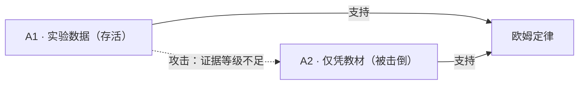

# Storage Format

> 中文 → [**FORMAT.md**](FORMAT.md)

> One concept = one `.md` file. `front-matter` holds what machines need; the body holds
> what humans need. **A rule has only two homes**: **mechanically enforced** (by
> [`tools/kbcheck.py`](tools/kbcheck.py)) or **convention / human review** (listed in the
> self-check in [`CONTRIBUTING.md`](CONTRIBUTING.en.md)). **If it can't be mechanized, say so
> — never pretend it is enforced.**
>
> The *why* behind the rules (cases, incidents, inferences) lives in
> [`docs/decisions/`](docs/decisions/README.en.md); this document holds only the **rules**.

## 0. Language: bilingual storage

**Every document exists in both Chinese and English**:

| Document | Chinese (canonical, primary) | English (translation) |
|---|---|---|
| Spec · process · decisions · indexes · entry points (`START` `AGENTS`) · READMEs | **`<name>.md`** | `<name>.en.md` |
| **Knowledge entries · events** | **`<Chinese name>.md`** | **`<derived from id>.en.md`** |

- **An entry's English filename is derived from its `id`**: take the last segment of the `id`,
  drop the type prefix (`kp-` `prop-` `method-` `mis-` `path-` `res-` `attack-`), add `.en.md`,
  and put it in the **same folder** as the Chinese original.

  ```
  id:   kb:physics:kp-frame-of-reference
  zh:   knowledge/physics/concepts/参考系.md
  en:   knowledge/physics/concepts/frame-of-reference.en.md
  ```

  > [!IMPORTANT]
  > **Why not "same-named `.en.md`"** (the original rule, replaced 2026-10-18): "same name" makes the
  > English page **inherit the Chinese filename** — an English reader lands on
  > `.../physics/concepts/参考系.en.md`, i.e. **English content under a Chinese name**. Worse, "same name"
  > is only a **character-level coincidence**; a machine cannot tell which files are a pair.
  > The `id` is the pairing key: unique, stable, unchanged by renames.
  > See the [decision record](docs/decisions/english-filenames-from-id.en.md).

- **Chinese is the canonical language** (`title`, terms, quotations); **English is a translation**,
  for international readers and AI.
- **Pairing is machine-checked**: entries by `R-BILING-01` (a missing translation is a notice; a
  filename not derived from the `id`, or an English page linking to a Chinese one, fail); **documents**
  by `R-BILING-03` (root / subject READMEs / coverage / `docs/` need a same-named `.en.md`).
  **Exempt**: `templates/` (skeletons are Chinese, written to be copied) and `.github/` (bilingual
  forms get cramped). **content sync is still manual** (`M-10`).
- The line in an English page that points back to the Chinese original is fixed:

  ```markdown
  > **English version of [`参考系.md`](参考系.md).**
  ```

  `R-LINK-03` exempts only that line — every other in-repo link must land on an English page.

> [!IMPORTANT]
> **This library has three readers, all reading the same file.**

| Reader | What they want | Where to start |
|---|---|---|
| **Learner** (student / teacher) | what the concept **is**, how to teach it | [`START.md`](START.en.md) |
| **Reviewer** (contributor) | **why it holds**, who has attacked it | this document |
| **AI / program** | what must not be quoted, each entry's real source | [`llms.txt`](llms.txt) + [`index.json`](index.json) |

**Every entry has two halves**: the first for learners (`## 定义` · `## 陈述` · `## 做法` ·
`## 关联` · `## 禁忌` · `## 风险`), the second for reviewers (`## 依据` · `## 证据` ·
`## 论证` · `## 变更记录`). **Say what it is first, then why you say so.**

---

## Readability for learners: three rules

| # | Rule | Why |
|---|---|---|
| 1 | **Every English quotation needs a Chinese gloss nearby** (before or after — not absent) | Readers are Chinese learners. **The English original is a "source", not the "content".** |
| 2 | **Learner-facing content comes first** | A learner stops at `## 论证`. |
| 3 | **Structural headings in Chinese** (`### 一、先让人犹豫，再让人算`) | So a reader **knows at a glance** what a section is about. |

### `知识点` body's first line must be "what you'll be able to do"

```markdown
> [!TIP]
> **读完这一条，你应该**能用 a = Δv/Δt 计算加速度，并说清正负号与方向的关系
```

**Why**: a `知识点` body starts with a formula; a learner's first sight is `a = Δv/Δt`, not
"why should I read this." This `[!TIP]` lets them decide in three seconds.

> [!NOTE]
> **`命题` / `误解` / `教法` do not need this line** — their bodies *are* the content from
> line one. **Only `知识点` is "formula first, meaning after".**

> The history (`scope.目标` was misplaced; a measurement that nearly became an assertion) is
> in [readability-rules](docs/decisions/readability-rules.en.md).

---

## 1. Three hard rules

1. **One concept = one file.** Don't merge or split. Keeps PR diffs clean and disputes locatable.
2. **Never write the same fact twice.** `front-matter` for machines, body for humans.
3. **Fixed section order** (kbcheck enforces order). `## 论证` **must exist for all types**
   (may be empty under draft, noted as "no arguments yet").

## 2. Directory layout

```
knowledge/
└─ <subject>/                folder names are English (physics · life · medicine · geography
   │                         · science · transport · computing · economics · law)
   ├─ README.md              subject index
   ├─ concepts/              knowledge points: concept nodes carrying prerequisites; methods hang under them
   ├─ claims/                propositions: true/false, must converge
   │  └─ attacks/            attack entries (type is still 命题, see §6)
   ├─ methods/               teaching methods: conditional, non-converging, contraindications required
   ├─ misconceptions/        common misconceptions: teaching assets
   ├─ paths/                 paths: an ordering of concepts, with prerequisites and outcomes
   ├─ resources/             resources: figures, animations, exercises
   └─ coverage/              coverage pages (indexes, not knowledge objects)
evidence/
├─ README.md           evidence index
└─ <raw data>
```

> [!NOTE]
> Two easily-missed but **real** conventions: **attack entries** live in `claims/attacks/` but their
> `type` is still `命题` (they can themselves be attacked, see §6); **coverage pages** (e.g.
> `physics/coverage/README.md`) are indexes, not knowledge objects.

### Why prerequisites live on `知识点`, not on methods

A teaching method is a *(concept × level)* pair — one concept has several method files. But
"reference frames precede speed" is a relation **between concepts**, independent of level. If
it hung on methods, you'd be forced to write "position-time-BL precedes speed-BL", **binding
level into the prerequisite**.

> [!IMPORTANT]
> **Prerequisite edges connect `知识点` only.** Hard rule, enforced by `tools/kbcheck.py`
> (background: [Issue #11](https://github.com/hpleapfrog/Scholia/issues/11)).
>
> **The one exception is `路径`**: a path's `先修` declares **external prerequisites** —
> things you should already know before walking it, which the path itself does not teach
> (e.g. the electrostatics path requires conservation of mechanical energy).
> These edges must still point at `知识点`.
>
> The exception was added on 2026-10-21: `check_paths` had always relied on this field to decide
> that a prerequisite sits outside the path, while the hard rule above banned it for paths —
> **two rules fighting each other**, unnoticed only because every path's `先修` had been `[]`.

### Naming: every folder in English; Chinese entries keep Chinese filenames

**Folder names are always English** (`knowledge/` `physics/` `claims/` `evidence/` `tools/`) —
paths get copied, pasted into terminals and parsed as URLs, so **Chinese folders turn into
percent-encoding**. Content stays Chinese-canonical (see §0); that just no longer shows in the path.

| Layer | Uses | Example |
|---|---|---|
| Folder | **English, readable full word** | `knowledge/physics/claims/` |
| Chinese entry filename | **readable Chinese** | `欧姆定律.md` |
| English edition filename | **`id`-derived English** (§0) | `ohm-law.en.md` |
| System file | English | `README.md` · `FORMAT.md` |

> **Subject folder names and `id` prefixes are two different namespaces**: folders must read well
> (`medicine/`), `id` prefixes must be short (`kb:med:`). Both are registered in `tools/kbcheck.py`
> (`SUBJECT_DIRS` / `SUBJECT_SLUGS`) and **nowhere else**.

`evidence/` lives at the repo root, shared library-wide.

### Naming and links

- Filenames: system files in English (`README.md`); a **Chinese entry uses a readable Chinese name**;
  its **English edition uses the `id`-derived English name** (`ohm-law.en.md`, see §0).
  The stable identifier goes in the `id` field (`kb:physics:ohm-law`)
- Internal links use **relative-path Markdown**: `[电流](../claims/电流.md)`
- **No `[[wikilinks]]`** — an Obsidian extension GitHub won't render
- **Absolute links back to this repo are validated too** (anchors must exist)
- **Links inside an English page point at English pages** (`R-LINK-03`) — an English reader should
  land on an English page, not get bounced back to Chinese. **Two exemptions:**
  1. the conventional line pointing at the Chinese original, written as `English version of [x.md](x.md)`
     (the line at the top of each `.en.md`);
  2. a link to **a file that has no translation** (READMEs, `docs/`, templates) — those exist once.
  **False-positive handling**: when you genuinely need to cite the Chinese original from an English
  document, put that link on a line containing the phrase `English version of` and it is exempt;
  **conversely, do not** send English readers to a Chinese page just to silence the check — that is
  exactly what this rule exists to remove.

### What this library does NOT store: procedural knowledge

> [!IMPORTANT]
> **None of the six object types can hold "a single step". This is an accepted boundary, not a backlog item.**

**Two criteria**:

| # | Criterion | Does not store |
|---|---|---|
| 1 | **Scarcity** | flows that are everywhere (repeating them just adds noise) |
| 2 | **Risk** | flows whose mistakes are irreversible **and** whose applicability this library cannot bound |

> **Criterion 2 excludes "flows", not "conclusions".** The *conclusion* of a low-tidal-volume
> trial is still admitted (see [`knowledge/medicine/`](knowledge/medicine/README.en.md)) — **a sourced
> conclusion can be checked; an operating instruction gets followed.**

> The three probes (metro / flight / ventilator), the full rationale, and "what it would take
> to change this boundary" are in
> [procedural-knowledge-boundary](docs/decisions/procedural-knowledge-boundary.en.md).

## 3. `front-matter`

Field names are English (for stable parsing by scripts and AI). **All 11 fields are required**:

| Field | Meaning |
|---|---|
| `id` | stable identifier, unchanged on file rename. **Deliberately contains no project name** — it must survive a fork |
| `type` | one of six (`知识点` `命题` `教法` `误解` `路径` `资源`) |
| `title` | human-readable title |
| `status` | status, constrained by `type` (see §4) |
| `author` | last substantive contributor. **Cannot be anonymous** (`@handle`; AI involvement see §6) |
| `created` / `updated` | timestamps, `YYYY-MM-DD`. **Advisory only** |
| `scope` | applicability. Without it, any conclusion can be misused |
| `edges` | `先修` / `支持` / `攻击` |
| `evidence` | evidence ids, per `evidence/README.md`. **At least one** (no source, no entry) |
| `license` | license / redistribution terms |

```yaml
---
id: kb:physics:your-topic        # stable id: unchanged on rename
type: 命题
title: 你的标题
status: 待审                      # constrained by type, see §4
author: "@你的 GitHub 用户名"     # not anonymous
created: 2026-01-01
updated: 2026-01-01
scope:
  学科: 物理
  学段: 高中                     # enum: 小学/初中/高中/大学/不限, join with 「至」
  适用: 说清对谁成立
  条件: 说清在什么条件下成立
edges:
  先修: []
  支持: []
  攻击: []
evidence: [ev-001]               # at least one; must be registered in evidence/README.md
license: CC-BY-SA-4.0
---
```

> [!NOTE]
> **The above is a placeholder, not a real entry.** A spec's own example must obey the spec —
> an earlier version of this block used a fictional author, a **voided** evidence id, and
> `status: 已确证` (a status that does not exist in this library).

## 4. Status values (constrained by `type`)

| `type` | allowed `status` |
|---|---|
| 命题 (claims) | 草案 · 待审 · 争议 · 暂定确认 · **已确证** · 已推翻 · **失据** · 需复审 · 已失效 |
| 知识点 · 路径 | 草案 · 待审 · 有效 · 争议 · 需复审 · 已失效 |
| 教法 · 误解 · 资源 | 草案 · 待审 · 有效 · 争议 · 需复审 · 已失效 |

> [!IMPORTANT]
> **知识点, 教法, 误解, 路径, 资源 may not use `已确证` (confirmed).** They are organizational or
> conditional; there is no single correct answer. Allowing it for methods would admit a unique
> optimal method. **Only `命题` may be `已确证`.**

### Extra required field for 教法 (methods)

A `教法` **must** have `knowledge_point` pointing to its concept:

```yaml
type: 教法
knowledge_point: ["[参考系](../concepts/参考系.md)"]
```

`tools/kbcheck.py` checks that this link **points to an object of type `知识点`**.

### What `水平档` records

A method's `scope.水平档` records **the span of textbook markers** — which groups a suggestion
was tagged for.

> [!IMPORTANT]
> **One suggestion can be tagged for several groups at once** (markers attach to `<para>`), so
> write a **span** like **`低于年级水平 / 年级水平（BL / OL）`**, **not** a single pick.

> [!IMPORTANT]
> **Enforced by `kbcheck.py`:**
> - a `教法` **must** have `scope.水平档`, valued `BL` / `OL` / `AL` (may be multiple) or `不分档`;
> - `scope.学段` may only be `小学` / `初中` / `高中` / `大学` / `不限`, joined with 「至」, **never `/`**.

> The abbreviations are an **inference, not a quotation**; `[EL]` is a language identity, not a
> level; and the counting rules — see
> [level-marker-inference](docs/decisions/level-marker-inference.en.md).

### Extra required field for `路径`: `outcomes`

A `路径` must declare **observable outcomes** (`o1` `o2` …) and mark which outcomes each step
covers in the `## 编排` table:

```yaml
outcomes:
  - o1: 能说出「描述运动必须先指定参考系」
  - o2: 能区分速率与速度（速度含方向）
```

```markdown
| # | 环节 | 条目 | 覆盖 | 时长 |
|---|---|---|---|---|
| 1 | 建立参考系 | [...] | o1 | 15 min |
| 2 | 诊断：参考系是不是「背景」 | [...] | — | 5 min |
```

**The validator checks** each declared outcome is **covered by at least one step**.

> [!IMPORTANT]
> **An uncovered outcome is an error, not a warning** — the path fails its own declared goal.
> A path without `outcomes` gets a **warning** noting coverage is still a human judgement.

Beyond "is it there", **two dimensions are computable** (`R-GRAPH-07`, advisory, non-blocking):

| Dimension | How | What it does **not** answer |
|---|---|---|
| **Redundancy** | how many 编排 rows cover each outcome; `≤1` is reported | whether two passes are enough |
| **Whether it was read** | the **maximum verification depth** of the covering entries' evidence; `仅定位` / `未核验` is reported | whether this was the right source |

> [!WARNING]
> **Parse the sequencing table by row, not by column position**: outcome ids may sit in the last column or
> in the second-to-last (`| # | 环节 | 条目 | 覆盖 | 时长 |`). **Scanning only the last column reports an
> unreadable path as "no redundancy problem"** — this silent degradation already happened once here; see
> [decision record](docs/decisions/coverage-is-not-strength.en.md).
> This branch has **two** injected samples: `sample_graph07` (changes evidence depth) and
> `sample_graph07b` (**pushes the 覆盖 column off the end**, which is the one that watches column position).
> The second was validated on 2026-10-20 by reverting to the first implementation: after the revert the
> number of paths reporting single-step coverage **dropped from 4 to 2**.

### Every step must link to a knowledge object

A `路径` is "an **ordering of concepts**"; a step that points at nothing is not a step.
`check_path_steps` reads each row of the `## 编排` table and requires the `条目` cell to have
**at least one link to an existing object**. **This also rejects "flows"** (check-in, registration,
tax filing) — a flow's steps are **actions**, and this library has no object for "an action".

### Cross-stage `先修` edges

`先修` **may cross stages** (it's a concept relation). The validator emits a **warning** (non-blocking)
asking the author to confirm it is a **conceptual prerequisite**, not an **"advanced / deepening"**
relation:

> "prerequisite" = must be learned first in time; "advanced" = a deeper layer of the same topic. **Not the same thing.**

> [!NOTE]
> This library currently has **no way** to express "advanced". If cross-stage edges become
> numerous, that signals a need — **don't design for it before real demand.**

## 5. Required sections

| `type` | required `##` sections |
|---|---|
| 知识点 | 定义 · 关联 · **论证** · 变更记录 |
| 命题 | 陈述 · 依据 · 论证 · 变更记录 |
| 教法 | 做法 · **禁忌** · **风险** · 证据 · 论证 · 变更记录 |
| 误解 | 陈述 · 出现频率 · **论证** · 变更记录 |
| 路径 | 编排 · 自检 · **论证** · 变更记录 |
| 资源 | 定位 · **论证** · 变更记录 |

> [!IMPORTANT]
> **`## 论证` is required for all six types** (may be empty under draft). Why —
> [argument-required-for-all-types](docs/decisions/argument-required-for-all-types.en.md).

### The two sections of `教法` must be kept apart

| Section | Question | Dimension |
|---|---|---|
| `## 禁忌` (contraindications) | **Who is it not for?** | population / applicability |
| `## 风险` (risks) | **How does the method backfire?** | the method itself |

**They must be separate**: a path's "contraindication conflict" self-check must judge whether a
chosen method is marked *not applicable* to a profile. If risks are mixed into contraindications,
that self-check can never run (background: [Issue #13](https://github.com/hpleapfrog/Scholia/issues/13)).

> [!IMPORTANT]
> **`禁忌` must state its evidence strength.** "The textbook mentions no other level" **is not**
> "the method doesn't apply to other levels" — that's over-inference. When you can't show strong
> evidence, write **weak**; don't invent.

> [!IMPORTANT]
> **A section existing ≠ its content being sufficient.** When you have nothing, **keep the section
> and write "no data yet"** — don't delete it or loosen the rule. **Making a gap visible is honest;
> loosening a rule hides it.**

## 6. Who writes `status`

Rules are dead; people execute them:

```
1. List all arguments of the entry; mark who attacks whom
2. Compute the surviving set: an argument survives only if all its attackers are defeated
3. Surviving set agrees      → 已确证 (needs an independent non-author review)
   Surviving set conflicts   → 争议
   Surviving set empty       → 待审 (never argued) or 失据 (argued, then defeated)
4. Write status and its grounds into the PR description and the 变更记录 table
```

### "Empty surviving set" has two causes

| Cause | Status | Meaning |
|---|---|---|
| **Never argued** | `待审` | new entry, no arguments yet |
| **Argued, then defeated** | **`失据`** | the claim stands, but nothing currently supports it; not refuted either |

> `失据` was added only after running the rules for real (see
> [status-and-liveness](docs/decisions/status-and-liveness.en.md)) — collapsing both causes into one
> status made an attack **invisible in `status`**.

### Three high-tier statuses cannot be obtained by editing one field (`R-SCHEMA-19`)

Step 3 of the algorithm above **is executed by a human**, but its **preconditions** are objective facts —
so they can be machine-checked:

| Status | Mechanical precondition | What it blocks |
|---|---|---|
| `已确证` | **≥2 distinct `@` handles** across `author` and 变更记录 | a self-declared confirmation leaving no trace — if a non-author review really happened, it signed something |
| `争议` | the entry has **≥2 arguments** and **≥1 inbound `攻击` edge** | with one argument the correct status is `失据` / `需复审`; writing `争议` **fabricates a conflict** |
| `已推翻` | **≥1 inbound `攻击` edge whose attacker is citable** | when the attacker itself has been knocked down, only the support was removed — **write `失据`** |

> These three **do not produce statuses**. They make **the zero auditable**: reading a library where
> nothing is `已确证`, you can tell that is **a rule holding**, not **nobody watching**. Cases and
> measurements: [decision record](docs/decisions/status-zero-is-auditable.en.md).

### Arguments must have IDs; attacks must land on an argument

Each argument under `## 论证` must be `### <ID> · <title>`, ID like `A1` `M2` `K3` (`[A-Z]+\d+`),
unique within a file. `支持` / `攻击` edges **must carry an argument anchor**:

```yaml
edges:
  攻击: ["[命题：n=2 无法归因](../claims/两个样本无法归因.md#a1)"]
```

- Pointing at an entry only **is invalid** — you can't locate which argument is attacked
- Anchors are lowercase (`#a1` ↔ `### A1`)
- `kbcheck.py` checks: target exists + the anchor is indeed an argument ID in the target

> **An attack is itself an attackable argument** — it has its own entry, status, and way of being
> defeated. **Four valid attacks**: ① false premise ② invalid inference ③ insufficient evidence
> ④ a stronger counterexample. **The burden of proof is deliberately asymmetric**: the claimant
> must prove; a rebutter need only find one fatal flaw. **Refutability over confirmability.**

### AI may attack, never review

| Role | Burden | AI fit |
|---|---|---|
| **Attacker** | find **one** fatal flaw | ✅ **fit** |
| **Reviewer** (for `已确证`) | positively prove the conclusion | ❌ **not fit** |

**AI is unfit as a confirmer**: it tends to agree; it shares training bias with the author (its
"agreement" may be **false independence**); it has no accountable subject to be questioned.
**So `已确证` remains a human gate.**

**An AI attack must pass three gates** before entry: ① human review (AI saying so ≠ it holds)
② disclosure (the `author` names the AI · model · date, and the body says who reviewed what)
③ counter-attackable (same standing as a human attack).

### When dispatching adversarial tasks, **always** include "question whether the evidence exists"

**Logical attack and truth-checking are not the same thing**; the former is cheap but does not
replace the latter (this library once missed an "it was never a measurement" evidence because the
dispatch excluded truth-checking — see
[status-and-liveness](docs/decisions/status-and-liveness.en.md)). The dispatch template must contain:

> "**Before attacking the logic, question the evidence itself**: does it exist as described?
> Does its claimed type (measured / quoted / statistical / reproducible) match its actual form?
> Is '**reproducible**' being passed off as '**evidence strength**'?"

> [!TIP]
> **A rejected AI attack is an asset.** Don't delete it — record it as "a defeated attack" with
> **why it fails**, so the next person (or AI) doesn't repeat it. **Erasing traces is the real information loss.**

### The number of `支持` edges does **not** mean strength

> [!IMPORTANT]
> **Many instances from the same source are not independent evidence.**

**Don't write counts into an entry** — `kbcheck.py` reports edge counts live; **hard-coding drifts**.
**Independence turns on the source, not the count.** That sentence contains **two halves** — do not blur them:

| The half | Who does it | How |
|---|---|---|
| **Same source identifier** (do the edges' evidence items sit inside one source?) | **machine** (`R-GRAPH-06`) | union of evidence ids + set of source identifiers; a "source identifier" is just **one way of cutting the locator string** (take the 《title》, otherwise record `（未识别）`) |
| **Whether different sources are truly independent** | **human** (`M-03`) | whether two publishers' books count as independent is a judgement, not a string comparison |

`（未识别）` **does not mean "independent"** — that half returns to a human. (On the "15 supporting edges"
mistake, see [support-count-not-strength](docs/decisions/support-count-not-strength.en.md).)

### "Survived" cannot self-assert — write "not yet attacked" when there are zero attacks

| Situation | Write |
|---|---|
| Has attack edges, all attackers defeated | **（存活）survived** |
| Has attack edges, some attackers not defeated | **（未定）undecided** or **（有争议）disputed** |
| **No `攻击` edges** | **（尚无攻击）not yet attacked** — the honest wording |

`kbcheck.py` mechanically lists "claims survival with zero attacks" (`check_argument_liveness`),
and also "a `支持` edge points to a defeated argument". **A deleted check** ("an `攻击` edge points
to a defeated argument" — it gave wrong advice) is in
[status-and-liveness](docs/decisions/status-and-liveness.en.md).

## 7. GitHub-native features

### Dispute marker

```markdown
> [!WARNING]
> **此处存在争议**：存活论证结论相反，尚无更强证据决出胜负。
```

| alert | use |
|---|---|
| `[!WARNING]` | a dispute exists |
| `[!CAUTION]` | contraindications, legal & safety risk |
| `[!IMPORTANT]` | rule constraints |
| `[!NOTE]` / `[!TIP]` | supplementary notes |

### Argument graphs

Mermaid is rendered natively by GitHub; write it right in the `.md`:

````markdown

````

### Evidence

- Put raw data and scripts in `evidence/`, referenced by relative links
- **Never upload textbook text or scanned pages**

## 8. Disclaimer

The format spec uses **MIT** (see [LICENSE-CODE](LICENSE-CODE)): **if the format itself carried a
share-alike clause, others would face legal doubts implementing it — that would be strangling your
own format.**
