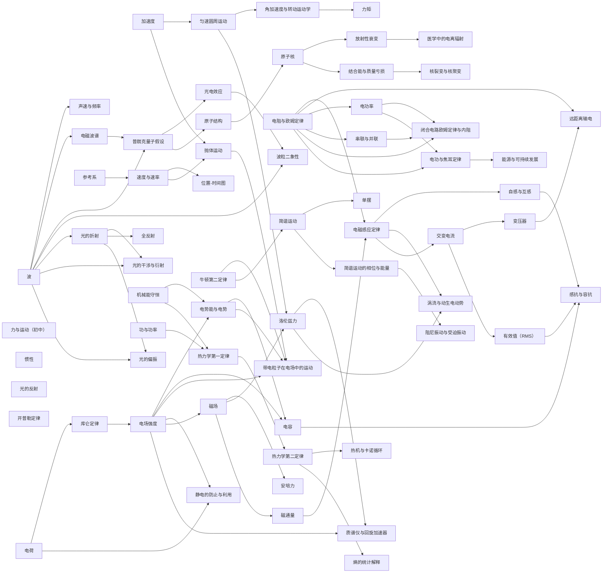
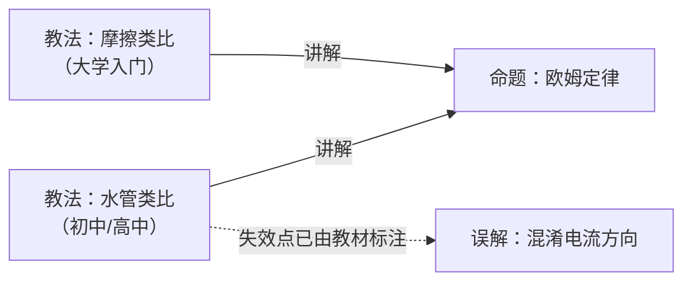

# Physics

> **English version of [`README.md`](README.md).**

## 知识点 (Knowledge points · concept nodes · carriers of prerequisite relations)



| 知识点 | 学段 | 先修 | 挂在其下的教法 | 误解 |
|---|---|---|---|---|
| [力与运动（初中）](concepts/forces-and-motion-jhs.en.md) | **初中** | — | 现象探究循环 | — |
| [波](concepts/waves.en.md) | 高中 | — | BL · OL 共 2 条 | 波把物质一起推走 |
| [惯性](concepts/inertia.en.md) | 高中 | **力（高中）**（与**初中**那一节的关系仍是进阶，非先修） | BL · AL 共 2 条 | 运动物体自然慢下来 |
| [力（高中）](concepts/force.en.md) | 高中 | —（**前置是「矢量」，归数学，库里还没有**） | OL · AL 共 2 条 | — |
| [牛顿第二定律](concepts/newtons-second-law.en.md) | 高中 | **惯性** | OL · AL 共 2 条 | —（教材点名的「重量 vs g」**本库未建**） |
| [牛顿第三定律](concepts/newtons-third-law.en.md) | 高中 | **牛顿第二定律** | OL · AL 共 2 条 | —（同上） |
| [参考系](concepts/frame-of-reference.en.md) | 高中 | — | BL · OL · AL 共 3 条 | 参考系当成背景 |
| [速度与速率](concepts/speed-and-velocity.en.md) | 高中 | 参考系 | BL/OL · AL 共 2 条 | — |
| [位置-时间图](concepts/position-time-graph.en.md) | 高中 | 速度与速率 | BL/OL · AL 共 2 条 | — |
| [加速度](concepts/acceleration.en.md) | 高中 | **速度与速率** | OL · AL 共 2 条 | — |
| [抛体运动](concepts/projectile-motion.en.md) | 高中 | **速度与速率** · **加速度**（正交分解本身归数学，库里没有） | — | — |
| [简谐运动](concepts/simple-harmonic-motion.en.md) | 高中 | **牛顿第二定律**（回复力经 `a = F/m` 决定运动） | — | — |
| [单摆](concepts/simple-pendulum.en.md) | 高中 | **简谐运动** · **力（高中）**（重力的分解） | — | — |
| [Phase and energy of simple harmonic motion](concepts/phase-and-energy-of-shm.en.md) | 高中 | **Simple harmonic motion** (`F = −kx`, `T = 2π√(m/k)`) | — | — |
| [Damped and forced oscillation](concepts/damped-and-forced-oscillation.en.md) | 高中 | **Phase and energy of simple harmonic motion** (the baseline for energy loss and resonance) | — | — |
| [电功率](concepts/electric-power.en.md) | 高中 | **电阻与欧姆定律**（`P = V²/R`、`P = I²R` 由 `V = IR` 代入） | — | — |
| [串联与并联](concepts/series-and-parallel-circuits.en.md) | 高中 | **电阻与欧姆定律**（各电阻上的 `V = IR` 与等效电阻的定义） | — | — |
| [Closed-circuit Ohm's law and internal resistance](concepts/closed-circuit-ohms-law.en.md) | 高中 | **电阻与欧姆定律** · **串联与并联** · **电功率** | — | — |
| [Electric work and Joule's law](concepts/electric-work-and-joule-law.en.md) | 高中 | **电功率** · **电阻与欧姆定律** | — | — |
| [Energy resources and sustainability](concepts/energy-resources-and-sustainability.en.md) | 高中 | **电功与焦耳定律** | — | — |
| [光的反射](concepts/reflection-of-light.en.md) | 高中 | —（前置是**初中几何**，不归物理） | BL · AL 共 2 条 | — |
| [声速与频率](concepts/speed-of-sound.en.md) | 高中 | **波** | BL · AL 共 2 条 | — |
| [机械能守恒](concepts/conservation-of-mechanical-energy.en.md) | 高中 | — | BL · OL 共 2 条 | 运动物体自然慢下来 |
| [电磁波谱](concepts/electromagnetic-spectrum.en.md) | 高中 | **波** | BL · OL/AL 共 2 条 | 可见光与不可见辐射有本质不同 |
| [普朗克量子假设](concepts/planck-quantum-hypothesis.en.md) | 高中 | **波** · **电磁波谱** | — | — |
| [光电效应](concepts/photoelectric-effect.en.md) | 高中 | **普朗克量子假设** | — | — |
| [波粒二象性](concepts/wave-particle-duality.en.md) | 高中 | **光电效应** · **波** | — | — |
| [开普勒定律](concepts/keplers-laws.en.md) | 高中 | — | OL · AL 共 2 条 | — |
| [万有引力定律](concepts/universal-gravitation.en.md) | 高中 | **开普勒定律** | OL · AL 共 2 条 | 混淆 G 与 g |
| [原子结构](concepts/atomic-structure.en.md) | 高中 | **Planck's quantum hypothesis** (energy quantization; attached 2026-10-21) | OL 共 3 条 | — |
| [功与功率](concepts/work-and-power.en.md) | 高中 | —（与机械能守恒的关系**尚未定**） | OL · AL 共 2 条 | — |
| [光的折射](concepts/refraction.en.md) | 初中 / 高中 | **波** | BL · OL · AL 共 3 条 | — |
| [Total internal reflection](concepts/total-internal-reflection.en.md) | 高中 | **Refraction of light** | — | — |
| [Light interference and diffraction](concepts/light-interference-and-diffraction.en.md) | 高中 | **Waves** · **Refraction of light** | — | — |
| [Polarization of light](concepts/polarization.en.md) | 高中 | **Waves** · **Refraction of light** (Brewster's law uses `n`) | — | — |
| [动量和冲量](concepts/momentum-impulse.en.md) | 高中 | **牛顿第二定律** | AL 共 1 条 | — |
| [动量守恒定律](concepts/conservation-of-momentum.en.md) | 高中 | **动量和冲量** | OL · AL 共 2 条 | — |
| [弹性碰撞与非弹性碰撞](concepts/elastic-inelastic-collisions.en.md) | 高中 | **动量守恒定律** · **机械能守恒** | — | — |
| [电阻与欧姆定律](concepts/resistance-and-ohms-law.en.md) | 初中至高中 | — | 水管类比 · 摩擦类比 共 2 条 | 混淆电流方向 |
| [匀速圆周运动](concepts/uniform-circular-motion.en.md) | 高中 | **加速度**（「速度变化」含方向变化） | 剪断绳子 · 共 1 条 | 离心力是一个真实的力 |
| [角加速度与转动运动学](concepts/rotational-kinematics.en.md) | 高中 | **加速度** · **匀速圆周运动**（`ω` 不再恒定） | — | — |
| [力矩](concepts/torque.en.md) | 高中 | **力（高中）** · **角加速度与转动运动学**（依据是定义句与节内位置——见条目 K1） | — | — |
| [电荷](concepts/electric-charge.en.md) | 高中 | —（本章入口；「万有引力」「矢量」是复习提示，非先修） | — | — |
| [库仑定律](concepts/coulombs-law.en.md) | 高中 | **电荷**（教材未写「Review electric charge」，依据是定律定义——见条目 K1） | — | — |
| [电场强度](concepts/electric-field.en.md) | 高中 | **库仑定律** | — | — |
| [电势能与电势](concepts/electric-potential-energy.en.md) | 高中 | **电场强度** · **机械能守恒**（势能只在差值上记账） | — | — |
| [电容](concepts/capacitance.en.md) | 高中 | **电势能与电势** · **电场强度**（`C = Q/V` 与匀强场 `E = V/d`） | — | — |
| [Motion of a charged particle in an electric field](concepts/charged-particle-in-electric-field.en.md) | 高中 | **电势能与电势** · **电场强度** · **抛体运动** · **牛顿第二定律** | — | — |
| [Prevention and utilization of static electricity](concepts/electrostatic-prevention-and-utilization.en.md) | 高中 | **电场强度** · **电荷** | — | — |
| [热力学第一定律](concepts/thermodynamic-first-law.en.md) | 高中 | **Work and power** · **Conservation of mechanical energy** (`W = PΔV` and energy bookkeeping) | — | — |
| [热力学第二定律](concepts/thermodynamic-second-law.en.md) | 高中 | **First law of thermodynamics** | — | — |
| [Heat engines and the Carnot cycle](concepts/heat-engine-and-carnot-cycle.en.md) | 高中 | **First law of thermodynamics** · **Second law of thermodynamics**（循环 `ΔU = 0`；第二定律的第二种表述） | — | — |
| [Statistical interpretation of entropy](concepts/statistical-interpretation-of-entropy.en.md) | 高中 | **Second law of thermodynamics**（`ΔS = Q/T` 与自发方向；本条给它微观基础） | — | — |
| [原子核](concepts/atomic-nucleus.en.md) | 高中 | **Atomic structure** | — | — |
| [放射性衰变](concepts/radioactive-decay.en.md) | 高中 | **Atomic nucleus** | — | — |
| [Binding energy and mass defect](concepts/binding-energy-and-mass-defect.en.md) | 高中 | **Atomic nucleus**（nuclide notation and mass number; `E = (Δm)c²`） | — | — |
| [Nuclear fission and fusion](concepts/nuclear-fission-and-fusion.en.md) | 高中 | **Binding energy and mass defect** · **Atomic nucleus**（iron peak and `A`、`Z` bookkeeping） | — | — |
| [Ionizing radiation in medicine](concepts/ionizing-radiation-in-medicine.en.md) | 高中 | **Radioactive decay**（half-life, activity, and β⁺ annihilation） | — | — |
| [磁场](concepts/magnetic-field.en.md) | 高中 | **Electric field strength**（教材以电场类比引出磁场） | — | — |
| [安培力](concepts/ampere-force.en.md) | 高中 | **Magnetic field** | — | — |
| [洛伦兹力](concepts/lorentz-force.en.md) | 高中 | **Magnetic field** · **Uniform circular motion**（垂直于速度的恒力 ⇒ 匀速圆周运动） | — | — |
| [质谱仪与回旋加速器](concepts/mass-spectrometer-and-cyclotron.en.md) | 高中 | **Lorentz force** · **Electric field strength**（速度选择器的 `qE`；回旋加速器的 `T` 与 `r`） | — | — |
| [磁通量](concepts/magnetic-flux.en.md) | 高中 | **Magnetic field** | — | — |
| [电磁感应定律](concepts/electromagnetic-induction.en.md) | 高中 | **Magnetic flux** · **Resistance and Ohm's law**（`I = ε/R`） | — | — |
| [自感与互感](concepts/self-and-mutual-inductance.en.md) | 高中 | **Electromagnetic induction**（`ε = −NΔΦ/Δt`、Lenz's law） | — | — |
| [涡流与动生电动势](concepts/eddy-currents-and-motional-emf.en.md) | 高中 | **Electromagnetic induction** · **Lorentz force**（`F = qvB`） | — | — |
| [交变电流](concepts/alternating-current.en.md) | 高中 | **Electromagnetic induction** · **Uniform circular motion**（`ω`, `v = rω`, `T = 2π/ω`） | — | — |
| [有效值（RMS）](concepts/rms-values.en.md) | 高中 | **Alternating current**（正弦式 `V = V0 sin 2πft`、峰值与频率） | — | — |
| [感抗与容抗](concepts/reactance-and-impedance.en.md) | 高中 | **Alternating current** · **RMS values** · **Self-inductance and mutual inductance** · **Capacitance**（`X_L = 2πfL`, `X_C = 1/(2πfC)`） | — | — |
| [变压器](concepts/transformer.en.md) | 高中 | **Electromagnetic induction** · **Alternating current**（需要变化的磁通） | — | — |
| [远距离输电](concepts/power-transmission.en.md) | 高中 | **Transformer** · **Resistance and Ohm's law**（`P_loss = I²R_wire`） | — | — |

> [!IMPORTANT]
> **Batch 34 (2026-10-21) adds RMS values and reactance/impedance — two blocks of item 8 of the priority list are complete, and 选必二 chapter 3 "Alternating current" still lacks three-phase power, so it stays 🟡.**
>
> ```
> 交变电流 → 有效值（RMS） → 感抗与容抗 ← 自感与互感
>                                        ← 电容
> ```
>
> "RMS values" covers `V = V0 sin 2πft`, `P_ave = ½I0V0`, `I_rms = I0/√2`, `V_rms = V0/√2`, `P_ave = I_rmsV_rms = I_rms²R = V_rms²/R`, the pure-resistor peak power `P0 = 2P_ave`, and the use of rms in transmission loss; the mean-square derivation of `√2` and the average/rms distinction are library additions.
> "Reactance and impedance" covers `X_L = 2πfL`, `X_C = 1/(2πfC)`, voltage leading by 90° across an inductor and lagging by 90° across a capacitor, series RLC `Z = √(R² + (X_L − X_C)²)`, `f0 = 1/(2π√(LC))`, `cosφ = R/Z`, and `P_ave = I_rmsV_rms cosφ`; the calculus derivations of `X_L`/`X_C` and the leading/lagging criterion are library additions.
> Recomputed: `170 V`, `P0 = 120 W`, `500 A`, `250 kW`, `0.250%`, `4000 A`, `16.0 MW`, `16.0%`; `X_L(60) = 1.131 Ω`, `X_L(10⁴) = 188.5 Ω`, `X_C(60) = 530.5 Ω`, `X_C(10⁴) = 3.183 Ω`, `Z(60) = 530.9 Ω`, `Z(10⁴) = 189.6 Ω`, `f0 = 1.2995 kHz`, `cosφ = 0.07535`, `φ = 85.68°`, `P(60) = 2.043 W`, `P_res = 360 W`.
>
> **Sources**: OpenStax *College Physics 2e* chapter 20, `m42348` (Alternating Current versus Direct Current), and chapter 23, `m42427` (Reactance, Inductive and Capacitive) and `m42431` (RLC Series AC Circuits), all read in full from their cnxml sources; the license is handled conservatively under the repository's **CC BY-NC-SA 4.0** (the openstax.org page for the same book states CC BY 4.0), with locators and short quotes only (ev-194/ev-195).
>
> **Source defects**: `m42348` conflates `average` and `rms`, gives `√2` without derivation, and states "AC shocks are more harmful" without citation; `m42427` calls reactance an `effective resistance` and explains `X_L ∝ f` by conflating frequency with rate of change; `m42431` has a `7.50 Hz` exercise whose answers correspond to about 1.0 kHz, and its (c) `26.4 W` is apparent power rather than average power; its glossary turns power factor into an amount.
>
> **Still missing**: three-phase power — **none of the available CC BY textbooks (CP2e and University Physics Vol 2) has a corresponding module**, so this needs a user decision on accepting another verifiable source; rms of non-sinusoidal waveforms, true-rms meters, parallel AC networks, complex impedance and phasors, quality factor and passband, and power-factor correction remain in the entries' gap tables.

> [!IMPORTANT]
> **Batch 33 (2026-10-21) adds self-inductance and mutual inductance, and eddy currents and motional emf — item 7 of the priority list is complete, and 选必二 chapter 2 "Electromagnetic induction" turns 🟢.**
>
> ```
> 磁通量 → 电磁感应定律 → 自感与互感
>                       ├→ 涡流与动生电动势 ← 洛伦兹力
>                       └→ 交变电流 → 变压器 → 远距离输电
> ```
>
> "Self-inductance and mutual inductance" covers `ε = −L ΔI/Δt`, `L = NΔΦ/ΔI`, the solenoid `L = μ0N²A/ℓ`, mutual inductance `ε₂ = −M ΔI₁/Δt`, the henry, and `E_ind = ½LI²`; "Eddy currents and motional emf" covers the Lorentz-force and Faraday routes to `ε = Bℓv`, relative motion, eddy currents, magnetic damping, slots and insulators, and the applications in balances, sorting, detectors, brakes, and induction cooktops.
> Recomputed: `0.632 mH`, `0.284 J`, `1.0×10⁴ V`, `31.25 kV / 125 kJ / 1.56 MW`, `1.97×10⁻² H`, `200 H` and `5.00 °C`; `150 μV`, `7.80 kV`, `0.630 V`, `1.44 V`, `2.22 m/s`, `1.98×10² T`, `θ = 24.2°`.
>
> **Sources**: OpenStax *College Physics 2e* chapter 23, modules `m42420` (Inductance), `m42400` (Motional Emf), and `m42404` (Eddy Currents and Magnetic Damping), all read in full from their cnxml sources; the license is handled conservatively under the repository's **CC BY-NC-SA 4.0** (the openstax.org page for the same book states CC BY 4.0; the two disagree), with locators and short quotes only (ev-192/ev-193).
>
> **Source defects**: in `m42420` the Section Summary and glossary define `inductance` as mutual inductance; the 1 H example mixes the magnitude with the minus sign; the formulas use finite differences rather than derivatives; the traffic-loop and metal-detector claims are uncited. In `m42400` the body gives only the perpendicular `ε = Bℓv` while an exercise asks for `Bℓv sinθ`; the tethered-satellite `10.0 N` in (a) corresponds with (b) to `78 kW`, against the stated `5.00 kV × 10.0 A = 50 kW`, a factor of `1.56`. In `m42404` the glossary restricts eddy currents to motional emf; "the base must be ferromagnetic" is too strong; "drag proportional to speed" is not derived.
>
> **Still missing**: RL transients, inductive reactance `X_L = ωL`, series and parallel inductors, magnetic energy density, geometric calculations of mutual inductance, quantitative core saturation and eddy-current loss, electromagnetic driving (induction and linear motors), engineering design of eddy-current brakes, and the quantitative relation between Hall voltage and carrier sign; RMS values, inductors and capacitors in AC, and three-phase power remain in the gap table of "Alternating current", so chapter 3 stays 🟡 (batch 34 has since filled the first two; only three-phase power remains).

> [!IMPORTANT]
> **Batch 32 (2026-10-21) adds phase and energy of simple harmonic motion and damped and forced oscillation — item 10 of the priority list is complete, and 选必一 chapter 2 "Mechanical vibration" turns 🟢.**
>
> ```
> 简谐运动 → 简谐运动的相位与能量 → 阻尼振动与受迫振动
> ```
>
> "Phase and energy of simple harmonic motion" covers the circular-motion projection `x = X cos θ`, `θ = ωt`, `ω = 2π/T`,
> the phase and initial phase `φ` (a library addition), phase difference and time difference `Δt = |Δφ|/ω` (library additions),
> and `½mv² + ½kx² = ½kX²`, `v = ±ω√(X² − x²)`, `v_max = ωX`, `a_max = ω²X` (library additions).
> "Damped and forced oscillation" covers the three damping regimes, forced oscillation, natural frequency, and resonance;
> less damping gives a higher and narrower resonance peak and more damping a lower and broader one; a forced oscillation can keep a constant amplitude when the energy input replaces the dissipation.
> Recomputed: `v_max = 0.852 m/s`, `E = 19.74 J`, `x/X = √3/2`, `d = 1.59 m`, a 3% amplitude loss per cycle corresponding to about `5.9%` energy loss,
> `384 J`, `5.00×10⁵ J` with `1.20×10³ s`, and `141 J` for the suspension.
>
> **Sources**: OpenStax *College Physics 2e*, Chapter 16, Oscillatory Motion and Waves:
> `m42244` (Energy and the Simple Harmonic Oscillator), `m42245` (Uniform Circular Motion and Simple Harmonic Motion),
> `m42246` (Damped Harmonic Motion), and `m42247` (Forced Oscillations and Resonance), all four cnxml sources read in full;
> the license is handled conservatively under the repository's **CC BY-NC-SA 4.0** (the openstax.org page for the same book states CC BY 4.0, the two disagree),
> with locators and short quotes only (ev-190/ev-191).
>
> **Source defects**: `m42244` and `m42245` have only the zero-initial-phase cosine, with no phase difference or time difference; in the pendulum energy expression `ω` is the angular velocity `dθ/dt`,
> while the circular-motion expression uses the angular frequency `2π/T` — the same symbol with two meanings; an AP question calls `½kX²` the `internal energy`; the Section Summary renders `v_max` as `Xkm`.
> `m42246`'s body says critical damping `may overshoot ... only once`, while the caption and glossary say `without overshooting`;
> the body says underdamped motion returns faster, conflicting with the definition of critical damping as the fastest return; the AP answer `1.698 m` differs from the textbook's own formula's `3.40 m` by about a factor of two.
> The claim that wind drove the Tacoma Narrows Bridge at its resonant frequency is not verified here and is not treated as established.
>
> **Still missing**: experimental measurement of phase difference (Lissajous figures), superposition of different frequencies (beats), the damping equation and exponential time constant, the quality factor `Q`,
> the quantitative resonance curve and its half-width, the phase lag of a forced oscillation, and the primary engineering report on the Tacoma Narrows Bridge;
> the pendulum's large-angle period corrections, the conical pendulum, and the physical pendulum remain recorded in the pendulum entry's gap table.

> [!IMPORTANT]
> **Batch 31 (2026-10-21) adds ionizing radiation in medicine — item 6 of the priority list is complete, and 选必三 chapter 5 "Atomic nucleus" turns 🟢.**
>
> ```
> 放射性衰变 → 医学中的电离辐射
> ```
>
> "Ionizing radiation in medicine" covers tracers and radiopharmaceuticals, `99mTc`'s `0.142 MeV` γ ray and `6.0 h` half-life,
> the gamma camera / SPECT / PET (the two oppositely directed `0.511 MeV` photons from β⁺ annihilation and coincidence detection),
> absorbed dose in `Gy` and equivalent dose in `Sv` (`H = D × RBE`), background and diagnostic doses, the therapeutic ratio and
> geometric convergence in radiotherapy, and protection by shielding, distance, and time. The recomputations here are:
> one abdomen CT equals about `3.6` years of background, one chest X-ray about `2.6` days, `50–80 Sv` at `2 Sv` per fraction
> becomes `25–40` fractions, and `0.75 Sv` is `50` times `15 mSv`.
>
> **Sources**: OpenStax *College Physics 2e* chapter 32, Medical Applications of Nuclear Physics —
> `m42649` (Diagnostics and Medical Imaging), `m42652` (Biological Effects of Ionizing Radiation), and
> `m42654` (Therapeutic Uses of Ionizing Radiation); all three cnxml source files were read in full.
> The license is handled conservatively under the repository's **CC BY-NC-SA 4.0** (the openstax.org page states
> CC BY 4.0, so the two disagree), citing locators and short quotations only (ev-187/ev-188/ev-189).
>
> **Source defects recorded**: m42654 gives the prostate seeds as `135I` (6 months) and `103Pd` (3 months); that
> isotope/half-life pairing cannot be verified within the material read here, so this entry does not use it;
> m42652's body says "about 5 mSv per dental X-ray" while its own table gives `0.01 mSv`, a difference of about 500×;
> the low-dose band "less than 100 mSv" overlaps the moderate band starting at 0.1 Sv; the `80+ Sv` column does not
> state fractionation or localization; "200 rem" is mixed with Gy; and m42649 says the annihilation energy comes from
> "an electron or positron mass" when in fact two rest masses annihilate.
>
> **Still missing**: X-ray production (bremsstrahlung and characteristic X-rays), quantitative radioimmunoassay,
> MRI spins/relaxation/gradient encoding, radiobiological mechanisms and repair kinetics, treatment protocols and
> fractionation, nuclear accidents and emergency response, food irradiation, and medical-isotope production and waste;
> particles and the cosmos (the Standard Model) are not on this page's chapter-level list and remain in the gap tables
> of "Atomic nucleus" and "Binding energy and mass defect".

> [!IMPORTANT]
> **Batch 30 (2026-10-21) adds binding energy and mass defect, and nuclear fission and fusion — item 6 of the priority list is largely complete, and 选必三 chapter 5 "Atomic nucleus" stays 🟡 (medical applications missing).**
>
> ```
> 原子核 → 结合能与质量亏损 → 核裂变与核聚变
> 原子核 → 核裂变与核聚变
> ```
>
> "Binding energy and mass defect" covers `BE = Δm c²`, the neutral-atom mass formula, the alpha particle's
> `0.030378 u → 28.3 MeV → 7.07 MeV per nucleon`, the `BE/A` curve and the iron peak, and why heavy stable
> nuclei need more neutrons; the `Q = ΔBE` energy ledger and the two-decimal recomputation are library
> additions. "Nuclear fission and fusion" covers the liquid-drop model, chain reactions and critical mass,
> `200 MeV` per fission (`0.2147 u`, `0.091%`), the solar p-p chain at `26.7 MeV` (`0.711%`), D-T at
> `17.6 MeV`, the Coulomb barrier and quantum tunnelling, and the direction of energy release on either side
> of the iron peak; the `k` factor, the `4.1×` energy per gram of fusion relative to fission, and the
> `1.3 keV` mean thermal energy at `1.5×10⁷ K` are all recomputed in this library.
>
> **Sources**: OpenStax *Physics* chapter 22 `m54574` (Nuclear Fission and Fusion, CC BY 4.0, ev-185);
> OpenStax *College Physics 2e* chapter 31 `m42640` (Binding Energy, treated conservatively under the
> repository's CC BY-NC-SA 4.0, ev-186). Both cnxml source files were read in full; the entries cite
> locators and short quotations only.
>
> **Source defects recorded**: m54574's body calls fission `the splitting of an atomic bond`, contradicting
> its own glossary; its Section Summary explains fusion energy as a "decreased strong nuclear force",
> contradicting the body's `BE/A` account; its "3 to 4 times" per gram recomputes to about `4.1×` for D-T;
> its PWR "water boils → chain reaction stops" holds only for negative-void-coefficient designs; its fusion
> section is promotional and under-cited. m42640 treats "larger `BE/A` ⇒ more stable" as sufficient; its
> "most common elements have the most tightly bound nuclei" ignores hydrogen; its β⁺ electron compensation of
> `0.511 MeV` should be `1.022 MeV` when atomic masses are used (verified against `m42633`'s
> `Δm=m(parent)−[m(daughter)+2m_e]`).
>
> **Still missing**: medical applications (the remaining gap in this chapter), reactor neutron kinetics and
> criticality calculations, fission-product yields and decay heat, breeders and reprocessing, inertial
> confinement and ignition, quantitative tokamak confinement, fusion `Q`, weapons physics, the shell model
> and semi-empirical mass formula, and astrophysical nucleosynthesis.

> [!IMPORTANT]
> **Batch 29 (2026-10-21) adds heat engines, the Carnot cycle, and the statistical interpretation of entropy — item 5 of the priority list is complete, and 选必三 chapter 3 "Laws of thermodynamics" turns 🟢.**
>
> ```
> 热力学第二定律 → 热机与卡诺循环
> 热力学第二定律 → 熵的统计解释
> ```
>
> "Heat engines and the Carnot cycle" covers the cyclic ledger `W = Q_h − Q_c`, the efficiency
> `Eff = 1 − Q_c/Q_h`, the second expression of the second law, the Otto cycle's `P–V` diagram, and the
> Carnot cycle with `Eff_C = 1 − T_c/T_h`; the coal plant's 40.8% / 1180 MW / 3.7×10⁸ kg CO₂ and the
> pressurised-water reactor's 47.6% are both recomputed. "Statistical interpretation of entropy" covers
> macrostates and microstates, the equal-probability assumption, the five- and hundred-coin examples,
> the gas example, and `S = k ln W` with `ΔS = k ln(W_f/W_i)`; the second law is therefore a statistical
> law, not an absolute ban.
>
> **Source**: CP2e ch. 15 `m42234` (Heat Engines and Their Efficiency), `m42235` (Carnot's Perfect Heat
> Engine), and `m42238` (Statistical Interpretation of Entropy); the license is handled conservatively
> under the repository's **CC BY-NC-SA 4.0**, with locators and short quotes only (ev-183/ev-184).
>
> **Supplied here**: the Carnot ratio `Q_c/Q_h = T_c/T_h` is derived from entropy conservation around a
> reversible cycle (the textbook gives only the result); `ΔS = k ln(W_f/W_i)`, the normalisation `P = W/Ω`,
> and "probability of an entropy decrease ≈ `e^(−ΔS/k)`" are also this library's additions.
>
> **Source defects**: the five-coin table repeats the five microstates of "3 heads, 2 tails" (the count 10
> is right); `this expression for s` uses lowercase s; "about 1 in 90" is the absolute probability of the
> 60/40 macrostate, not `W_60/W_50`; "`ΔS` of `10^-21 J/K` corresponds to 1 in 10^30" recomputes to about
> 1 in 3×10^31; "all Qs are positive... Qc... preceded by a minus sign" contradicts itself; the drinking
> bird is not a Carnot engine; "the best-ever achieved of about 70%" has no source.
>
> **Still missing**: heat-pump and refrigerator COPs, quantitative real cycles (Diesel/Rankine/Brayton),
> a rigorous proof of Carnot's theorem, the Otto-cycle compression-ratio formula, free energy, and a proof
> that `S = k ln W` equals `ΔS = Q/T`.

> [!IMPORTANT]
> **Batch 28 (2026-10-21) adds mass spectrometers and cyclotrons — item 22 of the priority list is complete, and Elective-2 chapter 1 "Ampere force and Lorentz force" turns 🟢.**
>
> ```
> 洛伦兹力 → 质谱仪与回旋加速器
> 电场强度 → 质谱仪与回旋加速器
> ```
>
> The entry covers the crossed-field velocity selector (`qE = qvB` ⇒ `v = E/B`, independent of `q`, `m`,
> and the sign of the charge), the three stages of the mass spectrometer (ion source → velocity selector →
> uniform magnetic field) and `r ∝ m` (strictly the mass-to-charge ratio), the cyclotron's Dees and fixed
> frequency (`T = 2πm/(qB)`, `f = qB/(2πm)`), and why a synchrotron must tune frequency and field together.
> The textbook's oxygen-16/oxygen-18 separation `0.173 m` and the proton cyclotron frequency `18.3 MHz`
> are both recomputed. `K_max = q²B²R²/(2m)`, `r = (m/q)(E/B²)`, the isotope separation `2Δr`, and the
> relativistic loss of synchronism are supplied here and flagged in K2/K3. The old note in "Lorentz force"
> that listed the period as missing is corrected — the period was already derived in K2.
>
> **Source**: CP2e ch. 22 `m42375` (Force on a Moving Charge in a Magnetic Field) and `m42388` (More
> Applications of Magnetism), ch. 28 `m42718` (Accelerators Create Matter from Energy); the license is
> handled conservatively under the repository's **CC BY-NC-SA 4.0**, with locators and short quotes only
> (ev-182).
>
> **Source defects recorded**: m42718 calls Van de Graaff a "Dutch physicist" (he was American, born in
> Tuscaloosa, Alabama); its AP answer `(c)` does not match its own explanation; m42388's Critical Thinking
> answer uses `9.11×10⁻¹¹ kg` for the electron mass instead of `9.11×10⁻³¹ kg`, so its radius and time
> have the wrong exponents; m42718's LHC figures date from around 2010.
>
> **Still missing**: quantitative relativistic cyclotrons (synchrocyclotrons), beam focusing and emittance,
> RF-cavity and superconducting-magnet engineering, quantitative MRI/NMR, quantitative CRT magnetic
> deflection, and the Hall effect and MHD generators — listed in the entry's gap table.

> [!IMPORTANT]
> **Batch 27 (2026-10-21) adds prevention and utilization of static electricity — item 21 of the priority list is complete, and Compulsory-3 chapter 9 "Electrostatics and its applications" turns 🟢.**
>
> ```
> 电荷 → 静电的防止与利用
> 电场强度 → 静电的防止与利用
> ```
>
> The entry covers the three properties of a conductor in electrostatic equilibrium (zero field inside,
> field perpendicular to the surface just outside, all excess charge on the surface), the Faraday cage
> and the car as a shield, point discharge and the lightning rod (air breakdown at `3×10⁶ N/C`), smooth
> surfaces on high-voltage lines, and electrostatic precipitation (removing over 99% of particles),
> xerography and laser printing, electrostatic painting, ink-jet printing, and the Van de Graaff
> generator; the prevention side covers grounding, shielding, avoiding field concentration, and humidity.
> The textbook presents the uses one by one; the "use the field / block the field" dichotomy is this
> library's organization, recorded in argument K3.
>
> **Source**: CP2e Chapter 18, `m42317` (Conductors and Electric Fields in Static Equilibrium) and
> `m42329` (Applications of Electrostatics); the license is handled conservatively under the
> repository's **CC BY-NC-SA 4.0**, using locators and short quotes only (ev-181).
>
> **Source defects recorded**: m42317 has the sentence `Air ionizes ions and electrons recombine`
> (punctuation missing in the original); the exercise sets of m42317 and m42329 are almost entirely
> point-charge field-and-force problems, with little connection to conductors, shielding or applications.
>
> **Still missing**: the quantitative relation between surface charge density and curvature,
> `E = σ/ε₀` just outside a conductor, grounding when charge is inside a cavity, lightning leaders and
> the protection angle, human-body electrostatic discharge models, and shielding in alternating fields
> (skin effect) — all listed in the entry's gap table.

> [!IMPORTANT]
> **Batch 26 (2026-10-21) adds energy resources and sustainability — item 20 of the priority list is complete, and "electrical energy and energy resources" turns 🟢.**
>
> ```
> 电功与焦耳定律 → 能源与可持续发展
> ```
>
> The entry covers renewable and nonrenewable sources (water, wind, solar, biomass vs oil, natural gas,
> coal), the 2020 world energy mix (557.1 EJ; fossil 83.1%, oil 31.3%, renewables 12.6%, nuclear 4.3%),
> world energy growth and country examples (the U.S., Germany, New Zealand, China, India), the qualitative
> relation between energy and GDP per capita, and **the difference between the law of conservation of
> energy and "energy conservation"**: the law says the total energy of an isolated system is constant,
> while energy conservation means using less or converting more efficiently, because every practical
> conversion degrades part of the energy into waste heat. The textbook's "about 85% fossil", "21% of world
> oil", and "China's 2/3 coal" disagree with the 2020 table's 83.1%, 18.7%, and 56.6%, a difference of
> data year recorded in ev-180.
>
> **Source**: CP2e Chapter 7, `m42154` (World Energy Use); the license is handled conservatively under
> the repository's **CC BY-NC-SA 4.0**, using locators and short quotes only (ev-180).
>
> **Source defects recorded**: Egypt's coal cell reads `0.0%` in an EJ column; the table declares
> `tgroup cols="10"` with 10 colspecs but has 8 cells per row; 8 of 11 country rows do not sum to
> their totals (Russia 0.4 EJ off); the prose's "10% of U.S. electricity" and the Section Summary's
> "10% of its energy" are different quantities, and the 2020 table's 10.0% is total energy; the
> prose calls U.S. renewables "primarily hydro" although other renewables exceed hydro in the 2020
> table; one figure is dated 2006 while the table is 2020; most exercises are work-and-energy
> problems unrelated to the section.
>
> **Still missing**: technical details of photovoltaics, wind, and nuclear power; quantitative carbon
> accounting; Chinese energy policy and the curriculum standard; unifying the scope and year of
> energy statistics; and storage and grid dispatch — all listed in the entry's gap table.

> [!IMPORTANT]
> **Batch 25 (2026-10-21) adds electric work and Joule's law — item 19 of the priority list is complete.**
>
> ```
> 电功率 → 电功与焦耳定律
> 电阻与欧姆定律 → 电功与焦耳定律
> ```
>
> The entry covers electric work `W = qU = UIt = Pt`, Joule's law `Q = I²Rt`, the pure-resistance
> result `W = Q = UIt = I²Rt = U²t/R`, the non-resistive relation `W = Q + E_other` (motors,
> electrolytic cells; not discussed in the textbook, stated here only as a scope condition),
> and kilowatt-hours and electricity cost. **The name Joule's law and the combination into
> `W = Q` are supplied here**; the textbook gives only `P = I²R` and `E = Pt`. The headlight's
> `30.0 W` hot, `411 W` cold, and `34.3 A`; the extension cords' `1.50 W` and `7.50 W`; and the
> CFL example's `$7.45` and `$1.95` have all been rechecked.
>
> **Source**: CP2e Chapter 20, `m42714` (Electric Power and Energy); the license is handled
> conservatively under the repository's **CC BY-NC-SA 4.0**, using locators and short quotes only (ev-179).
>
> **Source defects recorded**: the 00-gauge wire exercise (9.266 mm, 1 km, 100 A) credits
> `25.5 W`, but `R ≈ 0.255 Ω` gives about `2.55×10³ W` — the answer corresponds to 10 A and is
> off by 100×; the maximum-CFL-price exercise credits `$6.25`, which is the incandescent total,
> while the CFL purchase price should be `$4.75`; the prose writes `1 kA · V = 1 kW` instead of
> `1 kV · A`; the exercises section is titled `Problem Exercises` (missing `&`); several
> exercises give stems only.
>
> **Still missing**: energy resources and sustainability, so Compulsory-3 "electrical energy and
> energy resources" remains 🟡; quantitative power sharing in non-resistive circuits, RMS values
> and power factor, energy storage and reactive power of capacitors and inductors, and tariff
> structures are listed in the entry's gap table.

> [!IMPORTANT]
> **Batch 24 (2026-10-21) adds closed-circuit Ohm's law and internal resistance — item 18 of the priority list is complete.**
>
> ```
> 电阻与欧姆定律 → 闭合电路欧姆定律与内阻
> 串联与并联 → 闭合电路欧姆定律与内阻
> 电功率 → 闭合电路欧姆定律与内阻
> ```
>
> The entry covers emf (the potential difference between the terminals when no current flows, not a force),
> internal resistance `r`, the terminal voltage `V = emf − Ir`, the closed-circuit law `I = emf/(R+r)`,
> `emf = IR + Ir`, how the terminal voltage varies with external resistance, the short-circuit current
> `emf/r`, charging with a terminal voltage above the emf (a 12.0 V battery charged at 8.00 A with a
> 15.0 V terminal voltage gives `r = 0.375 Ω`), and identical sources in series and parallel.
> **The maximum output power at `R = r` and the 50% efficiency there are derived here**, not given by the
> textbook; the eel example uses `0.15 × 5000 = 750 V`, and the textbook's "approximately 600 V" does not
> follow from its own data (ev-178).
>
> **Source**: CP2e Chapter 21, `m42357` (Electromotive Force: Terminal Voltage); the license is handled
> conservatively under the repository's **CC BY-NC-SA 4.0**, using locators and short quotes only (ev-178).
>
> **Source defects recorded**: the eel passage's 140×5,000 cells of 0.15 V are said to give "approximately
> 600 V", but each row gives 750 V and the parallel combination still 750 V; the paired exercise with 800 Ω
> of water gives about 0.93 A rather than the prose's 1 A and has no answer; the exercises section is titled
> `Problem Exercises` (missing `&`); the second Unreasonable Results item has no answer; several exercises
> give stems only.
>
> **Still missing**: electric work and Joule's law, and energy resources and sustainability, so Compulsory-3
> "electrical energy and energy resources" remains 🟡; non-resistive circuits (motors), capacitor transients,
> temperature/aging models of internal resistance, and general Kirchhoff networks are listed in the entry's
> gap table.

> [!IMPORTANT]
> **Batch 23 (2026-10-21) adds motion of a charged particle in an electric field — item 17 of the priority list is complete, and 必修三 "Energy in an Electric Field" turns 🟢.**
>
> ```
> 电势能与电势 → 带电粒子在电场中的运动
> 电场强度 → 带电粒子在电场中的运动
> 抛体运动 → 带电粒子在电场中的运动
> 牛顿第二定律 → 带电粒子在电场中的运动
> ```
>
> "Motion of a charged particle in an electric field" covers `E = U/d` and `F = qE` in a uniform field,
> acceleration from rest (`|q|U = ½mv²`, a 100 V electron reaching `5.93×10⁶ m/s`), the electron volt and the
> `200 eV` gained by a doubly charged ion, projectile-like transverse deflection
> (`y = qUL²/(2mdv₀²)`, `tan θ = 2y/L`), and the oscilloscope. **Motion in non-uniform fields, quantitative
> relativistic corrections, the full structure of an oscilloscope, fringing fields, beam focusing, and the
> theory of accelerators are still missing** and are listed in the entry's gap table.
>
> **How the sources are used**: `m42324` supplies acceleration and the electron volt; `m42326` supplies
> `E = V_AB/d`, the electron gun, and a hidden projectile analogy; **OpenStax gives no transverse-deflection
> formula**, so the entry derives it from projectile motion and Newton's second law and states explicitly that
> it is not textbook text. Both modules are in the *College Physics 2e* bundle, so the license is handled
> conservatively under the repository's **CC BY-NC-SA 4.0**, using locators and short quotes only
> (ev-176/ev-177).
>
> **Source defects recorded**: m42326's isoline item ("six lines spaced 5.0 V apart cross a 40 cm path")
> credits `75 V/m`, but six lines enclose five intervals (ΔV = 25 V), so the literal stem gives `62.5 V/m`
> and none of the options matches; a hidden Test Prep item says a fourfold range means "100% more mass",
> whereas fixed transverse deflection gives `x ∝ √m`, so it is 16× the mass (1500% more); the answer to the
> dropped-particle item depends on a figure absent from the cnxml; `800 KeV` is mis-capitalized; m42324
> substitutes `q = −1.60×10⁻¹⁹ C` and `V = −100 J/C` together into `√(2qV/m)` (correct value, misleading
> signs) and gives no answer for the 40 kV exercise. The entry does not carry these over.
>
> **Correction (2026-10-21)**: two earlier claims — `Section SummaryThe voltage` / `Section SummaryElectric
> potential` lacking a space, and `in to move` / `in into` being redundant — are **not source defects**. The
> raw cnxml has `<title>Section Summary</title>` as a separate element and contains neither `in to move` nor
> `in into`; both are artifacts of the local strip script concatenating elements. The claims are removed
> from ev-176/ev-177 and from this note.

> [!IMPORTANT]
> **Batch 22 (2026-10-21) adds capacitance — item 16 of the priority list is complete, but 必修三 "Energy in an Electric Field" stays 🟡.**
>
> ```
> 电势能与电势 → 电容
> 电场强度 → 电容
> ```
>
> "Capacitance" covers charging a capacitor (work is done against the charge already on the plates, and the energy
> ends up stored in the field between them), `C = Q/V` and the farad, the vacuum parallel-plate result
> `C₀ = ε₀A/d` with the 8.9 nF and `Q = 2.7×10⁻⁵ C` checks, dielectric polarization and `C = κC₀`, the κ table
> (Teflon 2.1, paper 3.7, water 80, strontium titanate 233), and the stored energy
> `U = ½CV² = Q²/(2C)` with the flash-tube example (`1.0 J` delivered in 1 ms, `1 kW`). **Motion of charged
> particles in an electric field, combinations of capacitors, RC transients, breakdown and leakage, fringing
> fields, the energy density `u = ½ε₀E²`, the microscopic model of dielectric polarization, and supercapacitors
> and capacitive sensors are still missing** and are listed in the entry's gap table.
>
> **Why the chapter stays 🟡**: "Energy in an Electric Field" still lacks **motion of charged particles in an
> electric field**; adding capacitance and capacitor energy is not the whole chapter. The priority list therefore
> gains a new item 17.
>
> **Source defects recorded**: m63179's definition sentence drops a preposition (`can store energy an electric
> field`); its 10 µF / 120 µC example prints `72 mJ` where `U = Q²/(2C) = 0.72 mJ` (100× too large); one
> capacitance multiple-choice item labels the options `nC` instead of `nF` (the correct value is `2.3 nF`); the
> dielectric-energy Concept Item and two true/false items never state whether the battery stays connected, although
> the answer reverses between fixed `Q` and fixed `V`; the 12 µF plate-attraction problem has no correct option
> (the force is `F = Qσ/(2ε₀) ≈ 5.9×10⁴ N`, and the offered `1.2×10⁵ N` is the missing-½ error); the κ table
> prints `Silicon oil` for `silicone oil`; a teacher note derives `di` from "two or double" and says a dielectric
> "can have two electric charges" (the prefix is Greek `dia-`, "through"); and the module's Performance Task
> compares gravitation with Coulomb's law and has nothing to do with capacitors.

> [!IMPORTANT]
> **Batch 21 (2026-10-21) adds polarization of light — item 15 of the priority list is complete, and 选必一 chapter 4 "Light" turns 🟢.**
>
> ```
> 波 → 光的偏振
> 光的折射 → 光的偏振
> ```
>
> "Polarization of light" covers the direction of polarization (defined as the direction of the electric field),
> unpolarized light and polarizing filters, Malus's law `I = I₀cos²θ` (the textbook never states that unpolarized
> light loses half its intensity at one filter; this entry derives `½I₀` by averaging `cos²θ`), a 90% intensity
> reduction giving 71.6°, Brewster's law `tan θ_b = n₂/n₁` (water 53.1°, crown glass 56.7°, water to crown 48.8°,
> crown to water 41.2°), polarization by reflection and by scattering, optical activity, birefringence and dichroic
> materials, and liquid-crystal displays. **Circular and elliptical polarization, Stokes parameters, the s- and
> p-components of the Fresnel coefficients, the degree of polarization, quantitative optical activity, and wave
> plates are still missing** and are listed in the entry's gap table.
>
> **Source and license**: this batch uses `m42522`, from *College Physics 2e*, Chapter 27 (Wave Optics), §27.8
> Polarization, not from the *Physics* collection used elsewhere in this library. The repository's `LICENSE` and
> README state **CC BY-NC-SA 4.0**, while the openstax.org page for the same section states **CC BY 4.0**; the two
> declarations disagree, and this library follows the repository license as the stricter one, using
> **locators and short quotes only** (ev-174).
>
> **Source defects recorded**: m42522's only Critical Thinking item is a diffraction-grating problem unrelated to
> polarization; its solution takes the grating spacing as `10⁻⁶ m` where the stem gives `1.0×10⁻⁵ m`, so all four
> answers are off by a factor of ten, writes `θ = 0.400 = 23.6°` for `θ = sin⁻¹(0.400)`, and mixes in `10⁻⁶ cm`;
> the prose `The electric field is strong compared with the magnetic field` compares quantities with different units.

> [!IMPORTANT]
> **Batch 20 (2026-10-21) adds total internal reflection — item 14 of the priority list is complete, but 选必一 chapter 4 "Light" does not turn 🟢.**
>
> ```
> 光的折射 → 全反射
> ```
>
> "Total internal reflection" covers the critical angle `sin θ_c = n₂/n₁` (only for `n₁ > n₂`), the two
> conditions for total internal reflection, the argument that `sin θ₂ = (n₁/n₂) sin θ₁ > 1` leaves no refracted
> ray, water-to-air 48.6° and diamond-to-air 24.4°, and the diamond cut, corner reflectors, optical fibers, and
> the endoscope. **Dispersion and the rainbow, evanescent waves, and the numerical aperture and modes of fibers
> are still missing**, as recorded in the entry's gap table.
>
> **Why chapter 4 stays 🟡**: the original checklist treated total internal reflection as the last block, but the
> gap table of [light interference and diffraction](concepts/light-interference-and-diffraction.en.md) already
> names **polarization of light** as missing (DIC microscopy uses polarized light), and the OpenStax collection
> has no polarization module. Rather than call "the original list is done" a complete chapter, the chapter stays
> 🟡; polarization becomes priority 15 and needs another citable CC BY source.
>
> **Source defects recorded**: m54365 prints the fixed value of the speed of light as `2.9972458×10⁸ m/s`
> (it is `2.99792458×10⁸ m/s`); misspells `indices` as `indicies` twice; the Section Summary says
> `total internal refraction`; a Key Equations cell begins with a stray `>`; and the corner-reflector passage
> treats two perpendicular mirrors as a retroreflector, which holds only for rays perpendicular to the fold line
> (a three-dimensional reflector needs three mutually perpendicular faces). The entry does not carry these over.

> [!IMPORTANT]
> **Batch 19 (2026-10-21) adds light interference and diffraction — only total internal reflection is left in 选必一 chapter 4 "Light".**
>
> Two prerequisites:
>
> ```
> 波 → 光的干涉与衍射
> 光的折射 → 光的干涉与衍射
> ```
>
> "Light interference and diffraction" covers Huygens's principle and wavefronts; the double-slit conditions
> `d sinθ = mλ` and `d sinθ = (m+½)λ`; the single-slit minima `D sinθ = mλ` with the small-angle form `Dy/L = mλ`;
> `λ_n = λ/n`; the grating equation and the order-by-order dispersion of white light; the CD as a reflection
> grating; circular-aperture diffraction and the Rayleigh criterion `θ = 1.22λ/D`; and five worked figures
> (`633 nm`, `1.56 μm`, `5.97°`, `7.72×10⁻⁴ rad`, `414 nm`). **Polarization, coherence length and coherence time,
> the quantitative double-slit intensity formula, thin-film interference, and the quantum account of single-photon
> interference are still missing**, as recorded in the entry's gap table.
>
> **Total internal reflection is still missing** — 选必一 chapter 4 stays 🟡 until `m54365` is built.
>
> **Source defects recorded**: m54371 writes "1,600 in a millimeter" for CD grooves while the same passage gives a
> 1,600 nm pitch (625 per mm); its Concept Items print the Rayleigh criterion as `θ = λ/D` without the 1.22 that
> the body text and Key Equations use; m54369's teacher note says "the sign of an angle is always ≥ 1" (the sine is
> at most 1) and misspells `lamda`; m54369 gives the visible range as 380–750 nm while m54371 gives 380–780 nm.
> The entry does not carry these over.

> [!IMPORTANT]
> **Batch 18 (2026-10-21) adds wave-particle duality — the 选必三 "atomic structure and wave-particle duality" chapter turns 🟢.**
>
> The entry connects the photon model of the photoelectric effect to momentum and matter waves:
>
> ```
> 光电效应 → 波粒二象性
> 波 → 波粒二象性
> ```
>
> "Wave-particle duality" covers photon momentum `p = h/λ`, the comparison between a `500 nm` photon and an
> electron of the same momentum (the electron's kinetic energy is about five orders of magnitude smaller), the
> Compton effect (energy and momentum conserved together; X-rays matter because their wavelength is short),
> the parallel accounts of interference/diffraction and discrete energy, the matter-wave relation `λ = h/p`,
> and solar sails, comet tails, and electron microscopes. **The Compton shift formula, electron-diffraction
> experiments, the uncertainty principle, and the quantitative Bohr model and hydrogen spectrum are still
> missing**, as recorded in the entry's gap table.
>
> **Source defects recorded**: m54552 dates Compton's Nobel Prize to 1929 (it was 1927); one exercise writes the
> de Broglie wavelength as `p = hλ` (it should be `λ = h/p`; the rest of the module writes it correctly); part (c)
> of the `500 nm` example substitutes `1,456 m/s` while part (b) gives `1,459.9 m/s`, and the quoted
> `9.64×10⁻²⁵ J` should be about `9.66×10⁻²⁵ J` for the value substituted; the glossary's `either a particle or
> a wave` conflicts with the module's own teacher support that light does not choose. The entry does not carry
> these over.

> [!IMPORTANT]
> **Batch 17 (2026-10-21) opens the 选必三 "atomic structure and wave-particle duality" chapter with Planck's quantum hypothesis and the photoelectric effect.**
>
> Two chains:
>
> ```
> 波 → 电磁波谱 → 普朗克量子假设 → 光电效应
> 普朗克量子假设 → 原子结构      (the "quantization" prerequisite atomic structure had left empty)
> ```
>
> "Planck's quantum hypothesis" covers the two regularities of the blackbody spectrum, the failure of classical
> theory at short wavelengths (the ultraviolet catastrophe), `E = nhf`, and three photon-energy examples;
> "The photoelectric effect" covers the five experimental properties, `KE_max = hf − BE` with the `BE = hf₀`
> threshold, the `KE–f` graph whose slope is `h`, the 420 nm violet-light/calcium example, and lists photoelectric
> tubes, photoconductive cells, solar cells, and movie soundtracks as related technologies (the last two belong to
> the internal photoelectric effect and the photovoltaic effect; the entry states the difference).
> **Wave-particle duality of light is still missing** — the 选必三 chapter 4 stays 🟡 until `m54552` is built.
>
> **Source defects recorded**: m54566's classical formula `I = 2kT/λ²` has both the wrong exponent and the wrong
> dimensions (Rayleigh–Jeans goes as `∝ T/λ⁴` per wavelength) and its glossary calls the ultraviolet catastrophe a
> "misconception"; m54559 calls `E = hf` "the energy of a photon or photoelectron", writes the eV conversion as
> `J⋅s`, uses a capital `f_O` in the Key Equations, says `bonding energy` in an exercise, and places a `0.26 eV`
> retarding voltage next to a computed `0.25 eV`. The entries do not carry these over.

> [!IMPORTANT]
> **Batch 16 (2026-10-21) adds series and parallel circuits to the Compulsory-3 "circuits and their applications" chapter — that chapter turns 🟢.**
>
> The entry turns Ohm's law into a network:
>
> ```
> 电阻与欧姆定律 → 串联与并联
> ```
>
> "Series and parallel circuits" covers the same current, the adding voltages, and `R_eq = ΣR` in series; the same
> voltage, the adding currents, and `1/R_eq = Σ1/R` in parallel; `R_eq` below the smallest branch resistance;
> `R/N` for N identical resistors in parallel; and the stepwise reductions of the seven-resistor `10 Ω` network to
> `160/11 Ω ≈ 14.5 Ω` and of the `10 V` complex circuit to `104.09 Ω → 0.096 A`.
> **The closed-circuit Ohm's law with internal resistance, electric work and Joule's law, capacitor charging, and
> non-series-parallel networks such as bridges are still missing** — so the "electrical energy and energy resources"
> chapter remains 🟡.
>
> **Source defects recorded**: in m54435 one learning objective repeats a phrase and an option prints `5V` as `5V4`;
> in m54442 the complex-circuit example writes an extra `R` (`25.71 Ω R.`) and says the current is `across` a branch.
> The entry does not carry these over. The modules assume an ideal wire (same voltage everywhere along it) and a
> battery with no internal resistance; the entry states both assumptions.

> [!IMPORTANT]
> **Batch 15 (2026-10-21) opens the 必修三 "electrical energy and energy resources" chapter with "electric power".**
>
> The entry attaches after Ohm's law and makes the rate of electric energy transfer explicit:
>
> ```
> 电阻与欧姆定律 → 电功率
> ```
>
> "Electric power" covers `P = IV` and its dimensional derivation, `P = V²/R` and `P = I²R`, the fact that only
> resistance dissipates power while a capacitor only stores energy, and the textbook's energy-conservation check in
> which the branches total `10.4 W` and the battery supplies `10.4 W`.
> **Electric work `W = UIt`, a separate statement of Joule's law, the closed-circuit Ohm's law with internal
> resistance, and energy resources and sustainability are still missing** — so the coverage page records chapter 12
> as 🟡, not 🟢.
>
> **Source defects recorded**: m54446 calls household `120 V` `time-averaged power` (a voltage is not a power; the
> correct statement is an RMS voltage, which the module never develops); the exercise "heat 1 L of water by 20 °C with
> a 1-kW resistor on 9.0 V" needs about `83.6 kJ`, which 1 kW delivers in about 84 s, so none of the options
> 10/20/30/40 min is correct. The entry does not use either passage.

> [!IMPORTANT]
> **Batch 14 (2026-10-21) opens the 选必一 "mechanical vibration" chapter — 选必一 no longer has a completely empty chapter.**
>
> The edge carries Newton's second law into back-and-forth motion:
>
> ```
> 牛顿第二定律 → 简谐运动 → 单摆
> ```
>
> "Simple harmonic motion" covers Hooke's law `F = −kx`, the restoring force, amplitude/period/frequency, and the spring
> oscillator's `T = 2π√(m/k)`; "Simple pendulum" covers the small-angle restoring force `−mg sinθ`, `T = 2π√(L/g)`, and
> measuring `g` with a pendulum (the textbook's example: `L = 75.000 cm`, `T = 1.7357 s` ⇒ `g = 9.8281 m/s²`).
> **Phase and `x = A cos(ωt + φ)`, the energy of simple harmonic motion, damped oscillation, forced oscillation, and
> resonance are still missing** — so the coverage page records chapter 2 as 🟡, not 🟢.
>
> **Source defects recorded**: the m54154 glossary writes Hooke's law as `F = kΔL` (no minus sign, using `ΔL`), which
> disagrees with the body's `F = −kx`; one passage calls simple harmonic motion `an object in simple motion`; the
> Performance Task teacher note is about vector addition and has nothing to do with simple harmonic motion. The module
> also notes that tension and period share the symbol `T` and warns against confusing them.

> [!IMPORTANT]
> **Batch 13 (2026-10-21) opens the 必修二 "projectile motion" chapter — the repo's first two-dimensional motion edge, filling priority 9 on the coverage page.**
>
> The edge carries one-dimensional kinematics into the plane:
>
> ```
> 速度与速率 ─┐
>             ├─→ 抛体运动
> 加速度 ─────┘
> ```
>
> The entry covers the independence of horizontal and vertical motion, `a_x = 0` and `a_y = −g`, the maximum height
> `h = v₀y²/(2g)`, the level-ground range `R = v₀²sin2θ₀/g`, and the textbook's two worked examples: the firework
> (70.0 m/s at 75° ⇒ 233 m, 6.90 s, 125 m) and the volcano rock (25.0 m/s at 35°, landing 20.0 m lower ⇒ 3.96 s).
> **The condition for curved motion and the composition and resolution of motion (vectors) are still missing** — the
> latter needs the mathematical "vector" node, the same gap recorded on [力（高中）](concepts/force.en.md) — so the coverage
> page records the chapter as 🟡.
>
> **Source defect recorded**: the Strategy in m54162 writes `a_x = 0 and a_y = g` (missing the minus sign), while every
> solution in the same section uses `−g` with up positive; the entry follows the solutions and states this in K1. The
> textbook does not derive "45° gives the maximum range" and does not give the trajectory equation; the entry marks both
> as the repo's own derivations.

> [!IMPORTANT]
> **Batch 12 (2026-10-21) adds the last empty chapter of 选必二, "alternating current"; none of the three 选必二 chapters is zero any more.**
>
> The branch follows induction into applications:
>
> ```
> 电磁感应定律 → 交变电流 → 变压器 → 远距离输电
> 电阻与欧姆定律 ───────────────────┘
> ```
>
> The AC entry covers the generator `ε = NABω sinωt`, the peak `ε₀ = NABω`, and the period and frequency; the transformer entry
> covers `V_S/V_P = N_S/N_P` and its idealised assumptions; the transmission entry covers `P = IV`, `P_loss = I²R_wire`,
> and the staged transformation. **RMS values, inductors and capacitors in AC, three-phase power, and the transformer's
> power and current relations are still missing** — so the coverage page records chapter 3 as 🟡, not 🟢.
>
> **Source defects recorded**: m54467 writes the maximum torque as `wℓB` (dropping `N` and `I`); the substation voltage is
> 5–13 kV in one passage and 5–30 kV in another; one passage says "voltage rather than emf because transformers have internal
> resistance" while another assumes the coil resistance is small enough that `V_S = ε_S`. The module also covers the motor
> torque `τ = NIABsinθ` and brush commutation; this batch did not build a separate node for them, and the source is registered as ev-162.

> [!IMPORTANT]
> **Batch 11 (2026-10-21) adds the 选必二 "electromagnetic induction" chapter and fills the "magnetic flux missing" gap recorded on the coverage page for two rounds.**
>
> The branch links the field to the circuit:
>
> ```
> 磁场 → 磁通量 → 电磁感应定律 ← 电阻与欧姆定律
> ```
>
> The flux entry covers `Φ = BAcosθ`, the weber, and the three ways to change the flux; the induction entry covers Faraday's law
> `ε = −NΔΦ/Δt`, Lenz's law, `I = ε/R`, and the energy balance of the slider circuit. **Self-inductance/mutual inductance,
> eddy currents, and the Lorentz-force explanation of motional emf are still missing** — so the coverage page records the chapter as 🟡 only.
> **Only "alternating current" remains a zero chapter in 选必二.**
>
> **Two source defects recorded**: m54456 calls the weber `magnetic field per unit area, or T/m2`
> (contradicting `Φ = BAcosθ`; it should be T·m²); and its glossary defines `induction` with the definition of `emf`.

> [!IMPORTANT]
> **Batch 10 (2026-10-21) opens the 选必二 "Ampere force and Lorentz force" chapter and gives the repo its first "field → force" branch.**
>
> It grows out of electrostatics:
>
> ```
> 电荷 → 库仑定律 → 电场强度 → 磁场 → 安培力
>                               └─→ 洛伦兹力 ←─ 匀速圆周运动
> ```
>
> The magnetic-field entry covers dipoles, field lines, fields of currents, and the tesla; the Ampere-force entry covers
> `F = IℓBsinθ` and motors; the Lorentz-force entry covers `F = qvBsinθ`, zero work, and circular motion.
> The Ampere force and the Lorentz force are the macroscopic and microscopic sides of the same force.
> **The period of circular motion, the cyclotron, the mass spectrometer, and magnetic flux are still missing** — so the coverage page records the chapter as 🟡 only.
>
> **One source defect recorded**: in m54465 the worked example is titled `Trajectory of Electron in Magnetic Field`,
> but the stem and solution compute for a proton (`+1.60×10⁻¹⁹ C`). The entries follow the prose and solution, and the inconsistency is recorded in K2 of "Lorentz force".

> [!IMPORTANT]
> **Batch 9 (2026-10-21) opens the 选必三 "atomic nucleus" chapter with "Atomic nucleus" and "Radioactive decay".**
>
> It attaches to the existing "Atomic structure" entry:
>
> ```
> 原子结构 → 原子核 → 放射性衰变
> ```
>
> The nucleus entry covers composition, nuclide notation, isotopes, and the strong nuclear force; the decay entry covers α / β⁻ / γ,
> conservation of mass number and charge, and half-life. **Binding energy/mass defect, fission and fusion, β⁺/antineutrinos,
> and medical applications are still missing** — so the coverage page records the chapter as 🟡 only.
>
> **Two source defects recorded**: the prose in m54580 gives the strong-force range as `10–15 meters` (the section table says 1 fm);
> and the alpha-decay energy example substitutes `0.0005631 u` as `0.005631 u`, a factor of 10. The entries use neither number.

> [!IMPORTANT]
> **Batch 8 (2026-10-21) begins the 选必三 thermal chapter with the first and second laws of thermodynamics.**
>
> It attaches to the end of the "work and power → conservation of mechanical energy" energy thread:
>
> ```
> 功与功率 → 机械能守恒 → 热力学第一定律 → 热力学第二定律
> ```
>
> The first law's `先修` points to work and power (where `W = PΔV` comes from) and to conservation of mechanical energy (energy bookkeeping);
> the second law covers total entropy and the direction of spontaneous processes only. Heat-engine efficiency, the Carnot cycle,
> and the statistical interpretation of entropy are **still missing** — so 选必三 Chapter 3 is recorded as 🟡 on the coverage page, not 🟢.
>
> **Two honest notes**: the textbook does not use the label "state function", so that label is this repo's transcription;
> and the second-law module gives no quantitative refrigerator example, so the entry records that as a gap instead of supplying one.

> [!IMPORTANT]
> **Batch 7 (2026-10-05) added the whole "momentum" chapter — the repo's first "force × time" thread.**
>
> It is **symmetric** with the existing "force × displacement" thread:
>
> | | Multiplied by | Yields | The repo's chain |
> |---|---|---|---|
> | **功 (work)** | **位移 (displacement)** | energy change | [功与功率](concepts/work-and-power.en.md) → [机械能守恒](concepts/conservation-of-mechanical-energy.en.md) |
> | **冲量 (impulse)** | **时间 (time)** | momentum change | [动量和冲量](concepts/momentum-impulse.en.md) → [动量守恒定律](concepts/conservation-of-momentum.en.md) |
>
> **The two threads meet at "collisions"**: momentum is always conserved; kinetic energy depends.
> So [弹性碰撞与非弹性碰撞](concepts/elastic-inelastic-collisions.en.md)'s `先修` **points to both threads**.
>
> **In fairness**: the momentum chapter's **leveled teaching hints are the thinnest the repo has met**
> (1388 characters across three modules, versus 2500+ for other chapters). So this batch **built only 3 教法**,
> and each entry states "the textbook gives only a few sentences; the expansion is the repo's interpretation".

> [!IMPORTANT]
> **Batch 6 (2026-10-05) completed the mechanics chain of 必修一, and fixed a real break.**
>
> [牛顿第二定律](concepts/newtons-second-law.en.md)'s `K19` once read:
>
> > **To be added: 力（高中）** — the repo has only the **初中** "力与运动", **no 高中 "力" node**,
> > and `F_net` needs it. **This is a real break in the repo's `先修` graph.**
>
> **The chain is now complete**, and every link's order comes from the textbook's Chapter 4 module arrangement
> (`Force → first law → second law → third law`):
>
> ```
> 力（高中） → 惯性 → 牛顿第二定律 → 牛顿第三定律
> ```
>
> **Every link's `先修` has a textbook basis** (the next link's `[OL]` hint says `Review Newton's first and
> second laws` and the like) — I did not infer it from logic.
>
> > [!WARNING]
> > **Also noting a new schema problem**:
> > [牛顿第三定律 · AL：两根橡皮筋](methods/newton3-al-rubber-band.en.md)
> > 's demonstration is marked **`[BL][OL][AL]` (all three levels share it)** in the textbook.
> > The repo's `水平档` field **cannot express "shared by all three levels"** — writing "进阶（AL）" is not equivalent.
> > **This is the repo's first all-three-levels 教法**; a separate Issue is open.

> [!IMPORTANT]
> **Batch 5 was the first batch "aligned to Chinese senior-high" (2026-10-05).**
>
> **The full gap list is in [覆盖度对照：中国高中物理](coverage/README.md)** —
> it lists the repo's state by chapter-level topic of the six 人教版 volumes, with statistics:
>
> | | 章级主题数 | 占比 |
> |---|---|---|
> | 🟢 covered | **4** | 15% |
> | 🟡 partially covered | **10** | 37% |
> | 🔴 fully missing | **13** | 48% |
>
> **This round added two, both in 必修一:** [加速度](concepts/acceleration.en.md) (after `速度与速率`)
> and [牛顿第二定律](concepts/newtons-second-law.en.md) (after `惯性`).
>
> **The same page notes a problem harder than the gaps**: nearly all of the repo's `教法` come from
> **OpenStax — an American textbook**. It gives "how America teaches",
> and **the repo has zero data on whether it works in a Chinese classroom**.

> [!IMPORTANT]
> **Both entries of batch 4 fill gaps I had written into my own entries.**
>
> | Gap filled | Current result |
> |---|---|
> | [开普勒定律](concepts/keplers-laws.en.md) `K11`'s to-add: "should clarify **the causal direction of the two**" | built [万有引力定律](concepts/universal-gravitation.en.md), `先修` is **开普勒定律 → 万有引力定律**, with **the textbook's own basis** (`m54189`'s `[OL]` hint asks for the "Kepler vs Newton" division) |
> | [光的反射](concepts/reflection-of-light.en.md) `K7`'s question: "should check **whether to merge**" | built [光的折射](concepts/refraction.en.md). **Answer: do not merge** — the textbook explicitly contrasts the two in refraction (`unlike the law of reflection…`), and **the two share the same geometric prerequisite**, which the textbook **writes in two separate modules** |
>
> **The shared prerequisite is itself a new finding**: the repo lacks a "angles in geometry" node,
> and **two nodes are already waiting for it**. This is a recorded gap (see [光的折射](concepts/refraction.en.md)).

> [!TIP]
> **The `先修` graph now has three chains:**
>
> - `波 → 声速与频率 / 电磁波谱 / 光的折射`
> - `参考系 → 速度与速率 → 位置-时间图`
> - `开普勒定律 → 万有引力定律` ← **added this round**, and the only edge expressing **"pattern → explanation"**

> [!TIP]
> **The `先修` graph has two chains: `波 → 声速与频率 / 电磁波谱` and `参考系 → 速度与速率 → 位置-时间图`.**
>
> The `波` node was **newly built to repair a gap**: the teaching of 声速与频率 and 电磁波谱 long said
> "first establish the concept of a wave", but there was no such 知识点 to point to. **Built it, and the two edges could hang.**

> [!NOTE]
> **Cross-stage relations are ruled** (`FORMAT.md` §4): `先修` **may cross stages**, but triggers a **warning**,
> reminding the author to confirm this is "conceptual prerequisite" rather than "advanced".
>
> The repo currently **has no way to express "advanced" relations**. `力与运动（初中）` and `惯性` are exactly this case —
> confirmed as **advanced**, so **no edge is built**, only noted in the entry body. See
> the "关联" section of [惯性](concepts/inertia.en.md).

> [!IMPORTANT]
> **`先修` edges connect only 知识点, not 教法.** Because 教法 is a **(知识点 × 水平档)** combination,
> and one 知识点 has multiple files; hanging prerequisites on 教法 would bind 水平档 into the prerequisite relation.
> This rule is enforced by [`tools/kbcheck.py`](../../tools/kbcheck.py) — **verified by an injected error**.

## 命题 (Propositions)

| Entry | Status | Source |
|---|---|---|
| [向心力不是一种新的力，而是合力垂直于速度的分量](claims/centripetal-is-not-a-new-force.en.md) | 待审 | OpenStax《Physics》§6（`ev-081`，**逐句核过全文**） |
| [欧姆定律](claims/ohm-law.en.md) | **失据** ⚠️ | ~~可复算实验数据~~（**`ev-002` 已作废** — it is constructed data）+ CC BY textbook · **A1 knocked down** |
| [电压符号 U 与 V 的中英文教材差异](claims/voltage-symbol-u-v.en.md) | 待审 | cross-textbook comparison |
| [欧姆定律局限性的呈现位置差异](claims/ohm-law-scope-placement.en.md) | 待审 | cross-textbook comparison |
| [类比的选择与学段相关（假设）](claims/analogy-by-stage.en.md) | **失据** ⚠️ | cross-textbook comparison (n=2) · **A1 knocked down** |
| [教材内建按学习者水平分档的教学变体](claims/textbook-tiered-guidance.en.md) | **失据** ⚠️⚠️ | full extraction of 580 teaching hints · **A1 knocked down** |
| [n=2 无法在多个同样变化的变量之间做归因](claims/analogy-stage-attribution-invalid.en.md) | 待审 | an **attack** on the "analogy" proposition's A1 |
| [攻击：「教材内建分组教学变体」的计数与分档模型](claims/attacks/tieredguidance.en.md) | 暂定确认 | **AI-proposed · human-reviewed** attack |
| [攻击：「运动物体自然慢下来」的三条断言](claims/attacks/slownaturally.en.md) | 暂定确认 | **AI-proposed · human-reviewed** attack |
| [攻击：「功与功率」的判据行与节点边界](claims/attacks/work-power.en.md) | 暂定确认 | **AI-proposed · human-reviewed** attack |
| [Area under a velocity–time graph equals displacement](claims/velocity-time-graph-area.en.md) | 待审 | OpenStax *Physics* §2.4 (`ev-151`) |

> [!CAUTION]
> **The repo's widest-reaching attack to date (2026-10-05).**
>
> [攻击：教材内建分组教学变体](claims/attacks/tieredguidance.en.md) knocked down the proposition's A1.
> What was hit is **the foundation of the entire leveling model**:
>
> | Original claim | Verification result |
> |---|---|
> | markers tier the notes ("three level cards") | ❌ **of 248 notes with markers, 79% contain 2+ markers**; one note in `m54108` contains **6** |
> | `[EL]` is a level marker | ❌ it is a **language identity** |
> | the expansions of the four markers are sourced | ❌ **the textbook legend was never cited in the repo** |
> | "anyone can rerun and get the same statistics" | ❌ **ev-020 had no script, no data, no commit** |
>
> **What survives**: the markers **exist** in the textbook, and they **point to different suggestions**.
>
> **Knock-on effect: 26 downstream entries** read `[BL]/[OL]/[AL]` as learner tiers and wrote them into `水平档` and `禁忌` —
> an Issue is open for the re-review.

> [!IMPORTANT]
> **The repo's first attacked argument (2026-10-05).**
>
> [两个样本无法归因](claims/analogy-stage-attribution-invalid.en.md#a1) knocked down
> [类比的选择与学段相关](claims/analogy-by-stage.en.md#a1)'s A1,
> and that entry's status went from `待审` to **`失据`**.
>
> **The attack did not say "stage is irrelevant"** — it said the claim "the only significant difference is stage" does not hold:
> between the two books, the quantities changing at the same time also include **author team, series positioning, and era**,
> and at n=2 they fit the data **just as well as "stage"**.
>
> This was the **first real execution** of the main chain "argument attacked →求存活集合 → determine status".

## Textbook errata: OpenStax *University Physics Volume 1* (200 entries)

> These 200 are **all Approved / Textbook errata in Chapters 1–5** of *University Physics Volume 1*.
> 42 of them are accepted pedagogical suggestions, not "wrong text"; each entry states its nature.
> The original "200 in one chapter" target is not reachable from the public data: the largest
> registered-subject chapter has 51 entries (physics). The batch therefore spans five chapters
> of one book — we did **not** relabel a mathematics book as physics to manufacture "one chapter".
> The gap and the alternative are in the [decision record](../../docs/decisions/errata-200-scope.en.md).

| Entry | Status | Source |
|---|---|---|
| [Erratum #1993 in University Physics Volume 1 (Chapter 1): Units and Measurement, Section: The Scope and Scale of Physics](claims/up1-errata-1993.en.md) | 待审 | OpenStax *University Physics Volume 1* erratum #1993 (`ev-150`) |
| [Erratum #2251 in University Physics Volume 1 (Chapter 1): Units and Measurement, End of Chapter Exercises, 55](claims/up1-errata-2251.en.md) | 待审 | OpenStax *University Physics Volume 1* erratum #2251 (`ev-150`) |
| [Erratum #3500 in University Physics Volume 1 (Chapter 1): Section 6, Example 1.7](claims/up1-errata-3500.en.md) | 待审 | OpenStax *University Physics Volume 1* erratum #3500 (`ev-150`) |
| [Erratum #3501 in University Physics Volume 1 (Chapter 1): Section 7](claims/up1-errata-3501.en.md) | 待审 | OpenStax *University Physics Volume 1* erratum #3501 (`ev-150`) |
| [Erratum #3502 in University Physics Volume 1 (Chapter 1): Section 7](claims/up1-errata-3502.en.md) | 待审 | OpenStax *University Physics Volume 1* erratum #3502 (`ev-150`) |
| [Erratum #8796 in University Physics Volume 1 (Chapter 1): Example 1.7](claims/up1-errata-8796.en.md) | 待审 | OpenStax *University Physics Volume 1* erratum #8796 (`ev-150`) |
| [Erratum #8944 in University Physics Volume 1 (Chapter 1): Appendix C](claims/up1-errata-8944.en.md) | 待审 | OpenStax *University Physics Volume 1* erratum #8944 (`ev-150`) |
| [Erratum #9035 in University Physics Volume 1 (Chapter 1): Section 1.2, "The Kilogram"](claims/up1-errata-9035.en.md) | 待审 | OpenStax *University Physics Volume 1* erratum #9035 (`ev-150`) |
| [Erratum #11081 in University Physics Volume 1 (Chapter 1): Problems page 38](claims/up1-errata-11081.en.md) | 待审 | OpenStax *University Physics Volume 1* erratum #11081 (`ev-150`) |
| [Erratum #11204 in University Physics Volume 1 (Chapter 1): In Chapter 1, Section 1.2 Units and Standards, Figure 1.9](claims/up1-errata-11204.en.md) | 待审 | OpenStax *University Physics Volume 1* erratum #11204 (`ev-150`) |
| [Erratum #12545 in University Physics Volume 1 (Chapter 1): Unit 1. Mechanics: Chapter 1 Units and Measurement: Section 1.5 Estimates and Fe…](claims/up1-errata-12545.en.md) | 待审 | OpenStax *University Physics Volume 1* erratum #12545 (`ev-150`) |
| [Erratum #14975 in University Physics Volume 1 (Chapter 1): Unit 1 Mechanics: Chapter 1 Units and Measurement: Section 1.6 Significant Figur…](claims/up1-errata-14975.en.md) | 待审 | OpenStax *University Physics Volume 1* erratum #14975 (`ev-150`) |
| [Erratum #17613 in University Physics Volume 1 (Chapter 1): Unit 1 Mechanics: Chapter 1 Units and Measurement: Section 1.1 The Scope and Sca…](claims/up1-errata-17613.en.md) | 待审 | OpenStax *University Physics Volume 1* erratum #17613 (`ev-150`) |
| [Erratum #17614 in University Physics Volume 1 (Chapter 1): Unit 1 Mechanics: Chapter 1 Units and Measurement: Section 1.1 The Scope and Sca…](claims/up1-errata-17614.en.md) | 待审 | OpenStax *University Physics Volume 1* erratum #17614 (`ev-150`) |
| [Erratum #17620 in University Physics Volume 1 (Chapter 1): Unit 1 Mechanics: Chapter 1 Units and Measurement: Section 1.2 Units and Standar…](claims/up1-errata-17620.en.md) | 待审 | OpenStax *University Physics Volume 1* erratum #17620 (`ev-150`) |
| [Erratum #17641 in University Physics Volume 1 (Chapter 1): Unit 1 Mechanics: Chapter 1 Units and Measurement: Section 1.5 Estimates and Fer…](claims/up1-errata-17641.en.md) | 待审 | OpenStax *University Physics Volume 1* erratum #17641 (`ev-150`) |
| [Erratum #17642 in University Physics Volume 1 (Chapter 1): Unit 1 Mechanics: Chapter 1 Units and Measurement: Section 1.5 Estimates and Fer…](claims/up1-errata-17642.en.md) | 待审 | OpenStax *University Physics Volume 1* erratum #17642 (`ev-150`) |
| [Erratum #17654 in University Physics Volume 1 (Chapter 1): Unit 1 Mechanics: Chapter 1 Units and Measurement: Section 1.6 Significant Figur…](claims/up1-errata-17654.en.md) | 待审 | OpenStax *University Physics Volume 1* erratum #17654 (`ev-150`) |
| [Erratum #17655 in University Physics Volume 1 (Chapter 1): Unit 1 Mechanics: Chapter 1 Units and Measurement: Section 1.6 Significant Figur…](claims/up1-errata-17655.en.md) | 待审 | OpenStax *University Physics Volume 1* erratum #17655 (`ev-150`) |
| [Erratum #18669 in University Physics Volume 1 (Chapter 1): Unit 1 Mechanics: Chapter 1 Units and Measurement: Section 1.3 Unit Conversion](claims/up1-errata-18669.en.md) | 待审 | OpenStax *University Physics Volume 1* erratum #18669 (`ev-150`) |
| [Erratum #20736 in University Physics Volume 1 (Chapter 1): Unit 1 Mechanics: Chapter 1 Units and Measurement: Chapter Review: Problems](claims/up1-errata-20736.en.md) | 待审 | OpenStax *University Physics Volume 1* erratum #20736 (`ev-150`) |
| [Erratum #21376 in University Physics Volume 1 (Chapter 1): Unit 1 Mechanics: Chapter 1 Units and Measurement: Chapter Review: Summary](claims/up1-errata-21376.en.md) | 待审 | OpenStax *University Physics Volume 1* erratum #21376 (`ev-150`) |
| [Erratum #23459 in University Physics Volume 1 (Chapter 1): Unit 1 Mechanics: Chapter 1 Units and Measurement: Chapter Review: Challenge Pro…](claims/up1-errata-23459.en.md) | 待审 | OpenStax *University Physics Volume 1* erratum #23459 (`ev-150`) |
| [Erratum #23666 in University Physics Volume 1 (Chapter 1): Unit 1 Mechanics: Chapter 1 Units and Measurement: Section 1.1 The Scope and Sca…](claims/up1-errata-23666.en.md) | 待审 | OpenStax *University Physics Volume 1* erratum #23666 (`ev-150`) |
| [Erratum #23669 in University Physics Volume 1 (Chapter 1): Unit 1 Mechanics: Chapter 1 Units and Measurement: Section 1.2 Units and Standar…](claims/up1-errata-23669.en.md) | 待审 | OpenStax *University Physics Volume 1* erratum #23669 (`ev-150`) |
| [Erratum #23773 in University Physics Volume 1 (Chapter 1): Unit 1 Mechanics: Chapter 1 Units and Measurement: Section 1.3 Unit Conversion](claims/up1-errata-23773.en.md) | 待审 | OpenStax *University Physics Volume 1* erratum #23773 (`ev-150`) |
| [Erratum #25754 in University Physics Volume 1 (Chapter 1): Unit 1 Mechanics: Chapter 1 Units and Measurement: Chapter Review](claims/up1-errata-25754.en.md) | 待审 | OpenStax *University Physics Volume 1* erratum #25754 (`ev-150`) |
| [Erratum #27063 in University Physics Volume 1 (Chapter 1): Unit 1 Mechanics: Chapter 1 Units and Measurement: Section 1.6 Significant Figur…](claims/up1-errata-27063.en.md) | 待审 | OpenStax *University Physics Volume 1* erratum #27063 (`ev-150`) |
| [Erratum #27155 in University Physics Volume 1 (Chapter 1): Unit 1 Mechanics: Chapter 1 Units and Measurement: Section 1.1 The Scope and Sca…](claims/up1-errata-27155.en.md) | 待审 | OpenStax *University Physics Volume 1* erratum #27155 (`ev-150`) |
| [Erratum #27277 in University Physics Volume 1 (Chapter 1): Unit 1 Mechanics: Chapter 1 Units and Measurement: Section 1.7 Solving Problems…](claims/up1-errata-27277.en.md) | 待审 | OpenStax *University Physics Volume 1* erratum #27277 (`ev-150`) |
| [Erratum #27679 in University Physics Volume 1 (Chapter 1): Unit 1 Mechanics: Chapter 1 Units and Measurement: Section 1.6 Significant Figur…](claims/up1-errata-27679.en.md) | 待审 | OpenStax *University Physics Volume 1* erratum #27679 (`ev-150`) |
| [Erratum #1984 in University Physics Volume 1 (Chapter 2): Vectors, Section: Products of Vectors](claims/up1-errata-1984.en.md) | 待审 | OpenStax *University Physics Volume 1* erratum #1984 (`ev-150`) |
| [Erratum #2091 in University Physics Volume 1 (Chapter 2): Vectors, End of Chapter Exercises](claims/up1-errata-2091.en.md) | 待审 | OpenStax *University Physics Volume 1* erratum #2091 (`ev-150`) |
| [Erratum #2148 in University Physics Volume 1 (Chapter 2): Vectors, End of Chapter Exercises, 7](claims/up1-errata-2148.en.md) | 待审 | OpenStax *University Physics Volume 1* erratum #2148 (`ev-150`) |
| [Erratum #2149 in University Physics Volume 1 (Chapter 2): Vectors, End of Chapter Exercises, 25](claims/up1-errata-2149.en.md) | 待审 | OpenStax *University Physics Volume 1* erratum #2149 (`ev-150`) |
| [Erratum #2164 in University Physics Volume 1 (Chapter 2): Vectors, Section: Coordinate Systems and Components of a Vector](claims/up1-errata-2164.en.md) | 待审 | OpenStax *University Physics Volume 1* erratum #2164 (`ev-150`) |
| [Erratum #3574 in University Physics Volume 1 (Chapter 2): Section 1](claims/up1-errata-3574.en.md) | 待审 | OpenStax *University Physics Volume 1* erratum #3574 (`ev-150`) |
| [Erratum #3575 in University Physics Volume 1 (Chapter 2): Section 2](claims/up1-errata-3575.en.md) | 待审 | OpenStax *University Physics Volume 1* erratum #3575 (`ev-150`) |
| [Erratum #3577 in University Physics Volume 1 (Chapter 2): Section 2](claims/up1-errata-3577.en.md) | 待审 | OpenStax *University Physics Volume 1* erratum #3577 (`ev-150`) |
| [Erratum #3578 in University Physics Volume 1 (Chapter 2): Section 2](claims/up1-errata-3578.en.md) | 待审 | OpenStax *University Physics Volume 1* erratum #3578 (`ev-150`) |
| [Erratum #3582 in University Physics Volume 1 (Chapter 2): Section 2](claims/up1-errata-3582.en.md) | 待审 | OpenStax *University Physics Volume 1* erratum #3582 (`ev-150`) |
| [Erratum #3583 in University Physics Volume 1 (Chapter 2): Section 2](claims/up1-errata-3583.en.md) | 待审 | OpenStax *University Physics Volume 1* erratum #3583 (`ev-150`) |
| [Erratum #5093 in University Physics Volume 1 (Chapter 2): Problem 28 (g)](claims/up1-errata-5093.en.md) | 待审 | OpenStax *University Physics Volume 1* erratum #5093 (`ev-150`) |
| [Erratum #5131 in University Physics Volume 1 (Chapter 2): Problems section](claims/up1-errata-5131.en.md) | 待审 | OpenStax *University Physics Volume 1* erratum #5131 (`ev-150`) |
| [Erratum #7656 in University Physics Volume 1 (Chapter 2): problem 38](claims/up1-errata-7656.en.md) | 待审 | OpenStax *University Physics Volume 1* erratum #7656 (`ev-150`) |
| [Erratum #7956 in University Physics Volume 1 (Chapter 2): Problem 37 (b), page 929, ver 12.5](claims/up1-errata-7956.en.md) | 待审 | OpenStax *University Physics Volume 1* erratum #7956 (`ev-150`) |
| [Erratum #7957 in University Physics Volume 1 (Chapter 2): Problem 47 (a), page 930, version 12.5](claims/up1-errata-7957.en.md) | 待审 | OpenStax *University Physics Volume 1* erratum #7957 (`ev-150`) |
| [Erratum #7958 in University Physics Volume 1 (Chapter 2): Problem 47 (b), page 930, version 12.5](claims/up1-errata-7958.en.md) | 待审 | OpenStax *University Physics Volume 1* erratum #7958 (`ev-150`) |
| [Erratum #8543 in University Physics Volume 1 (Chapter 2): Problem #47](claims/up1-errata-8543.en.md) | 待审 | OpenStax *University Physics Volume 1* erratum #8543 (`ev-150`) |
| [Erratum #9619 in University Physics Volume 1 (Chapter 2): example 2.10](claims/up1-errata-9619.en.md) | 待审 | OpenStax *University Physics Volume 1* erratum #9619 (`ev-150`) |
| [Erratum #11353 in University Physics Volume 1 (Chapter 2): Check your understanding 2.7](claims/up1-errata-11353.en.md) | 待审 | OpenStax *University Physics Volume 1* erratum #11353 (`ev-150`) |
| [Erratum #11926 in University Physics Volume 1 (Chapter 2): Unit 1. Mechanics: Chapter 2 Vectors: Section 2.2 Coordinate Systems and Compone…](claims/up1-errata-11926.en.md) | 待审 | OpenStax *University Physics Volume 1* erratum #11926 (`ev-150`) |
| [Erratum #12128 in University Physics Volume 1 (Chapter 2): Answer Key: Chapter 2](claims/up1-errata-12128.en.md) | 待审 | OpenStax *University Physics Volume 1* erratum #12128 (`ev-150`) |
| [Erratum #12856 in University Physics Volume 1 (Chapter 2): Unit 1. Mechanics: Chapter 2 Vectors: Section 2.4 Products of Vectors](claims/up1-errata-12856.en.md) | 待审 | OpenStax *University Physics Volume 1* erratum #12856 (`ev-150`) |
| [Erratum #12893 in University Physics Volume 1 (Chapter 2): Unit 1. Mechanics: Chapter 2 Vectors: Section 2.2 Coordinate Systems and Compone…](claims/up1-errata-12893.en.md) | 待审 | OpenStax *University Physics Volume 1* erratum #12893 (`ev-150`) |
| [Erratum #14972 in University Physics Volume 1 (Chapter 2): Unit 1 Mechanics: Chapter 2 Vectors: Chapter Review: Problems](claims/up1-errata-14972.en.md) | 待审 | OpenStax *University Physics Volume 1* erratum #14972 (`ev-150`) |
| [Erratum #16164 in University Physics Volume 1 (Chapter 2): Coordinate Systems and Components of a Vector](claims/up1-errata-16164.en.md) | 待审 | OpenStax *University Physics Volume 1* erratum #16164 (`ev-150`) |
| [Erratum #19201 in University Physics Volume 1 (Chapter 2): Unit 1 Mechanics: Chapter 2 Vectors: Additional Problems](claims/up1-errata-19201.en.md) | 待审 | OpenStax *University Physics Volume 1* erratum #19201 (`ev-150`) |
| [Erratum #20387 in University Physics Volume 1 (Chapter 2): Unit 1 Mechanics: Chapter 2 Vectors: Section 2.2 Coordinate Systems and Componen…](claims/up1-errata-20387.en.md) | 待审 | OpenStax *University Physics Volume 1* erratum #20387 (`ev-150`) |
| [Erratum #20393 in University Physics Volume 1 (Chapter 2): Unit 1 Mechanics: Chapter 2 Vectors: Section 2.2 Coordinate Systems and Componen…](claims/up1-errata-20393.en.md) | 待审 | OpenStax *University Physics Volume 1* erratum #20393 (`ev-150`) |
| [Erratum #20514 in University Physics Volume 1 (Chapter 2): Answer Key: Chapter 2](claims/up1-errata-20514.en.md) | 待审 | OpenStax *University Physics Volume 1* erratum #20514 (`ev-150`) |
| [Erratum #20856 in University Physics Volume 1 (Chapter 2): Unit 1 Mechanics: Chapter 2 Vectors: Section 2.3 Algebra of Vectors](claims/up1-errata-20856.en.md) | 待审 | OpenStax *University Physics Volume 1* erratum #20856 (`ev-150`) |
| [Erratum #20857 in University Physics Volume 1 (Chapter 2): Unit 1 Mechanics: Chapter 2 Vectors: Section 2.3 Algebra of Vectors](claims/up1-errata-20857.en.md) | 待审 | OpenStax *University Physics Volume 1* erratum #20857 (`ev-150`) |
| [Erratum #20858 in University Physics Volume 1 (Chapter 2): Unit 1 Mechanics: Chapter 2 Vectors: Section 2.3 Algebra of Vectors](claims/up1-errata-20858.en.md) | 待审 | OpenStax *University Physics Volume 1* erratum #20858 (`ev-150`) |
| [Erratum #21377 in University Physics Volume 1 (Chapter 2): Unit 1 Mechanics: Chapter 2 Vectors: Chapter Review: Problems](claims/up1-errata-21377.en.md) | 待审 | OpenStax *University Physics Volume 1* erratum #21377 (`ev-150`) |
| [Erratum #21379 in University Physics Volume 1 (Chapter 2): Answer Key: Chapter 2](claims/up1-errata-21379.en.md) | 待审 | OpenStax *University Physics Volume 1* erratum #21379 (`ev-150`) |
| [Erratum #21477 in University Physics Volume 1 (Chapter 2): Unit 1 Mechanics: Chapter 2 Vectors: Section 2.3 Algebra of Vectors](claims/up1-errata-21477.en.md) | 待审 | OpenStax *University Physics Volume 1* erratum #21477 (`ev-150`) |
| [Erratum #22805 in University Physics Volume 1 (Chapter 2): Answer Key: Chapter 2](claims/up1-errata-22805.en.md) | 待审 | OpenStax *University Physics Volume 1* erratum #22805 (`ev-150`) |
| [Erratum #22816 in University Physics Volume 1 (Chapter 2): Unit 1 Mechanics: Chapter 2 Vectors: Chapter Review: Problems](claims/up1-errata-22816.en.md) | 待审 | OpenStax *University Physics Volume 1* erratum #22816 (`ev-150`) |
| [Erratum #22834 in University Physics Volume 1 (Chapter 2): Unit 1 Mechanics: Chapter 2 Vectors: Chapter Review: Problems](claims/up1-errata-22834.en.md) | 待审 | OpenStax *University Physics Volume 1* erratum #22834 (`ev-150`) |
| [Erratum #23694 in University Physics Volume 1 (Chapter 2): Unit 1 Mechanics: Chapter 2 Vectors: Section 2.2 Coordinate Systems and Componen…](claims/up1-errata-23694.en.md) | 待审 | OpenStax *University Physics Volume 1* erratum #23694 (`ev-150`) |
| [Erratum #25991 in University Physics Volume 1 (Chapter 2): Answer Key: Chapter 2](claims/up1-errata-25991.en.md) | 待审 | OpenStax *University Physics Volume 1* erratum #25991 (`ev-150`) |
| [Erratum #25992 in University Physics Volume 1 (Chapter 2): Answer Key: Chapter 2](claims/up1-errata-25992.en.md) | 待审 | OpenStax *University Physics Volume 1* erratum #25992 (`ev-150`) |
| [Erratum #27308 in University Physics Volume 1 (Chapter 2): Unit 1 Mechanics: Chapter 2 Vectors: Section 2.4 Products of Vectors](claims/up1-errata-27308.en.md) | 待审 | OpenStax *University Physics Volume 1* erratum #27308 (`ev-150`) |
| [Erratum #27577 in University Physics Volume 1 (Chapter 2): Unit 1 Mechanics: Chapter 2 Vectors](claims/up1-errata-27577.en.md) | 待审 | OpenStax *University Physics Volume 1* erratum #27577 (`ev-150`) |
| [Erratum #27583 in University Physics Volume 1 (Chapter 2): Unit 1 Mechanics: Chapter 2 Vectors: Chapter Review: Problems](claims/up1-errata-27583.en.md) | 待审 | OpenStax *University Physics Volume 1* erratum #27583 (`ev-150`) |
| [Erratum #27642 in University Physics Volume 1 (Chapter 2): Unit 1 Mechanics: Chapter 2 Vectors: Section 2.2 Coordinate Systems and Componen…](claims/up1-errata-27642.en.md) | 待审 | OpenStax *University Physics Volume 1* erratum #27642 (`ev-150`) |
| [Erratum #27680 in University Physics Volume 1 (Chapter 2): Unit 1 Mechanics: Chapter 2 Vectors: Chapter Review](claims/up1-errata-27680.en.md) | 待审 | OpenStax *University Physics Volume 1* erratum #27680 (`ev-150`) |
| [Erratum #27753 in University Physics Volume 1 (Chapter 2): Unit 1 Mechanics: Chapter 2 Vectors: Section 2.1 Scalars and Vectors](claims/up1-errata-27753.en.md) | 待审 | OpenStax *University Physics Volume 1* erratum #27753 (`ev-150`) |
| [Erratum #27754 in University Physics Volume 1 (Chapter 2): Unit 1 Mechanics: Chapter 2 Vectors: Section 2.4 Products of Vectors](claims/up1-errata-27754.en.md) | 待审 | OpenStax *University Physics Volume 1* erratum #27754 (`ev-150`) |
| [Erratum #28415 in University Physics Volume 1 (Chapter 2): Unit 1 Mechanics: Chapter 2 Vectors: Chapter Review: Conceptual Questions](claims/up1-errata-28415.en.md) | 待审 | OpenStax *University Physics Volume 1* erratum #28415 (`ev-150`) |
| [Erratum #28919 in University Physics Volume 1 (Chapter 2): Unit 1 Mechanics: Chapter 2 Vectors: Chapter Review: Problems](claims/up1-errata-28919.en.md) | 待审 | OpenStax *University Physics Volume 1* erratum #28919 (`ev-150`) |
| [Erratum #3818 in University Physics Volume 1 (Chapter 3): Section 2](claims/up1-errata-3818.en.md) | 待审 | OpenStax *University Physics Volume 1* erratum #3818 (`ev-150`) |
| [Erratum #3828 in University Physics Volume 1 (Chapter 3): Section 3](claims/up1-errata-3828.en.md) | 待审 | OpenStax *University Physics Volume 1* erratum #3828 (`ev-150`) |
| [Erratum #3829 in University Physics Volume 1 (Chapter 3): Section 3](claims/up1-errata-3829.en.md) | 待审 | OpenStax *University Physics Volume 1* erratum #3829 (`ev-150`) |
| [Erratum #3830 in University Physics Volume 1 (Chapter 3): Section 3](claims/up1-errata-3830.en.md) | 待审 | OpenStax *University Physics Volume 1* erratum #3830 (`ev-150`) |
| [Erratum #3831 in University Physics Volume 1 (Chapter 3): Section 3](claims/up1-errata-3831.en.md) | 待审 | OpenStax *University Physics Volume 1* erratum #3831 (`ev-150`) |
| [Erratum #3849 in University Physics Volume 1 (Chapter 3): Section 4](claims/up1-errata-3849.en.md) | 待审 | OpenStax *University Physics Volume 1* erratum #3849 (`ev-150`) |
| [Erratum #3851 in University Physics Volume 1 (Chapter 3): Section 4](claims/up1-errata-3851.en.md) | 待审 | OpenStax *University Physics Volume 1* erratum #3851 (`ev-150`) |
| [Erratum #3920 in University Physics Volume 1 (Chapter 3): problem 96](claims/up1-errata-3920.en.md) | 待审 | OpenStax *University Physics Volume 1* erratum #3920 (`ev-150`) |
| [Erratum #5134 in University Physics Volume 1 (Chapter 3): section 3.5](claims/up1-errata-5134.en.md) | 待审 | OpenStax *University Physics Volume 1* erratum #5134 (`ev-150`) |
| [Erratum #5143 in University Physics Volume 1 (Chapter 3): Conceptual Question #2](claims/up1-errata-5143.en.md) | 待审 | OpenStax *University Physics Volume 1* erratum #5143 (`ev-150`) |
| [Erratum #5152 in University Physics Volume 1 (Chapter 3): Problem 6](claims/up1-errata-5152.en.md) | 待审 | OpenStax *University Physics Volume 1* erratum #5152 (`ev-150`) |
| [Erratum #5153 in University Physics Volume 1 (Chapter 3): Question 21](claims/up1-errata-5153.en.md) | 待审 | OpenStax *University Physics Volume 1* erratum #5153 (`ev-150`) |
| [Erratum #6569 in University Physics Volume 1 (Chapter 3): Problem 29.](claims/up1-errata-6569.en.md) | 待审 | OpenStax *University Physics Volume 1* erratum #6569 (`ev-150`) |
| [Erratum #6631 in University Physics Volume 1 (Chapter 3): problem 44](claims/up1-errata-6631.en.md) | 待审 | OpenStax *University Physics Volume 1* erratum #6631 (`ev-150`) |
| [Erratum #6839 in University Physics Volume 1 (Chapter 3): problem 57 part (b)](claims/up1-errata-6839.en.md) | 待审 | OpenStax *University Physics Volume 1* erratum #6839 (`ev-150`) |
| [Erratum #9156 in University Physics Volume 1 (Chapter 3): Section 3.2, Equation 3.7](claims/up1-errata-9156.en.md) | 待审 | OpenStax *University Physics Volume 1* erratum #9156 (`ev-150`) |
| [Erratum #10826 in University Physics Volume 1 (Chapter 3): https://openstax.org/books/university-physics-volume-1/pages/3-6-finding-velocit…](claims/up1-errata-10826.en.md) | 待审 | OpenStax *University Physics Volume 1* erratum #10826 (`ev-150`) |
| [Erratum #12682 in University Physics Volume 1 (Chapter 3): Unit 1. Mechanics: Chapter 3 Motion Along a Straight Line: Section 3.4 Motion wi…](claims/up1-errata-12682.en.md) | 待审 | OpenStax *University Physics Volume 1* erratum #12682 (`ev-150`) |
| [Erratum #12891 in University Physics Volume 1 (Chapter 3): Unit 1. Mechanics: Chapter 3 Motion Along a Straight Line: Section 3.1 Position,…](claims/up1-errata-12891.en.md) | 待审 | OpenStax *University Physics Volume 1* erratum #12891 (`ev-150`) |
| [Erratum #12923 in University Physics Volume 1 (Chapter 3): Unit 1. Mechanics: Chapter 3 Motion Along a Straight Line: Section 3.4 Motion wi…](claims/up1-errata-12923.en.md) | 待审 | OpenStax *University Physics Volume 1* erratum #12923 (`ev-150`) |
| [Erratum #13138 in University Physics Volume 1 (Chapter 3): Unit 1. Mechanics: Chapter 3 Motion Along a Straight Line: Chapter Review: Probl…](claims/up1-errata-13138.en.md) | 待审 | OpenStax *University Physics Volume 1* erratum #13138 (`ev-150`) |
| [Erratum #17597 in University Physics Volume 1 (Chapter 3): Answer Key: Chapter 3](claims/up1-errata-17597.en.md) | 待审 | OpenStax *University Physics Volume 1* erratum #17597 (`ev-150`) |
| [Erratum #17759 in University Physics Volume 1 (Chapter 3): Unit 1 Mechanics: Chapter 3 Motion Along a Straight Line: Section 3.1 Position,…](claims/up1-errata-17759.en.md) | 待审 | OpenStax *University Physics Volume 1* erratum #17759 (`ev-150`) |
| [Erratum #17760 in University Physics Volume 1 (Chapter 3): Unit 1 Mechanics: Chapter 3 Motion Along a Straight Line: Section 3.1 Position,…](claims/up1-errata-17760.en.md) | 待审 | OpenStax *University Physics Volume 1* erratum #17760 (`ev-150`) |
| [Erratum #17761 in University Physics Volume 1 (Chapter 3): Unit 1 Mechanics: Chapter 3 Motion Along a Straight Line: Section 3.2 Instantane…](claims/up1-errata-17761.en.md) | 待审 | OpenStax *University Physics Volume 1* erratum #17761 (`ev-150`) |
| [Erratum #17762 in University Physics Volume 1 (Chapter 3): Unit 1 Mechanics: Chapter 3 Motion Along a Straight Line: Section 3.2 Instantane…](claims/up1-errata-17762.en.md) | 待审 | OpenStax *University Physics Volume 1* erratum #17762 (`ev-150`) |
| [Erratum #17763 in University Physics Volume 1 (Chapter 3): Unit 1 Mechanics: Chapter 3 Motion Along a Straight Line: Section 3.2 Instantane…](claims/up1-errata-17763.en.md) | 待审 | OpenStax *University Physics Volume 1* erratum #17763 (`ev-150`) |
| [Erratum #17764 in University Physics Volume 1 (Chapter 3): Unit 1 Mechanics: Chapter 3 Motion Along a Straight Line: Section 3.3 Average an…](claims/up1-errata-17764.en.md) | 待审 | OpenStax *University Physics Volume 1* erratum #17764 (`ev-150`) |
| [Erratum #18762 in University Physics Volume 1 (Chapter 3): Unit 1 Mechanics: Chapter 3 Motion Along a Straight Line: Chapter Review](claims/up1-errata-18762.en.md) | 待审 | OpenStax *University Physics Volume 1* erratum #18762 (`ev-150`) |
| [Erratum #19594 in University Physics Volume 1 (Chapter 3): Unit 1 Mechanics: Chapter 3 Motion Along a Straight Line: Chapter Review](claims/up1-errata-19594.en.md) | 待审 | OpenStax *University Physics Volume 1* erratum #19594 (`ev-150`) |
| [Erratum #19806 in University Physics Volume 1 (Chapter 3): Unit 1 Mechanics Chapter 3 Motion Along a Straight Line Chapter Review Conceptua…](claims/up1-errata-19806.en.md) | 待审 | OpenStax *University Physics Volume 1* erratum #19806 (`ev-150`) |
| [Erratum #20194 in University Physics Volume 1 (Chapter 3): Unit 1 Mechanics: Chapter 3 Motion Along a Straight Line: Section 3.6 Finding Ve…](claims/up1-errata-20194.en.md) | 待审 | OpenStax *University Physics Volume 1* erratum #20194 (`ev-150`) |
| [Erratum #21584 in University Physics Volume 1 (Chapter 3): Unit 1 Mechanics: Chapter 3 Motion Along a Straight Line: Section 3.2 Instantane…](claims/up1-errata-21584.en.md) | 待审 | OpenStax *University Physics Volume 1* erratum #21584 (`ev-150`) |
| [Erratum #21921 in University Physics Volume 1 (Chapter 3): Unit 1 Mechanics: Chapter 3 Motion Along a Straight Line: Section 3.2 Instantane…](claims/up1-errata-21921.en.md) | 待审 | OpenStax *University Physics Volume 1* erratum #21921 (`ev-150`) |
| [Erratum #22531 in University Physics Volume 1 (Chapter 3): Answer Key: Chapter 3](claims/up1-errata-22531.en.md) | 待审 | OpenStax *University Physics Volume 1* erratum #22531 (`ev-150`) |
| [Erratum #22663 in University Physics Volume 1 (Chapter 3): Answer Key: Chapter 3](claims/up1-errata-22663.en.md) | 待审 | OpenStax *University Physics Volume 1* erratum #22663 (`ev-150`) |
| [Erratum #24111 in University Physics Volume 1 (Chapter 3): Unit 1 Mechanics: Chapter 3 Motion Along a Straight Line: Section 3.4 Motion wit…](claims/up1-errata-24111.en.md) | 待审 | OpenStax *University Physics Volume 1* erratum #24111 (`ev-150`) |
| [Erratum #24112 in University Physics Volume 1 (Chapter 3): Unit 1 Mechanics: Chapter 3 Motion Along a Straight Line: Section 3.4 Motion wit…](claims/up1-errata-24112.en.md) | 待审 | OpenStax *University Physics Volume 1* erratum #24112 (`ev-150`) |
| [Erratum #24113 in University Physics Volume 1 (Chapter 3): Unit 1 Mechanics: Chapter 3 Motion Along a Straight Line: Section 3.5 Free Fall](claims/up1-errata-24113.en.md) | 待审 | OpenStax *University Physics Volume 1* erratum #24113 (`ev-150`) |
| [Erratum #25654 in University Physics Volume 1 (Chapter 3): Unit 1 Mechanics: Chapter 3 Motion Along a Straight Line: Chapter Review: Key Eq…](claims/up1-errata-25654.en.md) | 待审 | OpenStax *University Physics Volume 1* erratum #25654 (`ev-150`) |
| [Erratum #25715 in University Physics Volume 1 (Chapter 3): Unit 1 Mechanics: Chapter 3 Motion Along a Straight Line: Section 3.3 Average an…](claims/up1-errata-25715.en.md) | 待审 | OpenStax *University Physics Volume 1* erratum #25715 (`ev-150`) |
| [Erratum #25899 in University Physics Volume 1 (Chapter 3): Answer Key: Chapter 3](claims/up1-errata-25899.en.md) | 待审 | OpenStax *University Physics Volume 1* erratum #25899 (`ev-150`) |
| [Erratum #26665 in University Physics Volume 1 (Chapter 3): Unit 1 Mechanics: Chapter 3 Motion Along a Straight Line: Section 3.5 Free Fall](claims/up1-errata-26665.en.md) | 待审 | OpenStax *University Physics Volume 1* erratum #26665 (`ev-150`) |
| [Erratum #26738 in University Physics Volume 1 (Chapter 3): Unit 1 Mechanics: Chapter 3 Motion Along a Straight Line: Section 3.2 Instantane…](claims/up1-errata-26738.en.md) | 待审 | OpenStax *University Physics Volume 1* erratum #26738 (`ev-150`) |
| [Erratum #27278 in University Physics Volume 1 (Chapter 3): Unit 1 Mechanics: Chapter 3 Motion Along a Straight Line: Section 3.2 Instantane…](claims/up1-errata-27278.en.md) | 待审 | OpenStax *University Physics Volume 1* erratum #27278 (`ev-150`) |
| [Erratum #27641 in University Physics Volume 1 (Chapter 3): Unit 1 Mechanics: Chapter 3 Motion Along a Straight Line: Section 3.2 Instantane…](claims/up1-errata-27641.en.md) | 待审 | OpenStax *University Physics Volume 1* erratum #27641 (`ev-150`) |
| [Erratum #27643 in University Physics Volume 1 (Chapter 3): Unit 1 Mechanics: Chapter 3 Motion Along a Straight Line: Section 3.1 Position,…](claims/up1-errata-27643.en.md) | 待审 | OpenStax *University Physics Volume 1* erratum #27643 (`ev-150`) |
| [Erratum #27755 in University Physics Volume 1 (Chapter 3): Unit 1 Mechanics: Chapter 3 Motion Along a Straight Line: Section 3.2 Instantane…](claims/up1-errata-27755.en.md) | 待审 | OpenStax *University Physics Volume 1* erratum #27755 (`ev-150`) |
| [Erratum #27772 in University Physics Volume 1 (Chapter 3): Unit 1 Mechanics: Chapter 3 Motion Along a Straight Line: Section 3.2 Instantane…](claims/up1-errata-27772.en.md) | 待审 | OpenStax *University Physics Volume 1* erratum #27772 (`ev-150`) |
| [Erratum #27886 in University Physics Volume 1 (Chapter 3): Unit 1 Mechanics: Chapter 3 Motion Along a Straight Line: Section 3.4 Motion wit…](claims/up1-errata-27886.en.md) | 待审 | OpenStax *University Physics Volume 1* erratum #27886 (`ev-150`) |
| [Erratum #29258 in University Physics Volume 1 (Chapter 3): Unit 1 Mechanics: Chapter 3 Motion Along a Straight Line: Chapter Review: Additi…](claims/up1-errata-29258.en.md) | 待审 | OpenStax *University Physics Volume 1* erratum #29258 (`ev-150`) |
| [Erratum #4988 in University Physics Volume 1 (Chapter 4): Displacement and Velocity Vectors (4.1)](claims/up1-errata-4988.en.md) | 待审 | OpenStax *University Physics Volume 1* erratum #4988 (`ev-150`) |
| [Erratum #5013 in University Physics Volume 1 (Chapter 4): problem 45](claims/up1-errata-5013.en.md) | 待审 | OpenStax *University Physics Volume 1* erratum #5013 (`ev-150`) |
| [Erratum #5137 in University Physics Volume 1 (Chapter 4): page 181](claims/up1-errata-5137.en.md) | 待审 | OpenStax *University Physics Volume 1* erratum #5137 (`ev-150`) |
| [Erratum #5147 in University Physics Volume 1 (Chapter 4): page 183](claims/up1-errata-5147.en.md) | 待审 | OpenStax *University Physics Volume 1* erratum #5147 (`ev-150`) |
| [Erratum #5150 in University Physics Volume 1 (Chapter 4): page 190](claims/up1-errata-5150.en.md) | 待审 | OpenStax *University Physics Volume 1* erratum #5150 (`ev-150`) |
| [Erratum #5151 in University Physics Volume 1 (Chapter 4): page 190](claims/up1-errata-5151.en.md) | 待审 | OpenStax *University Physics Volume 1* erratum #5151 (`ev-150`) |
| [Erratum #5507 in University Physics Volume 1 (Chapter 4): Example 4.8](claims/up1-errata-5507.en.md) | 待审 | OpenStax *University Physics Volume 1* erratum #5507 (`ev-150`) |
| [Erratum #5526 in University Physics Volume 1 (Chapter 4): Example 4.13](claims/up1-errata-5526.en.md) | 待审 | OpenStax *University Physics Volume 1* erratum #5526 (`ev-150`) |
| [Erratum #6829 in University Physics Volume 1 (Chapter 4): problem 39](claims/up1-errata-6829.en.md) | 待审 | OpenStax *University Physics Volume 1* erratum #6829 (`ev-150`) |
| [Erratum #6893 in University Physics Volume 1 (Chapter 4): Problem 59](claims/up1-errata-6893.en.md) | 待审 | OpenStax *University Physics Volume 1* erratum #6893 (`ev-150`) |
| [Erratum #7032 in University Physics Volume 1 (Chapter 4): problem 87](claims/up1-errata-7032.en.md) | 待审 | OpenStax *University Physics Volume 1* erratum #7032 (`ev-150`) |
| [Erratum #7033 in University Physics Volume 1 (Chapter 4): problem 8](claims/up1-errata-7033.en.md) | 待审 | OpenStax *University Physics Volume 1* erratum #7033 (`ev-150`) |
| [Erratum #7974 in University Physics Volume 1 (Chapter 4): Example 4.1, Figure 4.4, page 160, version 12.5](claims/up1-errata-7974.en.md) | 待审 | OpenStax *University Physics Volume 1* erratum #7974 (`ev-150`) |
| [Erratum #7984 in University Physics Volume 1 (Chapter 4): Solutions, Chapter 4, Problem 29 (d), page 939, version 12.5](claims/up1-errata-7984.en.md) | 待审 | OpenStax *University Physics Volume 1* erratum #7984 (`ev-150`) |
| [Erratum #8547 in University Physics Volume 1 (Chapter 4): Problem #39](claims/up1-errata-8547.en.md) | 待审 | OpenStax *University Physics Volume 1* erratum #8547 (`ev-150`) |
| [Erratum #9453 in University Physics Volume 1 (Chapter 4): figure 4.5](claims/up1-errata-9453.en.md) | 待审 | OpenStax *University Physics Volume 1* erratum #9453 (`ev-150`) |
| [Erratum #9525 in University Physics Volume 1 (Chapter 4): section 4 https://cnx.org/contents/1Q9uMg_a@13.41:py6Hulz7@9/4-4-Uniform-Circula…](claims/up1-errata-9525.en.md) | 待审 | OpenStax *University Physics Volume 1* erratum #9525 (`ev-150`) |
| [Erratum #9584 in University Physics Volume 1 (Chapter 4): textbook erratum](claims/up1-errata-9584.en.md) | 待审 | OpenStax *University Physics Volume 1* erratum #9584 (`ev-150`) |
| [Erratum #9585 in University Physics Volume 1 (Chapter 4): textbook erratum](claims/up1-errata-9585.en.md) | 待审 | OpenStax *University Physics Volume 1* erratum #9585 (`ev-150`) |
| [Erratum #9592 in University Physics Volume 1 (Chapter 4): textbook erratum](claims/up1-errata-9592.en.md) | 待审 | OpenStax *University Physics Volume 1* erratum #9592 (`ev-150`) |
| [Erratum #12743 in University Physics Volume 1 (Chapter 4): Unit 1. Mechanics: Chapter 4 Motion in Two and Three Dimensions: Section 4.4 Uni…](claims/up1-errata-12743.en.md) | 待审 | OpenStax *University Physics Volume 1* erratum #12743 (`ev-150`) |
| [Erratum #12985 in University Physics Volume 1 (Chapter 4): Unit 1. Mechanics: Chapter 4 Motion in Two and Three Dimensions: Section 4.2 Acc…](claims/up1-errata-12985.en.md) | 待审 | OpenStax *University Physics Volume 1* erratum #12985 (`ev-150`) |
| [Erratum #13001 in University Physics Volume 1 (Chapter 4): Unit 1. Mechanics: Chapter 4 Motion in Two and Three Dimensions: Section 4.3 Pro…](claims/up1-errata-13001.en.md) | 待审 | OpenStax *University Physics Volume 1* erratum #13001 (`ev-150`) |
| [Erratum #13028 in University Physics Volume 1 (Chapter 4): Unit 1. Mechanics: Chapter 4 Motion in Two and Three Dimensions: Section 4.3 Pro…](claims/up1-errata-13028.en.md) | 待审 | OpenStax *University Physics Volume 1* erratum #13028 (`ev-150`) |
| [Erratum #13498 in University Physics Volume 1 (Chapter 4): Unit 1. Mechanics: Chapter 4 Motion in Two and Three Dimensions: Chapter Review:…](claims/up1-errata-13498.en.md) | 待审 | OpenStax *University Physics Volume 1* erratum #13498 (`ev-150`) |
| [Erratum #13693 in University Physics Volume 1 (Chapter 4): Unit 1. Mechanics: Chapter 4 Motion in Two and Three Dimensions: Section 4.1 Dis…](claims/up1-errata-13693.en.md) | 待审 | OpenStax *University Physics Volume 1* erratum #13693 (`ev-150`) |
| [Erratum #17838 in University Physics Volume 1 (Chapter 4): Unit 1 Mechanics: Chapter 4 Motion in Two and Three Dimensions: Section 4.1 Disp…](claims/up1-errata-17838.en.md) | 待审 | OpenStax *University Physics Volume 1* erratum #17838 (`ev-150`) |
| [Erratum #17856 in University Physics Volume 1 (Chapter 4): Unit 1 Mechanics: Chapter 4 Motion in Two and Three Dimensions: Section 4.3 Proj…](claims/up1-errata-17856.en.md) | 待审 | OpenStax *University Physics Volume 1* erratum #17856 (`ev-150`) |
| [Erratum #17960 in University Physics Volume 1 (Chapter 4): Unit 1 Mechanics: Chapter 4 Motion in Two and Three Dimensions: Section 4.5 Rela…](claims/up1-errata-17960.en.md) | 待审 | OpenStax *University Physics Volume 1* erratum #17960 (`ev-150`) |
| [Erratum #19665 in University Physics Volume 1 (Chapter 4): Unit 1 Mechanics: Chapter 4 Motion in Two and Three Dimensions: Section 4.5 Rela…](claims/up1-errata-19665.en.md) | 待审 | OpenStax *University Physics Volume 1* erratum #19665 (`ev-150`) |
| [Erratum #19808 in University Physics Volume 1 (Chapter 4): Unit 1 Mechanics Chapter 4 Motion in Two and Three Dimensions Section 4.1 Displa…](claims/up1-errata-19808.en.md) | 待审 | OpenStax *University Physics Volume 1* erratum #19808 (`ev-150`) |
| [Erratum #19809 in University Physics Volume 1 (Chapter 4): Unit 1 Mechanics Chapter 4 Motion in Two and Three Dimensions Section 4.2 Accele…](claims/up1-errata-19809.en.md) | 待审 | OpenStax *University Physics Volume 1* erratum #19809 (`ev-150`) |
| [Erratum #20547 in University Physics Volume 1 (Chapter 4): Unit 1 Mechanics: Chapter 4 Motion in Two and Three Dimensions: Section 4.2 Acce…](claims/up1-errata-20547.en.md) | 待审 | OpenStax *University Physics Volume 1* erratum #20547 (`ev-150`) |
| [Erratum #20795 in University Physics Volume 1 (Chapter 4): Unit 1 Mechanics: Chapter 4 Motion in Two and Three Dimensions: Section 4.4 Unif…](claims/up1-errata-20795.en.md) | 待审 | OpenStax *University Physics Volume 1* erratum #20795 (`ev-150`) |
| [Erratum #20801 in University Physics Volume 1 (Chapter 4): Unit 1 Mechanics: Chapter 4 Motion in Two and Three Dimensions: Section 4.5 Rela…](claims/up1-errata-20801.en.md) | 待审 | OpenStax *University Physics Volume 1* erratum #20801 (`ev-150`) |
| [Erratum #20892 in University Physics Volume 1 (Chapter 4): Unit 1 Mechanics: Chapter 4 Motion in Two and Three Dimensions: Section 4.3 Proj…](claims/up1-errata-20892.en.md) | 待审 | OpenStax *University Physics Volume 1* erratum #20892 (`ev-150`) |
| [Erratum #20920 in University Physics Volume 1 (Chapter 4): Unit 1 Mechanics: Chapter 4 Motion in Two and Three Dimensions: Chapter Review](claims/up1-errata-20920.en.md) | 待审 | OpenStax *University Physics Volume 1* erratum #20920 (`ev-150`) |
| [Erratum #23716 in University Physics Volume 1 (Chapter 4): Unit 1 Mechanics: Chapter 4 Motion in Two and Three Dimensions: Section 4.4 Unif…](claims/up1-errata-23716.en.md) | 待审 | OpenStax *University Physics Volume 1* erratum #23716 (`ev-150`) |
| [Erratum #25541 in University Physics Volume 1 (Chapter 4): Answer Key: Chapter 4](claims/up1-errata-25541.en.md) | 待审 | OpenStax *University Physics Volume 1* erratum #25541 (`ev-150`) |
| [Erratum #25680 in University Physics Volume 1 (Chapter 4): Unit 1 Mechanics: Chapter 4 Motion in Two and Three Dimensions: Chapter Review:…](claims/up1-errata-25680.en.md) | 待审 | OpenStax *University Physics Volume 1* erratum #25680 (`ev-150`) |
| [Erratum #25681 in University Physics Volume 1 (Chapter 4): Answer Key: Chapter 4](claims/up1-errata-25681.en.md) | 待审 | OpenStax *University Physics Volume 1* erratum #25681 (`ev-150`) |
| [Erratum #27310 in University Physics Volume 1 (Chapter 4): Unit 1 Mechanics: Chapter 4 Motion in Two and Three Dimensions: Section 4.4 Unif…](claims/up1-errata-27310.en.md) | 待审 | OpenStax *University Physics Volume 1* erratum #27310 (`ev-150`) |
| [Erratum #27315 in University Physics Volume 1 (Chapter 4): Unit 1 Mechanics: Chapter 4 Motion in Two and Three Dimensions: Section 4.4 Unif…](claims/up1-errata-27315.en.md) | 待审 | OpenStax *University Physics Volume 1* erratum #27315 (`ev-150`) |
| [Erratum #27478 in University Physics Volume 1 (Chapter 4): Unit 1 Mechanics: Chapter 4 Motion in Two and Three Dimensions: Section 4.2 Acce…](claims/up1-errata-27478.en.md) | 待审 | OpenStax *University Physics Volume 1* erratum #27478 (`ev-150`) |
| [Erratum #28131 in University Physics Volume 1 (Chapter 4): Unit 1 Mechanics: Chapter 4 Motion in Two and Three Dimensions: Section 4.2 Acce…](claims/up1-errata-28131.en.md) | 待审 | OpenStax *University Physics Volume 1* erratum #28131 (`ev-150`) |
| [Erratum #28932 in University Physics Volume 1 (Chapter 4): Unit 1 Mechanics: Chapter 4 Motion in Two and Three Dimensions: Section 4.1 Disp…](claims/up1-errata-28932.en.md) | 待审 | OpenStax *University Physics Volume 1* erratum #28932 (`ev-150`) |
| [Erratum #28933 in University Physics Volume 1 (Chapter 4): Unit 1 Mechanics: Chapter 4 Motion in Two and Three Dimensions: Section 4.1 Disp…](claims/up1-errata-28933.en.md) | 待审 | OpenStax *University Physics Volume 1* erratum #28933 (`ev-150`) |
| [Erratum #29363 in University Physics Volume 1 (Chapter 4): Unit 1 Mechanics: Chapter 4 Motion in Two and Three Dimensions: Chapter Review:…](claims/up1-errata-29363.en.md) | 待审 | OpenStax *University Physics Volume 1* erratum #29363 (`ev-150`) |
| [Erratum #5620 in University Physics Volume 1 (Chapter 5): Question 15 (p. 255)](claims/up1-errata-5620.en.md) | 待审 | OpenStax *University Physics Volume 1* erratum #5620 (`ev-150`) |
| [Erratum #5635 in University Physics Volume 1 (Chapter 5): Problem 72](claims/up1-errata-5635.en.md) | 待审 | OpenStax *University Physics Volume 1* erratum #5635 (`ev-150`) |
| [Erratum #6223 in University Physics Volume 1 (Chapter 5): #79, page 261](claims/up1-errata-6223.en.md) | 待审 | OpenStax *University Physics Volume 1* erratum #6223 (`ev-150`) |
| [Erratum #6454 in University Physics Volume 1 (Chapter 5): Example 5.16](claims/up1-errata-6454.en.md) | 待审 | OpenStax *University Physics Volume 1* erratum #6454 (`ev-150`) |
| [Erratum #6830 in University Physics Volume 1 (Chapter 5): Problem 47](claims/up1-errata-6830.en.md) | 待审 | OpenStax *University Physics Volume 1* erratum #6830 (`ev-150`) |
| [Erratum #6932 in University Physics Volume 1 (Chapter 5): problem 83](claims/up1-errata-6932.en.md) | 待审 | OpenStax *University Physics Volume 1* erratum #6932 (`ev-150`) |
| [Erratum #8056 in University Physics Volume 1 (Chapter 5): Example 5.16 "Coupled Blocks"](claims/up1-errata-8056.en.md) | 待审 | OpenStax *University Physics Volume 1* erratum #8056 (`ev-150`) |
| [Erratum #9847 in University Physics Volume 1 (Chapter 5): Problem 57](claims/up1-errata-9847.en.md) | 待审 | OpenStax *University Physics Volume 1* erratum #9847 (`ev-150`) |
| [Erratum #9848 in University Physics Volume 1 (Chapter 5): In Chapter 5 (Newton’s Laws of Motion) on problem 36](claims/up1-errata-9848.en.md) | 待审 | OpenStax *University Physics Volume 1* erratum #9848 (`ev-150`) |
| [Erratum #9867 in University Physics Volume 1 (Chapter 5): Section 6 (Common Forces)](claims/up1-errata-9867.en.md) | 待审 | OpenStax *University Physics Volume 1* erratum #9867 (`ev-150`) |
| [Erratum #13176 in University Physics Volume 1 (Chapter 5): Unit 1. Mechanics: Chapter 5 Newton's Laws of Motion: Section 5.6 Common Forces](claims/up1-errata-13176.en.md) | 待审 | OpenStax *University Physics Volume 1* erratum #13176 (`ev-150`) |
| [Erratum #13385 in University Physics Volume 1 (Chapter 5): Unit 1. Mechanics: Chapter 5 Newton's Laws of Motion: Chapter Review: Problems](claims/up1-errata-13385.en.md) | 待审 | OpenStax *University Physics Volume 1* erratum #13385 (`ev-150`) |
| [Erratum #18527 in University Physics Volume 1 (Chapter 5): Unit 1 Mechanics: Chapter 5 Newton's Laws of Motion: Section 5.5 Newton’s Third…](claims/up1-errata-18527.en.md) | 待审 | OpenStax *University Physics Volume 1* erratum #18527 (`ev-150`) |
| [Erratum #19096 in University Physics Volume 1 (Chapter 5): Unit 1 Mechanics: Chapter 5 Newton's Laws of Motion: Chapter Review: Problems](claims/up1-errata-19096.en.md) | 待审 | OpenStax *University Physics Volume 1* erratum #19096 (`ev-150`) |
| [Erratum #19291 in University Physics Volume 1 (Chapter 5): Unit 1 Mechanics: Chapter 5 Newton's Laws of Motion: Chapter Review](claims/up1-errata-19291.en.md) | 待审 | OpenStax *University Physics Volume 1* erratum #19291 (`ev-150`) |
| [Erratum #19842 in University Physics Volume 1 (Chapter 5): Unit 1 Mechanics Chapter 5 Newton's Laws of Motion Section 5.3 Newton's Second L…](claims/up1-errata-19842.en.md) | 待审 | OpenStax *University Physics Volume 1* erratum #19842 (`ev-150`) |
| [Erratum #20637 in University Physics Volume 1 (Chapter 5): Unit 1 Mechanics: Chapter 5 Newton's Laws of Motion: Section 5.6 Common Forces](claims/up1-errata-20637.en.md) | 待审 | OpenStax *University Physics Volume 1* erratum #20637 (`ev-150`) |
| [Erratum #20638 in University Physics Volume 1 (Chapter 5): Unit 1 Mechanics: Chapter 5 Newton's Laws of Motion: Section 5.6 Common Forces](claims/up1-errata-20638.en.md) | 待审 | OpenStax *University Physics Volume 1* erratum #20638 (`ev-150`) |
| [Erratum #20652 in University Physics Volume 1 (Chapter 5): Unit 1 Mechanics: Chapter 5 Newton's Laws of Motion: Section 5.4 Mass and Weight](claims/up1-errata-20652.en.md) | 待审 | OpenStax *University Physics Volume 1* erratum #20652 (`ev-150`) |

## 教法 (Teaching methods)

<!-- kbcheck:begin -->
| Concepts | With a method | Without |
|---|---|---|
| 71 | 24 | **47** |

> Generated by `kbcheck.py`. To see *which* concepts lack a method, run `python tools/make_tasks.py` (grouped by path).
<!-- kbcheck:end -->

| Entry | Status | Target audience | `禁忌` (who it does not apply to) |
|---|---|---|---|
| [匀速圆周运动 · 剪断绳子](methods/ucm-cut-string.en.md) | 待审 | 不分档（教材标 `[BL][OL][AL]`） | 未学惯性者（强）；只想进计算题者（中） |
| [现象探究循环](methods/phenomenon-inquiry-cycle.en.md) | 有效 | 初中 | 无可呈现现象（中）；本档以外（弱） |
| [水管类比](methods/water-pipe.en.md) | 有效 | 有水流生活经验、未学电磁场 | 本档以外（弱） |
| [摩擦类比](methods/friction-analogy.en.md) | 有效 | 已建立力与能量概念 | 未建立「电阻是材料属性」者；学超导者 |
| [惯性 · BL：定义](methods/inertia-bl-definition.en.md) | 有效 | 低于年级水平（BL） | 未知牛顿第一定律者（中）；本档以外（弱） |
| [惯性 · AL：两车探究](methods/inertia-al-cart-inquiry.en.md) | 有效 | 进阶（AL） | 不清楚「运动状态」者（中）；本档以外（弱） |
| [光的反射 · BL：几何前提](methods/reflection-bl-geometry.en.md) | 有效 | 低于年级水平（BL） | **未掌握几何「角」的概念（强·教材明示）**；本档以外（弱） |
| [光的反射 · AL：相互作用](methods/reflection-al-interactions.en.md) | 有效 | 进阶（AL） | 未掌握反射定律者（中）；本档以外（弱） |
| [声速与频率 · BL：需介质](methods/sound-bl-mechanical-wave.en.md) | 有效 | 低于年级水平（BL） | 未建立「波」概念者（中）；本档以外（弱） |
| [声速与频率 · AL：雷声滞后](methods/sound-al-thunder-lag.en.md) | 有效 | 进阶（AL） | 无雷雨/烟花经验者（中）；本档以外（弱） |
| [电磁波谱 · BL：「谱」指的是什么](methods/em-spectrum-bl-what-is-a-spectrum.en.md) | 有效 | 低于年级水平（BL） | 未掌握频率/波长/振幅者（中）；本档以外（弱） |
| [电磁波谱 · OL/AL：一条连续的谱](methods/em-spectrum-olal-continuous.en.md) | 有效 | 年级 / 进阶水平 | 未建立波长概念者（中）；本档以外（弱） |
| [开普勒定律 · OL：历史情境](methods/kepler-ol-historical-context.en.md) | 有效 | 年级水平（OL） | **不知「同一中心天体」限制者（强·教材明示 Emphasize）**；本档以外（弱） |
| [开普勒定律 · AL：定律与理论](methods/kepler-al-law-vs-theory.en.md) | 有效 | 进阶（AL） | 仍在建立公式使用能力者（中）；本档以外（弱） |
| [波 · BL：脉冲波与周期波](methods/waves-bl-pulse-periodic.en.md) | 有效 | 低于年级水平（BL） | 无具体波经验者（中）；本档以外（弱） |
| [波 · OL：频率变则波长变](methods/waves-ol-same-speed.en.md) | 有效 | 年级水平（OL） | 未建立 `v = fλ` 者（中）；不知「波速由介质决定」者（中） |
| [原子结构 · OL：金箔两结论](methods/atom-ol-gold-foil-two-results.en.md) | 有效 | 年级水平（OL） | 未看过实验现象者（中）；本档以外（弱） |
| [原子结构 · OL：能级图测验](methods/atom-ol-energy-level-quiz.en.md) | 有效 | 年级水平（OL） | 未建立「能级分立」者（中）；本档以外（弱） |
| [原子结构 · OL：气球类比](methods/atom-ol-balloon-analogy.en.md) | 有效 | 年级水平（OL）· **仅给卡住的人** | 未听过标准表述者（中）；本档以外（弱） |
| [功与功率 · OL：算不算功](methods/work-ol-what-counts.en.md) | 有效 | 年级水平（OL） | 未学机械能方程者（中）；本档以外（弱） |
| [功与功率 · AL：单位关系](methods/work-al-unit-relations.en.md) | 有效 | 进阶（AL） | 未建立 `W = fd` 者（中）；本档以外（弱） |
| [机械能守恒 · BL：单位区分](methods/mech-energy-bl-units.en.md) | 有效 | 低于年级水平（BL） | 未学过功率者（中）；本档以外（弱） |
| [机械能守恒 · OL：摩擦生热](methods/mech-energy-ol-friction-heat.en.md) | 有效 | 年级水平（OL） | 不知摩擦力者（中）；本档以外（弱） |
| [参考系 · BL：多参考点观察](methods/frame-bl-multi-viewpoint.en.md) | 有效 | 低于年级水平（BL） | 本档以外（弱） |
| [参考系 · OL：提问引导](methods/frame-ol-guided-discovery.en.md) | 有效 | 年级水平（OL） | **教材未标注**（缺口，非「已确认适用」） |
| [参考系 · AL：生成式下定义](methods/frame-al-generative-definition.en.md) | 有效 | 进阶（AL） | **非惯性参考系（强·教材明示）**；本档以外（弱） |
| [速度与速率 · BL/OL：日常用语切入](methods/speed-bl-ol-everyday-language.en.md) | 有效 | 低于年级 / 年级水平 | 本档以外（弱） |
| [速度与速率 · AL：追问与反例](methods/speed-al-socratic.en.md) | 有效 | 进阶（AL） | 本档以外（弱） |
| [位置-时间图 · BL/OL：情境叙事](methods/ptgraph-bl-ol-narrative.en.md) | 有效 | 低于年级 / 年级水平 | 本档以外（弱） |
| [位置-时间图 · AL：边界情形追问](methods/ptgraph-al-boundary-cases.en.md) | 有效 | 进阶（AL） | 本档以外（弱） |

> [!NOTE]
> **The table above is `禁忌` (who it does not apply to), not risk.** Each entry's risk is in its `## 风险` section.
> Only two have **strong** evidence: `光的反射 · BL` (geometric prerequisite, textbook-stated) and
> `参考系 · AL` (non-inertial frame, textbook-stated). The rest are marked **weak** —
> "the textbook doesn't mention other levels" does not mean "other levels don't apply".

> [!NOTE]
> The expansion of `水平档` is **inference, not quotation** (the textbook has no legend). See
> [decision record: the expansion of 水平档 is inference](../../docs/decisions/level-marker-inference.en.md).

### 同一知识点的分档对照 (Leveled comparison for the same 知识点)

For **the same 知识点** the textbook gives different levels' practices; the difference across the three levels is **not difficulty, but where the cognitive load sits**:

| 知识点 | BL（低于年级） | OL（年级） | AL（进阶） |
|---|---|---|---|
| 参考系 | 实物操作 + **多参考点并置**制造矛盾 | **提问链**引导到「需要起点」 | 学生**自己下定义** → 结对 → 全班比较 |
| 位置-时间图 | 情境叙事 → 学生画情境 → 再画图 | 同 BL，但可加问「零点是否影响图」 | **边界情形逼问**：为什么可以忽略曲线 |
| 惯性 | 先命名「保持运动状态」的性质 | —（教材未给 OL 档） | **两辆小车探究**：惯性取决于什么 |
| 光的反射 | 先补几何 + 说破「弹跳是简化」 | —（教材未给 OL 档） | 把反射放回吸收/透射的完整图景 |
| 声速与频率 | 先立「机械波需介质」+ 读表 | —（教材未给 OL 档） | **先猜声速** → 用雷声滞后推出有限性 |
| 机械能守恒 | 分清能量/力/功率的量纲 | **用摩擦生热堵「能量去哪了」** | —（教材未给 AL 档） |
| 电磁波谱 | 先弄清「**谱**」指什么（举声音、身高的例子） | 破除「可见光特殊」+ **穿透性解释频段分工** | 矢量场、纵/横波、**用穿透性解释温室效应** |
| 开普勒定律 | —（教材未给 BL 档） | **历史情境 + 手工算的量级** + 图钉绳画椭圆 | **定律描述模式，理论才解释**；冥王星质心判据 |
| 波 | **三个分类维度不互斥**（机械/非机械 · 横/纵 · 脉冲/周期） | **同介质中声速相同 ⇒ 频率变则波长变** | —（教材未给 AL 档） |
| 原子结构 | —（教材未给 BL 档） | ① 金箔实验的**两条结论**与现象对应 ② **能级图当场画箭头** ③ 气球类比（**仅给卡住的人**） | 玻尔模型 ↔ 能级图对照；黑体辐射与光电效应的支持 |
| 功与功率 | —（教材未给 BL 档） | **用反例把「累 ≠ 做功」钉死**（举着不动 / 水平搬运） | **从单位链推出「千瓦时是能量」** |
| [万有引力 · OL：谁做了什么](methods/gravitation-ol-history.en.md) | 有效 | 年级水平（OL） | 未学开普勒者（强）；本档以外（中） |
| [万有引力 · AL：两个 10 kg 球有多大引力](methods/gravitation-al-magnitude.en.md) | 有效 | 进阶（AL） | 不熟科学计数法者（强）；本档以外（中） |
| [折射 · BL：先补几何，再推 n > 1](methods/refraction-bl-geometry.en.md) | 有效 | 低于年级水平（BL） | 已熟练用折射定律者（强）；本档以外（中） |
| [折射 · OL：这个规律用方程说比用文字说容易](methods/refraction-ol-equation.en.md) | 有效 | 年级水平（OL） | 未学正弦者（强）；本档以外（中） |
| [折射 · AL：棱镜分光，窗玻璃为什么不分](methods/refraction-al-prism.en.md) | 有效 | 进阶（AL） | 不会两界面计算者（强）；本档以外（中） |
| [加速度 · OL：正负与那个不用的词](methods/acceleration-ol-sign.en.md) | 有效 | 年级水平（OL） | 未建立「速度有方向」者（强）；本档以外（中） |
| [加速度 · AL：用「变化率的变化率」读一句绕口的话](methods/acceleration-al-rate.en.md) | 有效 | 进阶（AL） | 未分清矢量标量者（强）；本档以外（中） |
| [牛顿第二定律 · OL：先回到惯性与外力](methods/newton2-ol-first-law.en.md) | 有效 | 年级水平（OL） | 未学惯性者（强）；本档以外（中） |
| [牛顿第二定律 · AL：三个变量分别解](methods/newton2-al-three-vars.en.md) | 有效 | 进阶（AL） | 不熟单位换算者（强）；本档以外（中） |
| [力 · OL：静者恒静与一个单数的词](methods/force-ol-push-pull.en.md) | 有效 | 年级水平（OL） | 未学运动学者（强）；本档以外（中） |
| [力 · AL：两个学生推一张桌子](methods/force-al-desk.en.md) | 有效 | 进阶（AL） | 未接触矢量者（强）；无重物或无人配合（中）；本档以外（中） |
| [牛顿第三定律 · OL：它为什么停在地上](methods/newton3-ol-normal-force.en.md) | 有效 | 年级水平（OL） | 未学第一二定律者（强）；本档以外（中） |
| [牛顿第三定律 · AL：两根橡皮筋与系统内外](methods/newton3-al-rubber-band.en.md) | 有效 | 进阶（AL）**（教材标为三档共用）** | 不做演示的课堂（强）；本档以外——**教材标的是三档共用，无档可排除** |
| [动量和冲量 · AL：牛顿第二定律的两种写法](methods/momentum-al-two-forms.en.md) | 有效 | 进阶（AL） | 没把 F=ma 用熟者（强）；不知 a=Δv/Δt 者（强）；本档以外（中） |
| [动量守恒 · OL：先问「守恒」这个词](methods/momentum-ol-word-conservation.en.md) | 有效 | 年级水平（OL） | 没学过任何守恒定律者（强）；已读正文者（强）；本档以外（中） |
| [动量守恒 · AL：地球上有没有完全孤立的系统](methods/momentum-al-whole-system.en.md) | 有效 | 进阶（AL） | 还没建立「系统」概念者（强）；本档以外（中） |

> [!IMPORTANT]
> **The three levels are not "the same practice made easier or harder" — they are three different practices.**
> The teacher's intervention direction is even opposite: the BL level fears the student **can't say it**, the AL level fears the student **says too much and can't be reined in**.

## 误解 (Misconceptions)

| Entry | Status | Source |
|---|---|---|
| [离心力是一个真实存在的力](misconceptions/centrifugal-force-is-real.en.md) | 待审 | 教材 Teacher Support 点名 `Some students might be confused…` + 章首要求教师处理该误解 |
| [把电流方向当成电子实际移动方向](misconceptions/conventional-current.en.md) | 有效 | 教材明确标注为需强调项 |
| [把参考系当成「背景」而不是「观察视角」](misconceptions/frame-as-background.en.md) | 有效 | 教材 Misconception 标注 + **自带可当场诊断的演示** |
| [运动物体会「自然地」慢下来](misconceptions/objects-slow-naturally.en.md) | 有效 | 教材明确点名需破除 |
| [以为可见光与不可见辐射有本质不同](misconceptions/visible-light-is-special.en.md) | 有效 | 教材用 `Dispel any misconceptions` 明确要求破除 |
| [波把物质一起推走](misconceptions/waves-carry-matter.en.md) | 有效 | 教材正文用 `Many people think … In reality, however …` 直接纠偏 |
| [把 G 与 g 当成同一个东西](misconceptions/g-vs-g.en.md) | 有效 | 教材用 `Be sure no one is confusing G with g` **当成检查项**（全模块只此一句） |

> [!NOTE]
> **The last row of the table was added in batch 4 and forgotten then; `kbcheck.py`'s new check found it.**
>
> The repo's **subject-README omission** has happened **three times**:
>
> | Time | What was missed | Who found it |
> |---|---|---|
> | 1 | 5 `教法` | an AI adversarial review |
> | 2 | 9 `教法` (batch 4's 5 + batch 5's 4) | my own cross-check |
> | 3 | 1 `误解` (this one) | **`kbcheck.py`'s new check `check_readme_coverage`** |
>
> **The index does not catch up on its own.** This is now mechanically checkable.

## 资源 (Resources)

| Entry | Status | Type | Belongs to 知识点 | License |
|---|---|---|---|---|
| [PhET 模拟「力与运动：基础」](resources/phet-forces-and-motion-basics.en.md) | 有效 | 交互式模拟 | [惯性](concepts/inertia.en.md) | ⚠️ **CC BY-NC 4.0**（**非** CC BY） |
| [PhET 模拟「我的太阳系」](resources/phet-my-solar-system.en.md) | 有效 | 交互式模拟 | [开普勒定律](concepts/keplers-laws.en.md) | ⚠️ **CC BY-NC 4.0**（**非** CC BY） |

> [!CAUTION]
> **The license does not travel with the textbook.** The textbook OpenStax《Physics》 is **CC BY 4.0**,
> but the PhET sims it embeds are **CC BY-NC 4.0**, and **require attribution near the place of use**.
>
> "The textbook is freely reusable" **does not imply** "what it embeds is too".
> See the [resource entry](resources/phet-forces-and-motion-basics.en.md#license-important) and the [license-trap section of the evidence index](../../evidence/README.en.md).

## 路径 (Paths)

| Entry | Status | Target | Self-check |
|---|---|---|---|
| [运动学入门（低于年级水平）](paths/kinematics-intro-bl.en.md) | 有效 | 能用位置-时间图描述一个简单运动 | ✅ **3 项机械校验 + 1 项人工判定** |
| | | | 先修缺口 ✅ · 循环依赖 ✅ · **目标覆盖度 4/4 ✅** · 禁忌冲突 ✅（弱） |
| [力与运动（高中）](paths/forces-and-motion-hs.en.md) | 有效 | 用牛顿三条定律解释力如何改变运动 | 先修缺口 ✅ · **覆盖度 4/4 ✅** · 禁忌冲突 ✅（弱） |
| [万有引力与天体（高中）](paths/gravitation.en.md) | 有效 | 说出开普勒三定律，并用 GmM/r² 估算 | 先修缺口 ✅ · **覆盖度 3/3 ✅** · 禁忌冲突 ✅（弱） |
| [功、功率与机械能（高中）](paths/energy-work.en.md) | 有效 | 判断力是否做功，用机械能守恒算下落 | 先修缺口 ✅（两节点无先修）· **覆盖度 4/4 ✅** · 「不分档」故禁忌检查近乎空转 |

> [!NOTE]
> This path's `自检` exposed three schema problems, **all now resolved** (plan A + Issue #13 + the outcomes mechanism):
>
> 1. ✅ `edges.先修` has a carrier (the `知识点` layer) → the first two became **machine checks**
> 2. ✅ `禁忌` was split from `风险` and given an evidence strength → "禁忌冲突" **can be judged**
> 3. ✅ `先修` granularity resolved (connects only 知识点)
> 4. ✅ **目标覆盖度** got a mechanism (`outcomes` + the arrangement table's `覆盖` column) → the last of the four self-checks filled in

> [!CAUTION]
> This path's `自检` **exposed three schema problems**:
>
> 1. `edges.先修` was empty repo-wide → the first two self-checks degenerated into manual assertions
> 2. `禁忌` semantics were mixed (**audience 禁忌** vs **风险**) → "禁忌冲突" could not be filled
> 3. **`先修` granularity didn't match** — 先修 is a relation **between 知识点**, while `edges` hang on
>    **(知识点 × 水平档)** entries. **This must be answered before fixing problem 1.**
>
> See the path entry's body ([路径/运动学入门-BL.md#自检暴露的三个-schema-问题]).
> **The path isn't written wrong — the object model isn't finished.**

## 教法并存：一个真实案例 (Coexisting 教法: a real case)



**For the same 知识点, different textbooks chose different analogies, and both work.**

- **水管类比** is strong in **intuition** — water pressure / flow / sand filter are everyday experience
- **摩擦类比** is strong in **explaining heating** — charge–atom collisions transfer energy to the conductor

"Which is better" is the wrong question. The right question is **"for whom, under what conditions"** —
this is axiom A2 "knowledge converges, 教法 coexist", made real, and it **isn't deduced — three real textbooks gave it**.

> [!NOTE]
> Further observation: in two OpenStax textbooks, **高中** uses the water analogy, **大学** uses the friction analogy.
> This suggests analogy choice may relate to **stage** — but the sample is only 2 books;
> see [命题：类比的选择与学段相关](claims/analogy-by-stage.en.md), **the hypothesis is not established**.

## 三个核心区分 (Three core distinctions)

- 「欧姆定律」 is a **命题** → has truth, must **converge** to one conclusion
- 「水管类比 / 摩擦类比」 is **教法** → valid only for a specific audience, must **coexist**, no ranking
- 「混淆电流方向」 is a **误解** → it is a **by-product** of analogy teaching, an asset, not garbage

> [!IMPORTANT]
> **All 7 entries in this directory are from real sources; none are examples.**
> The early 3 examples (fictional author + constructed data) were all rewritten or deleted on 2026-10-05.
