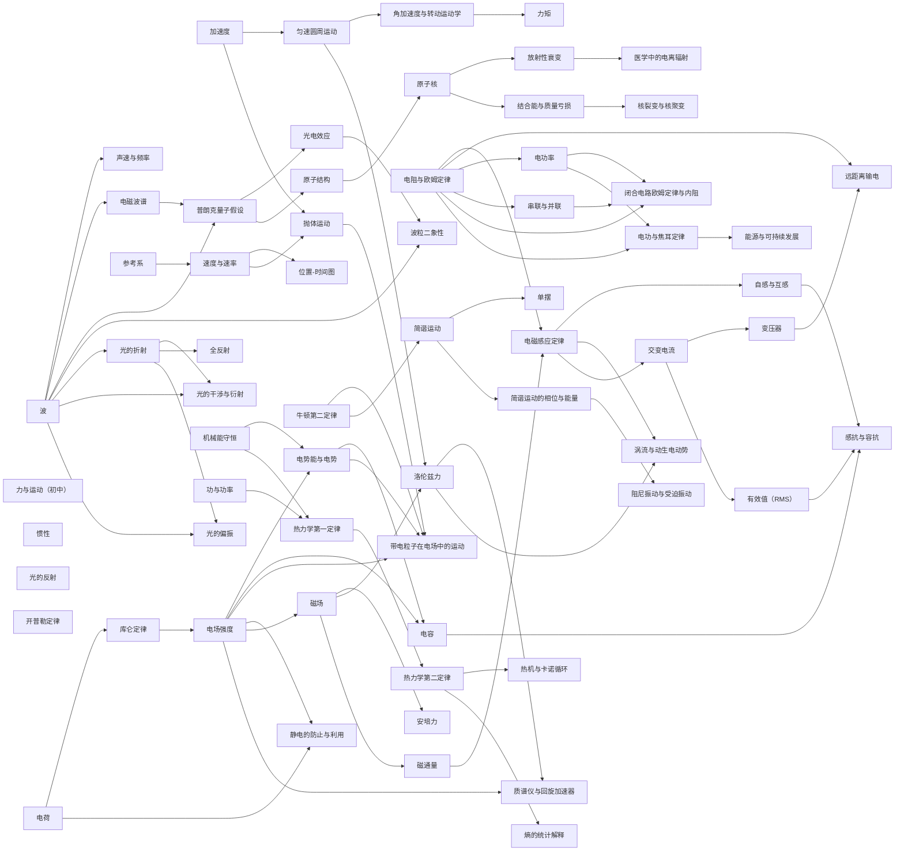
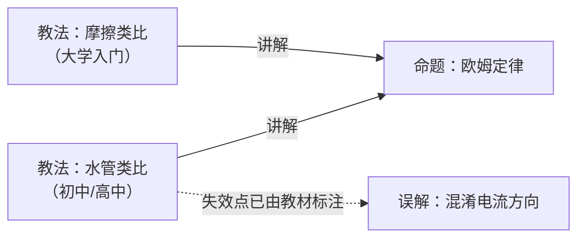

# 物理

> **English: [README.en.md](README.en.md)**

## 知识点（概念节点 · 先修关系的载体）



| 知识点 | 学段 | 先修 | 挂在其下的教法 | 误解 |
|---|---|---|---|---|
| [力与运动（初中）](concepts/力与运动-初中.md) | **初中** | — | 现象探究循环 | — |
| [波](concepts/波.md) | 高中 | — | BL · OL 共 2 条 | 波把物质一起推走 |
| [惯性](concepts/惯性.md) | 高中 | **力（高中）**（与**初中**那一节的关系仍是进阶，非先修） | BL · AL 共 2 条 | 运动物体自然慢下来 |
| [力（高中）](concepts/力-高中.md) | 高中 | —（**前置是「矢量」，归数学，库里还没有**） | OL · AL 共 2 条 | — |
| [牛顿第二定律](concepts/牛顿第二定律.md) | 高中 | **惯性** | OL · AL 共 2 条 | —（教材点名的「重量 vs g」**本库未建**） |
| [牛顿第三定律](concepts/牛顿第三定律.md) | 高中 | **牛顿第二定律** | OL · AL 共 2 条 | —（同上） |
| [参考系](concepts/参考系.md) | 高中 | — | BL · OL · AL 共 3 条 | 参考系当成背景 |
| [速度与速率](concepts/速度与速率.md) | 高中 | 参考系 | BL/OL · AL 共 2 条 | — |
| [位置-时间图](concepts/位置-时间图.md) | 高中 | 速度与速率 | BL/OL · AL 共 2 条 | — |
| [加速度](concepts/加速度.md) | 高中 | **速度与速率** | OL · AL 共 2 条 | — |
| [抛体运动](concepts/抛体运动.md) | 高中 | **速度与速率** · **加速度**（正交分解本身归数学，库里没有） | — | — |
| [简谐运动](concepts/简谐运动.md) | 高中 | **牛顿第二定律**（回复力经 `a = F/m` 决定运动） | — | — |
| [单摆](concepts/单摆.md) | 高中 | **简谐运动** · **力（高中）**（重力的分解） | — | — |
| [简谐运动的相位与能量](concepts/简谐运动的相位与能量.md) | 高中 | **简谐运动**（`F = −kx`、`T = 2π√(m/k)`） | — | — |
| [阻尼振动与受迫振动](concepts/阻尼振动与受迫振动.md) | 高中 | **简谐运动的相位与能量**（能量耗散与共振的基准） | — | — |
| [电功率](concepts/电功率.md) | 高中 | **电阻与欧姆定律**（`P = V²/R`、`P = I²R` 由 `V = IR` 代入） | — | — |
| [串联与并联](concepts/串联与并联.md) | 高中 | **电阻与欧姆定律**（各电阻上的 `V = IR` 与等效电阻的定义） | — | — |
| [闭合电路欧姆定律与内阻](concepts/闭合电路欧姆定律与内阻.md) | 高中 | **电阻与欧姆定律** · **串联与并联** · **电功率** | — | — |
| [电功与焦耳定律](concepts/电功与焦耳定律.md) | 高中 | **电功率** · **电阻与欧姆定律** | — | — |
| [能源与可持续发展](concepts/能源与可持续发展.md) | 高中 | **电功与焦耳定律** | — | — |
| [光的反射](concepts/光的反射.md) | 高中 | —（前置是**初中几何**，不归物理） | BL · AL 共 2 条 | — |
| [声速与频率](concepts/声速与频率.md) | 高中 | **波** | BL · AL 共 2 条 | — |
| [机械能守恒](concepts/机械能守恒.md) | 高中 | — | BL · OL 共 2 条 | 运动物体自然慢下来 |
| [电磁波谱](concepts/电磁波谱.md) | 高中 | **波** | BL · OL/AL 共 2 条 | 可见光与不可见辐射有本质不同 |
| [普朗克量子假设](concepts/普朗克量子假设.md) | 高中 | **波** · **电磁波谱** | — | — |
| [光电效应](concepts/光电效应.md) | 高中 | **普朗克量子假设** | — | — |
| [波粒二象性](concepts/波粒二象性.md) | 高中 | **光电效应** · **波** | — | — |
| [开普勒定律](concepts/开普勒定律.md) | 高中 | — | OL · AL 共 2 条 | — |
| [万有引力定律](concepts/万有引力定律.md) | 高中 | **开普勒定律** | OL · AL 共 2 条 | 混淆 G 与 g |
| [原子结构](concepts/原子结构.md) | 高中 | **普朗克量子假设**（能量量子化；2026-10-21 接上） | OL 共 3 条 | — |
| [功与功率](concepts/功与功率.md) | 高中 | —（与机械能守恒的关系**尚未定**） | OL · AL 共 2 条 | — |
| [光的折射](concepts/光的折射.md) | 初中 / 高中 | **波** | BL · OL · AL 共 3 条 | — |
| [全反射](concepts/全反射.md) | 高中 | **光的折射** | — | — |
| [光的干涉与衍射](concepts/光的干涉与衍射.md) | 高中 | **波** · **光的折射** | — | — |
| [光的偏振](concepts/光的偏振.md) | 高中 | **波** · **光的折射**（布儒斯特定律用 `n`） | — | — |
| [动量和冲量](concepts/动量和冲量.md) | 高中 | **牛顿第二定律** | AL 共 1 条 | — |
| [动量守恒定律](concepts/动量守恒定律.md) | 高中 | **动量和冲量** | OL · AL 共 2 条 | — |
| [弹性碰撞与非弹性碰撞](concepts/弹性碰撞与非弹性碰撞.md) | 高中 | **动量守恒定律** · **机械能守恒** | — | — |
| [电阻与欧姆定律](concepts/电阻与欧姆定律.md) | 初中至高中 | — | 水管类比 · 摩擦类比 共 2 条 | 混淆电流方向 |
| [匀速圆周运动](concepts/匀速圆周运动.md) | 高中 | **加速度**（「速度变化」含方向变化） | 剪断绳子 · 共 1 条 | 离心力是一个真实的力 |
| [角加速度与转动运动学](concepts/角加速度与转动运动学.md) | 高中 | **加速度** · **匀速圆周运动**（`ω` 不再恒定） | — | — |
| [力矩](concepts/力矩.md) | 高中 | **力（高中）** · **角加速度与转动运动学**（依据是定义句与节内位置——见条目 K1） | — | — |
| [电荷](concepts/电荷.md) | 高中 | —（本章入口；「万有引力」「矢量」是复习提示，非先修） | — | — |
| [库仑定律](concepts/库仑定律.md) | 高中 | **电荷**（教材未写「Review electric charge」，依据是定律定义——见条目 K1） | — | — |
| [电场强度](concepts/电场强度.md) | 高中 | **库仑定律** | — | — |
| [电势能与电势](concepts/电势能与电势.md) | 高中 | **电场强度** · **机械能守恒**（势能只在差值上记账） | — | — |
| [电容](concepts/电容.md) | 高中 | **电势能与电势** · **电场强度**（`C = Q/V` 与匀强场 `E = V/d`） | — | — |
| [带电粒子在电场中的运动](concepts/带电粒子在电场中的运动.md) | 高中 | **电势能与电势** · **电场强度** · **抛体运动** · **牛顿第二定律** | — | — |
| [静电的防止与利用](concepts/静电的防止与利用.md) | 高中 | **电场强度** · **电荷** | — | — |
| [热力学第一定律](concepts/热力学第一定律.md) | 高中 | **功与功率** · **机械能守恒**（`W = PΔV` 与能量记账） | — | — |
| [热力学第二定律](concepts/热力学第二定律.md) | 高中 | **热力学第一定律** | — | — |
| [热机与卡诺循环](concepts/热机与卡诺循环.md) | 高中 | **热力学第一定律** · **热力学第二定律**（循环 `ΔU = 0`；第二定律的第二种表述） | — | — |
| [熵的统计解释](concepts/熵的统计解释.md) | 高中 | **热力学第二定律**（`ΔS = Q/T` 与自发方向；本条给它微观基础） | — | — |
| [原子核](concepts/原子核.md) | 高中 | **原子结构** | — | — |
| [放射性衰变](concepts/放射性衰变.md) | 高中 | **原子核** | — | — |
| [结合能与质量亏损](concepts/结合能与质量亏损.md) | 高中 | **原子核**（核素记号与质量数；`E = (Δm)c²`） | — | — |
| [核裂变与核聚变](concepts/核裂变与核聚变.md) | 高中 | **结合能与质量亏损** · **原子核**（铁峰与 `A`、`Z` 记账） | — | — |
| [医学中的电离辐射](concepts/医学中的电离辐射.md) | 高中 | **放射性衰变**（半衰期、活度与 β⁺ 湮没） | — | — |
| [磁场](concepts/磁场.md) | 高中 | **电场强度**（教材以电场类比引出磁场） | — | — |
| [安培力](concepts/安培力.md) | 高中 | **磁场** | — | — |
| [洛伦兹力](concepts/洛伦兹力.md) | 高中 | **磁场** · **匀速圆周运动**（垂直于速度的恒力 ⇒ 匀速圆周运动） | — | — |
| [质谱仪与回旋加速器](concepts/质谱仪与回旋加速器.md) | 高中 | **洛伦兹力** · **电场强度**（速度选择器的 `qE`；回旋加速器的 `T` 与 `r`） | — | — |
| [磁通量](concepts/磁通量.md) | 高中 | **磁场** | — | — |
| [电磁感应定律](concepts/电磁感应定律.md) | 高中 | **磁通量** · **电阻与欧姆定律**（`I = ε/R`） | — | — |
| [自感与互感](concepts/自感与互感.md) | 高中 | **电磁感应定律**（`ε = −NΔΦ/Δt`、楞次定律） | — | — |
| [涡流与动生电动势](concepts/涡流与动生电动势.md) | 高中 | **电磁感应定律** · **洛伦兹力**（`F = qvB`） | — | — |
| [交变电流](concepts/交变电流.md) | 高中 | **电磁感应定律** · **匀速圆周运动**（`ω`、`v = rω`、`T = 2π/ω`） | — | — |
| [有效值（RMS）](concepts/有效值.md) | 高中 | **交变电流**（正弦式 `V = V0 sin 2πft`、峰值与频率） | — | — |
| [感抗与容抗](concepts/感抗与容抗.md) | 高中 | **交变电流** · **有效值（RMS）** · **自感与互感** · **电容**（`X_L = 2πfL`、`X_C = 1/(2πfC)`） | — | — |
| [变压器](concepts/变压器.md) | 高中 | **电磁感应定律** · **交变电流**（必须有变化的磁通） | — | — |
| [远距离输电](concepts/远距离输电.md) | 高中 | **变压器** · **电阻与欧姆定律**（`P_loss = I²R_wire`） | — | — |

> [!IMPORTANT]
> **第 34 批（2026-10-21）补上有效值（RMS）、感抗与容抗——优先清单第 8 项的两块完成，选必二第 3 章「交变电流」仍差三相电，保持 🟡。**
>
> ```
> 交变电流 → 有效值（RMS） → 感抗与容抗 ← 自感与互感
>                                        ← 电容
> ```
>
> 「有效值（RMS）」讲 `V = V0 sin 2πft`、`P_ave = ½I0V0`、`I_rms = I0/√2`、`V_rms = V0/√2`、
> `P_ave = I_rmsV_rms = I_rms²R = V_rms²/R`、纯电阻的峰值功率 `P0 = 2P_ave`，以及用有效值算输电损耗；
> `√2` 的均方根推导、平均值与有效值的区别由本库补写。
> 「感抗与容抗」讲 `X_L = 2πfL`、`X_C = 1/(2πfC)`、电感电压超前 90°、电容电压滞后 90°、
> 串联 RLC 的 `Z = √(R² + (X_L − X_C)²)`、`f0 = 1/(2π√(LC))`、`cosφ = R/Z` 与 `P_ave = I_rmsV_rms cosφ`；
> `X_L`／`X_C` 的微积分推导与相位超前／滞后判据由本库补写。
> 复算：`170 V`、`P0 = 120 W`、`500 A`、`250 kW`、`0.250%`、`4000 A`、`16.0 MW`、`16.0%`；
> `X_L(60) = 1.131 Ω`、`X_L(10⁴) = 188.5 Ω`、`X_C(60) = 530.5 Ω`、`X_C(10⁴) = 3.183 Ω`、
> `Z(60) = 530.9 Ω`、`Z(10⁴) = 189.6 Ω`、`f0 = 1.2995 kHz`、`cosφ = 0.07535`、`φ = 85.68°`、
> `P(60) = 2.043 W`、`P_res = 360 W`。
>
> **来源**：OpenStax《College Physics 2e》第 20 章 `m42348`（Alternating Current versus Direct Current）
> 与第 23 章 `m42427`（Reactance, Inductive and Capacitive）、`m42431`（RLC Series AC Circuits），
> 三模块都通读了 cnxml 源文件；许可按仓库的 **CC BY-NC-SA 4.0** 从严处理（openstax.org 同书页面标 CC BY 4.0），
> 只引用定位与短引用（ev-194/ev-195）。
>
> **原文缺陷**：`m42348` 把 `average` 与 `rms` 混用、`√2` 无推导、「AC 电击更危险」无引用；
> `m42427` 把电抗叫 `effective resistance`、`X_L ∝ f` 的解释把频率与变化率混为一谈；
> `m42431` 的 `7.50 Hz` 习题答案对应约 1.0 kHz，且 (c) 的 `26.4 W` 是视在功率而不是平均功率；
> 术语表把功率因数定义成「功率比最大值小的量」。
>
> **还缺**：三相电——**现有 CC BY 教材（CP2e 与 University Physics Vol 2）都没有对应模块**，
> 需要用户决定是否接受其他可核来源；非正弦有效值、真有效值仪表、并联交流网络、复数阻抗与相量法、
> 品质因数与通带、功率因数补偿仍记在条目缺口表。

> [!IMPORTANT]
> **第 33 批（2026-10-21）补上自感与互感、涡流与动生电动势——优先清单第 7 项完成，选必二第 2 章「电磁感应」转 🟢。**
>
> ```
> 磁通量 → 电磁感应定律 → 自感与互感
>                       ├→ 涡流与动生电动势 ← 洛伦兹力
>                       └→ 交变电流 → 变压器 → 远距离输电
> ```
>
> 「自感与互感」讲 `ε = −L ΔI/Δt`、`L = NΔΦ/ΔI`、螺线管 `L = μ0N²A/ℓ`、互感 `ε₂ = −M ΔI₁/Δt`、
> 亨利与 `E_ind = ½LI²`；「涡流与动生电动势」讲 `ε = Bℓv` 的洛伦兹力与法拉第两条路线、
> 相对运动、涡流、磁阻尼与开槽/绝缘体，以及天平、分选、探测器、制动与电磁炉。
> 复算：`0.632 mH`、`0.284 J`、`1.0×10⁴ V`、`31.25 kV / 125 kJ / 1.56 MW`、`1.97×10⁻² H`、
> `200 H` 与 `5.00 °C`；`150 μV`、`7.80 kV`、`0.630 V`、`1.44 V`、`2.22 m/s`、`1.98×10² T`、`θ = 24.2°`。
>
> **来源**：OpenStax《College Physics 2e》第 23 章的 `m42420`（Inductance）、`m42400`（Motional Emf）、
> `m42404`（Eddy Currents and Magnetic Damping），三模块都通读了 cnxml 源文件；
> 许可按仓库的 **CC BY-NC-SA 4.0** 从严处理（openstax.org 同书页面标 CC BY 4.0，两处不一致），
> 只引用定位与短引用（ev-192/ev-193）。
>
> **原文缺陷**：`m42420` 的 Section Summary 与术语表把 `inductance` 定义成互感；
> 1 H 例题把绝对值与负号混用；公式用有限差而非导数；地感线圈与金属探测器两句无引用。
> `m42400` 正文只给垂直情形的 `ε = Bℓv`，习题却要求 `Bℓv sinθ`；系绳卫星题 (a) 的 `10.0 N`
> 与 (b) 的能量对应 `78 kW`，与题给 `5.00 kV × 10.0 A = 50 kW` 相差 `1.56` 倍。
> `m42404` 术语表把涡流限定为「动生电动势引起」；电磁炉「必须铁磁性」说过头；「阻尼正比于速度」未推导。
>
> **还缺**：RL 暂态、感抗 `X_L = ωL`、电感串并联、磁能密度、互感系数的几何计算、磁芯饱和与涡流损耗的定量模型、
> 电磁驱动（异步电动机、直线电机）、涡流制动的工程设计、霍尔电压与载流子符号的定量关系；
> 有效值/RMS、电感电容对交流的影响、三相电仍记在「交变电流」的缺口表，所以第 3 章仍是 🟡
> （第 34 批已补前两项，只剩三相电）。

> [!IMPORTANT]
> **第 32 批（2026-10-21）补上简谐运动的相位与能量、阻尼振动与受迫振动——优先清单第 10 项完成，选必一第 2 章「机械振动」转 🟢。**
>
> ```
> 简谐运动 → 简谐运动的相位与能量 → 阻尼振动与受迫振动
> ```
>
> 「简谐运动的相位与能量」讲匀速圆周运动投影 `x = X cos θ`、`θ = ωt`、`ω = 2π/T`，
> 相位与初相 `φ`（本库补写）、相位差与时间差 `Δt = |Δφ|/ω`（本库补写），
> 以及 `½mv² + ½kx² = ½kX²`、`v = ±ω√(X² − x²)`、`v_max = ωX`、`a_max = ω²X`（本库补写）。
> 「阻尼振动与受迫振动」讲三种阻尼、受迫振动、固有频率与共振；
> 阻尼越小共振峰越高越窄、越大越宽越低；能量输入补偿耗散时受迫振动可等幅。
> 复算：`v_max = 0.852 m/s`、`E = 19.74 J`、`x/X = √3/2`、`d = 1.59 m`、每周期 3% 振幅损失对应 `≈5.9%` 能量损失、
> `384 J`、`5.00×10⁵ J` 与 `1.20×10³ s`、悬挂 `141 J`。
>
> **来源**：OpenStax《College Physics 2e》第 16 章 Oscillatory Motion and Waves 的
> `m42244`（Energy and the Simple Harmonic Oscillator）、`m42245`（Uniform Circular Motion and Simple Harmonic Motion）、
> `m42246`（Damped Harmonic Motion）、`m42247`（Forced Oscillations and Resonance），四个模块都通读了 cnxml 源文件；
> 许可按仓库的 **CC BY-NC-SA 4.0** 从严处理（openstax.org 同书页面标 CC BY 4.0，两处不一致），
> 只引用定位与短引用（ev-190/ev-191）。
>
> **原文缺陷**：`m42244` 与 `m42245` 只有初相为零的余弦式，没有相位差与时间差；单摆能量式的 `ω` 是角速度 `dθ/dt`，
> 与圆运动式的角频率 `2π/T` 同符号不同义；AP 题把 `½kX²` 叫 `internal energy`；Section Summary 把 `v_max` 排成 `Xkm`。
> `m42246` 正文说临界阻尼 `may overshoot ... only once`，图注与术语表却说 `without overshooting`；
> 正文说欠阻尼「更快回到平衡」，与临界阻尼「最快」的定义冲突；AP 题答案 `1.698 m` 与教材自己的公式 `3.40 m` 相差约 2 倍。
> 塔科马桥的「风以共振频率驱动」因果叙述本库未核实，不当作已证事实。
>
> **还缺**：相位差的实验测量（李萨如图形）、不同频率的合成（拍）、阻尼方程与指数衰减时间常数、品质因数 `Q`、
> 共振曲线的定量公式与半高宽、受迫振动的相位滞后、塔科马桥工程调查原始报告；
> 单摆的大角度周期修正、圆锥摆、复摆仍记在「单摆」条目的缺口表。

> [!IMPORTANT]
> **第 31 批（2026-10-21）补上医学中的电离辐射——优先清单第 6 项完成，选必三第 5 章「原子核」转 🟢。**
>
> ```
> 放射性衰变 → 医学中的电离辐射
> ```
>
> 「医学中的电离辐射」讲示踪与放射性药物、`99mTc` 的 `0.142 MeV` γ 与 `6.0 h` 半衰期、
> γ 相机 / SPECT / PET（β⁺ 湮没的两个 `0.511 MeV` 反向光子与符合探测）、
> 吸收剂量 `Gy` 与等效剂量 `Sv`（`H = D × RBE`）、本底与诊断剂量、放疗的治疗比与几何汇聚、以及屏蔽/距离/时间防护。
> 一次腹部 CT 相当于约 `3.6` 年本底、一张胸片约 `2.6` 天、`50–80 Sv` 按每次 `2 Sv` 折合 `25–40` 次，
> 以及 `0.75 Sv` 对 `15 mSv` 的 `50` 倍差距，都是本库复算。
>
> **来源**：OpenStax《College Physics 2e》第 32 章 Medical Applications of Nuclear Physics 的
> `m42649`（Diagnostics and Medical Imaging）、`m42652`（Biological Effects of Ionizing Radiation）、
> `m42654`（Therapeutic Uses of Ionizing Radiation），三个模块都通读了 cnxml 源文件；
> 许可按仓库的 **CC BY-NC-SA 4.0** 从严处理（openstax.org 页面标 CC BY 4.0，两处不一致），
> 只引用定位与短引用（ev-187/ev-188/ev-189）。
>
> **原文缺陷**：m42654 把前列腺籽源写成 `135I`（6 个月）与 `103Pd`（3 个月），这组同位素/半衰期配对无法由已核材料内部核实，
> 本条不采用；m42652 正文说「每张牙片约 5 mSv」而同一模块的表写 `0.01 mSv`，相差约 500 倍；
> 低剂量「小于 100 mSv」与中剂量「从 0.1 Sv 起」在边界重叠；`80+ Sv` 的一列没有说明分次与局部；
> 「200 rem」与 Gy 混用；m42649 把湮没能量说成来自「一个电子或正电子质量」，实际是两个静质量。
>
> **还缺**：X 射线的产生（轫致辐射与特征 X 射线）、放射免疫分析的定量、MRI 的自旋/弛豫/梯度编码、
> 放射生物学机制与修复动力学、具体治疗方案与剂量分割、核事故与应急、食品辐照、医用同位素生产与放射性废物；
> 粒子与宇宙（标准模型）不在本页的章级清单里，仍记在「原子核」「结合能与质量亏损」条目的缺口表。

> [!IMPORTANT]
> **第 30 批（2026-10-21）补上结合能与质量亏损、核裂变与核聚变——优先清单第 6 项大部分完成，选必三第 5 章「原子核」仍为 🟡（医学应用缺）。**
>
> ```
> 原子核 → 结合能与质量亏损 → 核裂变与核聚变
> 原子核 → 核裂变与核聚变
> ```
>
> 「结合能与质量亏损」讲 `BE = Δm c²`、中性原子质量公式、α 粒子的 `0.030378 u → 28.3 MeV → 7.07 MeV/核子`、
> `BE/A` 曲线与铁峰，以及重核为什么需要更多中子；`Q = ΔBE` 的反应能记账与两位小数复算是本库补写。
> 「核裂变与核聚变」讲液滴模型、链式反应与临界质量、每次裂变 `200 MeV`（`0.2147 u`、`0.091%`）、
> 太阳 p-p 链 `26.7 MeV`（`0.711%`）、D-T `17.6 MeV`、库仑势垒与量子隧穿，以及铁峰两侧的放能方向；
> `k` 因子、每克聚变约为裂变的 `4.1` 倍、`1.5×10⁷ K` 对应约 `1.3 keV` 的平均热动能均为本库复算。
>
> **来源**：OpenStax《Physics》第 22 章 `m54574`（Nuclear Fission and Fusion，CC BY 4.0，ev-185）；
> OpenStax《College Physics 2e》第 31 章 `m42640`（Binding Energy，许可按仓库的 CC BY-NC-SA 4.0 从严处理，ev-186）。
> 两个模块都通读了 cnxml 源文件，条目只引用定位与短引用。
>
> **原文缺陷**：m54574 正文把裂变写成 `the splitting of an atomic bond`，与术语表矛盾；Section Summary 把聚变放能
> 说成「强核力减小」，与正文的 `BE/A` 解释冲突；每克 `3 到 4 倍` 按 D-T 复算约 `4.1` 倍；压水堆的「水烧干即停堆」
> 只适用于负空泡系数堆型；聚变堆一节带宣传口吻且引用不全。m42640 把「`BE/A` 越大越稳定」当充分条件；
> 「最常见元素结合最紧」忽略氢；β⁺ 的电子补偿写 `0.511 MeV`，按原子质量应为 `1.022 MeV`（已对照 `m42633`
> 的 `Δm=m(parent)−[m(daughter)+2m_e]` 核实）。
>
> **还缺**：医学应用（本章剩余的缺口）、反应堆中子动力学与临界计算、裂变产物产额与衰变热、增殖堆与后处理、
> 惯性约束聚变与点火、托卡马克约束的定量、聚变 `Q` 值、核武器物理、核壳层模型与半经验质量公式、天体核合成。

> [!IMPORTANT]
> **第 29 批（2026-10-21）补上热机、卡诺循环与熵的统计解释——优先清单第 5 项完成，选必三第 3 章「热力学定律」转 🟢。**
>
> ```
> 热力学第二定律 → 热机与卡诺循环
> 热力学第二定律 → 熵的统计解释
> ```
>
> 「热机与卡诺循环」讲循环过程 `W = Q_h − Q_c`、效率 `Eff = 1 − Q_c/Q_h`、
> 第二定律的第二种表述、奥托循环的 `P–V` 图，以及卡诺循环与 `Eff_C = 1 − T_c/T_h`；
> 燃煤电厂的 40.8% / 1180 MW / 3.7×10⁸ kg CO₂ 与压水堆的 47.6% 均已复算。
> 「熵的统计解释」讲宏观态与微观态、等概率假设、5 枚与 100 枚硬币、气体例子，
> 以及 `S = k ln W` 与 `ΔS = k ln(W_f/W_i)`；第二定律因此是统计规律，不是绝对禁令。
>
> **来源**：CP2e 第 15 章 `m42234`（Heat Engines and Their Efficiency）、
> `m42235`（Carnot's Perfect Heat Engine）、`m42238`（Statistical Interpretation of Entropy），
> 许可按仓库的 **CC BY-NC-SA 4.0** 从严处理，只引用定位与短引用（ev-183/ev-184）。
>
> **本库补写**：卡诺比值 `Q_c/Q_h = T_c/T_h` 由可逆循环的熵守恒推出（教材只给结论）；
> `ΔS = k ln(W_f/W_i)`、概率归一化 `P = W/Ω` 与「熵减概率约 `e^(−ΔS/k)`」也是本库补的。
>
> **原文缺陷**：5 枚硬币表把「3 正 2 反」的 5 个微观态重复了一遍（计数 10 正确）；
> `this expression for s` 用小写 s；「反向熵减约 1/90」是 60/40 宏观态的绝对概率，不是 `W_60/W_50`；
> 「`ΔS` 为 `10^-21 J/K` 对应 1/10^30」按复算约为 1/3×10^31；「所有 Q 都是正的……Qc 前面带负号」自相矛盾；
> 喝水鸟不是卡诺热机；「史上最高约 70%」没有来源。
>
> **还缺**：热泵与制冷机的 COP、实际循环（柴油/朗肯/布雷顿）的定量、卡诺定理的严格证明、
> 奥托循环的压缩比公式、自由能、`S = k ln W` 与 `ΔS = Q/T` 的等价性证明。

> [!IMPORTANT]
> **第 28 批（2026-10-21）补上质谱仪与回旋加速器——优先清单第 22 项完成，选必二第 1 章「安培力与洛伦兹力」转 🟢。**
>
> ```
> 洛伦兹力 → 质谱仪与回旋加速器
> 电场强度 → 质谱仪与回旋加速器
> ```
>
> 「质谱仪与回旋加速器」讲交叉场速度选择器（`qE = qvB` ⇒ `v = E/B`，与 `q`、`m`、电荷符号都无关）、
> 质谱仪的三段结构（离子源 → 速度选择器 → 均匀磁场）与 `r ∝ m`（严格说是质荷比）、
> 回旋加速器的 D 形盒与固定频率（`T = 2πm/(qB)`、`f = qB/(2πm)`），
> 以及同步加速器为什么要同时调频调场。教材的氧-16/氧-18 分离 `0.173 m` 与质子回旋频率 `18.3 MHz`
> 均已复算。`K_max = q²B²R²/(2m)`、`r = (m/q)(E/B²)`、同位素分离 `2Δr` 与相对论失步的推理
> 是本库补写，记在 K2/K3。顺带修正「洛伦兹力」中把周期列为缺口的旧记录——周期在 K2 已经推导。
>
> **来源**：CP2e 第 22 章 `m42375`（Force on a Moving Charge in a Magnetic Field）与 `m42388`
> （More Applications of Magnetism）、第 28 章 `m42718`（Accelerators Create Matter from Energy），
> 许可按仓库的 **CC BY-NC-SA 4.0** 从严处理，只引用定位与短引用（ev-182）。
>
> **Source defects recorded**: m42718 calls Van de Graaff a "Dutch physicist" (he was American, born in
> Tuscaloosa, Alabama); its AP answer `(c)` does not match its own explanation; m42388's Critical Thinking
> answer uses `9.11×10⁻¹¹ kg` for the electron mass instead of `9.11×10⁻³¹ kg`, so its radius and time
> have the wrong exponents; m42718's LHC figures date from around 2010.
>
> **还缺**：相对论性回旋加速器（同步回旋加速器）的定量、束流聚焦与发射度、RF 腔与超导磁体的工程、
> MRI/NMR 的定量、CRT 磁偏转的定量、霍尔效应与 MHD 发电机记在条目缺口表。

> [!IMPORTANT]
> **第 27 批（2026-10-21）补上静电的防止与利用——优先清单第 21 项完成，必修三第 9 章「静电场及其应用」转 🟢。**
>
> ```
> 电荷 → 静电的防止与利用
> 电场强度 → 静电的防止与利用
> ```
>
> 「静电的防止与利用」讲静电平衡导体的三条性质（内部场强为零、表面外侧场强垂直、多余电荷全在表面）、
> 法拉第笼与汽车屏蔽、尖端放电与避雷针（空气击穿场强 `3×10⁶ N/C`）、高压线的光滑表面，
> 以及静电除尘（去除 99% 以上颗粒）、静电复印/激光打印、静电喷漆、喷墨打印与范德格拉夫起电机；
> 防止的一侧讲接地、屏蔽、避免场集中与湿度。教材的利用清单按应用逐个叙述，
> 「用场」与「防场」的二分法是本库的整理，记在条目 K3。
>
> **来源**：CP2e 第 18 章 `m42317`（Conductors and Electric Fields in Static Equilibrium）与 `m42329`
> （Applications of Electrostatics），许可按仓库的 **CC BY-NC-SA 4.0** 从严处理，只引用定位与短引用（ev-181）。
>
> **Source defects recorded**: m42317 has the sentence `Air ionizes ions and electrons recombine`
> (punctuation missing in the original); the exercise sets of m42317 and m42329 are almost entirely
> point-charge field-and-force problems, with little connection to conductors, shielding or applications.
>
> **还缺**：表面电荷密度与曲率的定量关系、导体表面外侧 `E = σ/ε₀`、空腔内有电荷时的接地处理、
> 雷击先导与保护角、人体静电放电模型、交变场下的屏蔽（趋肤效应）记在条目缺口表。

> [!IMPORTANT]
> **第 26 批（2026-10-21）补上能源与可持续发展——优先清单第 20 项完成，「电能与能源」转 🟢。**
>
> ```
> 电功与焦耳定律 → 能源与可持续发展
> ```
>
> 「能源与可持续发展」讲可再生与不可再生能源（水、风、太阳、生物质 vs 石油、天然气、煤）、
> 2020 年世界能源结构（557.1 EJ，化石 83.1%、石油 31.3%、可再生 12.6%、核能 4.3%）、
> 世界能源消费的增长与国别例子（美国、德国、新西兰、中国、印度）、能源与人均 GDP 的定性关系，
> 以及**能量守恒定律与「节能」的区别**：能量守恒说的是孤立系统总能量不变，节能说的是减少用能
> 或提高效率，理由是所有实际转换都把一部分能量降级为废热。教材的「约 85% 化石」「21% 世界石油」
> 「中国煤 2/3」与 2020 年表的 83.1%、18.7%、56.6% 不一致，按数据年份不同记在 ev-180。
>
> **来源**：CP2e 第 7 章 `m42154`（World Energy Use），许可按仓库的 **CC BY-NC-SA 4.0** 从严处理，
> 只引用定位与短引用（ev-180）。
>
> **Source defects recorded**: Egypt's coal cell reads `0.0%` in an EJ column; the table declares
> `tgroup cols="10"` with 10 colspecs but has 8 cells per row; 8 of 11 country rows do not sum to
> their totals (Russia 0.4 EJ off); the prose's "10% of U.S. electricity" and the Section Summary's
> "10% of its energy" are different quantities, and the 2020 table's 10.0% is total energy; the
> prose calls U.S. renewables "primarily hydro" although other renewables exceed hydro in the 2020
> table; one figure is dated 2006 while the table is 2020; most exercises are work-and-energy
> problems unrelated to the section.
>
> **还缺**：光伏/风电/核电的技术细节、碳排放定量核算、中国能源政策与课程标准原文、能源统计口径
> 与年份的统一、储能与电网调度记在条目缺口表。

> [!IMPORTANT]
> **第 25 批（2026-10-21）补上电功与焦耳定律——优先清单第 19 项完成。**
>
> ```
> 电功率 → 电功与焦耳定律
> 电阻与欧姆定律 → 电功与焦耳定律
> ```
>
> 「电功与焦耳定律」讲电功 `W = qU = UIt = Pt`、焦耳定律 `Q = I²Rt`、纯电阻电路
> `W = Q = UIt = I²Rt = U²t/R`、非纯电阻电路 `W = Q + E_其他`（电动机、电解槽；
> 教材未讨论，本条只作适用范围说明）、千瓦时与电费核算。**焦耳定律的名称与 `W = Q`
> 的合并由本库补写**，教材只给 `P = I²R` 与 `E = Pt`；车头灯热态 `30.0 W`、冷态
> `411 W` 与 `34.3 A`、延长线 `1.50 W` 与 `7.50 W`、CFL 算例 `$7.45` 与 `$1.95`
> 均已复核。
>
> **来源**：CP2e 第 20 章 `m42714`（Electric Power and Energy），许可按仓库的
> **CC BY-NC-SA 4.0** 从严处理，只引用定位与短引用（ev-179）。
>
> **Source defects recorded**: the 00-gauge wire exercise (9.266 mm, 1 km, 100 A) credits
> `25.5 W`, but `R ≈ 0.255 Ω` gives about `2.55×10³ W` — the answer corresponds to 10 A and is
> off by 100×; the maximum-CFL-price exercise credits `$6.25`, which is the incandescent total,
> while the CFL purchase price should be `$4.75`; the prose writes `1 kA · V = 1 kW` instead of
> `1 kV · A`; the exercises section is titled `Problem Exercises` (missing `&`); several
> exercises give stems only.
>
> **还缺**：能源与可持续发展，所以必修三「电能与能源」仍是 🟡；非纯电阻电路的定量功率分配、
> 交流有效值与功率因数、电容与电感的储能及无功功率、电价机制记在条目缺口表。

> [!IMPORTANT]
> **第 24 批（2026-10-21）补上闭合电路欧姆定律与内阻——优先清单第 18 项完成。**
>
> ```
> 电阻与欧姆定律 → 闭合电路欧姆定律与内阻
> 串联与并联 → 闭合电路欧姆定律与内阻
> 电功率 → 闭合电路欧姆定律与内阻
> ```
>
> 「闭合电路欧姆定律与内阻」讲电动势（无电流时两极间的电势差，不是力）、内阻 `r`、端电压
> `V = emf − Ir`、闭合电路 `I = emf/(R+r)`、`emf = IR + Ir`、路端电压随外电阻变化、短路电流
> `emf/r`、充电时端电压高于电动势（12.0 V 电池以 8.00 A 充电、端电压 15.0 V → `r = 0.375 Ω`），
> 以及相同电源的串联与并联。**输出功率在 `R = r` 时最大、效率 50% 这一结论由本库推导**，教材未给；
> 电鳗例子按 `0.15 × 5000 = 750 V` 计算，教材的「约 600 V」与其自身数据不符（ev-178）。
>
> **来源**：CP2e 第 21 章 `m42357`（Electromotive Force: Terminal Voltage），许可按仓库的
> **CC BY-NC-SA 4.0** 从严处理，只引用定位与短引用（ev-178）。
>
> **Source defects recorded**: the eel passage's 140×5,000 cells of 0.15 V are said to give
> "approximately 600 V", but each row gives 750 V and the parallel combination still 750 V; the paired
> exercise with 800 Ω of water gives about 0.93 A rather than the prose's 1 A and has no answer; the
> exercises section is titled `Problem Exercises` (missing `&`); the second Unreasonable Results item has
> no answer; several exercises give stems only.
>
> **还缺**：电功与焦耳定律、能源与可持续发展，所以必修三「电能与能源」仍是 🟡；非纯电阻电路
> （电动机）、电容暂态、内阻的温度/老化模型、基尔霍夫一般网络记在条目缺口表。

> [!IMPORTANT]
> **第 23 批（2026-10-21）补上带电粒子在电场中的运动——优先清单第 17 项完成，必修三「静电场中的能量」转 🟢。**
>
> ```
> 电势能与电势 → 带电粒子在电场中的运动
> 电场强度 → 带电粒子在电场中的运动
> 抛体运动 → 带电粒子在电场中的运动
> 牛顿第二定律 → 带电粒子在电场中的运动
> ```
>
> 「带电粒子在电场中的运动」讲匀强场的 `E = U/d` 与 `F = qE`、从静止加速的 `|q|U = ½mv²`
> （100 V 电子 `5.93×10⁶ m/s`）、电子伏特与双电荷离子的 `200 eV`、垂直于场射入的类平抛偏转
> `y = qUL²/(2mdv₀²)` 与 `tan θ = 2y/L`，以及示波管。**非匀强场、相对论修正的定量处理、
> 示波管的完整结构、边缘场、束流聚焦、加速器原理仍缺**，记在条目的缺口表里。
>
> **来源怎么用**：`m42324` 提供加速与电子伏特，`m42326` 提供 `E = V_AB/d`、电子枪与一条隐藏的
> 抛体类比；**OpenStax 没有给出横向偏转公式**，本条按抛体运动与牛顿第二定律自行推导，并在条目里
> 写明「不是教材原文」。两段材料都在《College Physics 2e》合集里，许可按仓库的 **CC BY-NC-SA 4.0**
> 从严处理，只引用定位与短引用（ev-176/ev-177）。
>
> **Source defects recorded**: m42326's isoline item ("six lines spaced 5.0 V apart cross a 40 cm path")
> credits `75 V/m`, but six lines enclose five intervals (ΔV = 25 V), so the literal stem gives `62.5 V/m`
> and none of the options matches; a hidden Test Prep item says a fourfold range means "100% more mass",
> whereas fixed transverse deflection gives `x ∝ √m`, so it is 16× the mass (1500% more); the answer to the
> dropped-particle item depends on a figure absent from the cnxml; `800 KeV` is mis-capitalized; m42324
> substitutes `q = −1.60×10⁻¹⁹ C` and `V = −100 J/C` together into `√(2qV/m)` (correct value, misleading
> signs) and gives no answer for the 40 kV exercise. The entry does not carry these over.
>
> **Correction (2026-10-21)**: two earlier claims — `Section SummaryThe voltage` / `Section SummaryElectric
> potential` lacking a space, and `in to move` / `in into` being redundant — are **not source defects**. The
> raw cnxml has `<title>Section Summary</title>` as a separate element and contains neither `in to move` nor
> `in into`; both are artifacts of the local strip script concatenating elements. The claims are removed
> from ev-176/ev-177 and from this note.

> [!IMPORTANT]
> **第 22 批（2026-10-21）补上电容——优先清单第 16 项完成，但必修三「静电场中的能量」仍是 🟡。**
>
> ```
> 电势能与电势 → 电容
> 电场强度 → 电容
> ```
>
> 「电容」讲电容器的充电过程（克服已上板的电荷做功，能量储存在板间电场）、`C = Q/V` 与法拉、
> 真空平行板的 `C₀ = ε₀A/d`（8.9 nF 与 `Q = 2.7×10⁻⁵ C` 两个算例）、电介质的极化与 `C = κC₀`、
> `κ` 表（特氟龙 2.1 · 纸 3.7 · 水 80 · 钛酸锶 233）、储能 `U = ½CV² = Q²/(2C)`，以及闪光灯
> `1.0 J` / `1 kW` 算例。**带电粒子在电场中的运动、电容器的串并联、RC 充放电暂态、击穿与漏电、
> 边缘效应、能量密度 `u = ½ε₀E²`、电介质极化的微观模型、超级电容器与电容式传感器仍缺**，
> 记在条目的缺口表里。
>
> **为什么本章仍是 🟡**：「静电场中的能量」只剩**带电粒子在电场中的运动**未建；本条补的是电容与
> 电容器的储能，不等于整章完成。优先清单据此新增第 17 项。
>
> **Source defects recorded**: m63179's definition sentence drops a preposition (`can store energy an electric
> field`); its 10 µF / 120 µC example prints `72 mJ` where `U = Q²/(2C) = 0.72 mJ` (100× too large); one
> capacitance multiple-choice item labels the options `nC` instead of `nF` (the correct value is `2.3 nF`); the
> dielectric-energy Concept Item and two true/false items never state whether the battery stays connected, although
> the answer reverses between fixed `Q` and fixed `V`; the 12 µF plate-attraction problem has no correct option
> (the force is `F = Qσ/(2ε₀) ≈ 5.9×10⁴ N`, and the offered `1.2×10⁵ N` is the missing-½ error); the κ table
> prints `Silicon oil` for `silicone oil`; a teacher note derives `di` from "two or double" and says a dielectric
> "can have two electric charges" (the prefix is Greek `dia-`, "through"); and the module's Performance Task
> compares gravitation with Coulomb's law and has nothing to do with capacitors.

> [!IMPORTANT]
> **第 21 批（2026-10-21）补上光的偏振——优先清单第 15 项完成，选必一第 4 章「光」转 🟢。**
>
> ```
> 波 → 光的偏振
> 光的折射 → 光的偏振
> ```
>
> 「光的偏振」讲偏振方向（定义为电场方向）、未偏振光与偏振片、马吕斯定律 `I = I₀cos²θ`
> （教材未写未偏振光过一片只剩一半，本条由 `cos²θ` 的平均推出 `½I₀`）、强度削减 90% 对应 71.6°、
> 布儒斯特定律 `tan θ_b = n₂/n₁`（水 53.1°、冕牌玻璃 56.7°、水→冕牌 48.8°、冕牌→水 41.2°）、
> 反射偏振与散射偏振、旋光性、双折射与二向色性、液晶显示。**圆偏振与椭圆偏振、斯托克斯参量、
> 菲涅耳反射系数的 s/p 分量、偏振度的定量、旋光性的定量、波片仍缺**，记在条目的缺口表里。
>
> **来源与许可**：本批用的是 `m42522`，属《College Physics 2e》第 27 章 Wave Optics §27.8 Polarization，
> 不在本库常用的《Physics》合集里。仓库 `LICENSE` 与 README 标 **CC BY-NC-SA 4.0**，而 openstax.org
> 同节页面标 **CC BY 4.0**，两处声明不一致；本库按仓库许可从严处理，**只引用定位与短引用**（ev-174）。
>
> **Source defects recorded**: m42522's only Critical Thinking item is a diffraction-grating problem unrelated to
> polarization; its solution takes the grating spacing as `10⁻⁶ m` where the stem gives `1.0×10⁻⁵ m`, so all four
> answers are off by a factor of ten, writes `θ = 0.400 = 23.6°` for `θ = sin⁻¹(0.400)`, and mixes in `10⁻⁶ cm`;
> the prose `The electric field is strong compared with the magnetic field` compares quantities with different units.

> [!IMPORTANT]
> **第 20 批（2026-10-21）补上全反射——优先清单第 14 项完成，但选必一第 4 章「光」没有转 🟢。**
>
> ```
> 光的折射 → 全反射
> ```
>
> 「全反射」讲临界角 `sin θ_c = n₂/n₁`（仅当 `n₁ > n₂`）、全反射的两个条件、由
> `sin θ₂ = (n₁/n₂) sin θ₁ > 1` 说明「没有折射光线」、水→空气 48.6° 与金刚石→空气 24.4°，
> 以及金刚石切工、角反射器、光纤与内窥镜。**色散与彩虹、隐失波、光纤的数值孔径与模式仍缺**，
> 记在条目的缺口表里。
>
> **为什么第 4 章仍是 🟡**：原清单把全反射当作最后一块，但本库
> [光的干涉与衍射](concepts/光的干涉与衍射.md) 的缺口表已经点名**光的偏振**未建（DIC 显微用的就是偏振光），
> 而 OpenStax 本合集没有偏振模块。为了不把「原清单跑完」说成「整章覆盖」，本章保持 🟡，
> 偏振列为优先级 15，需要另找可核的 CC BY 来源。
>
> **Source defects recorded**: m54365 prints the fixed value of the speed of light as `2.9972458×10⁸ m/s`
> (it is `2.99792458×10⁸ m/s`); misspells `indices` as `indicies` twice; the Section Summary says
> `total internal refraction`; a Key Equations cell begins with a stray `>`; and the corner-reflector passage
> treats two perpendicular mirrors as a retroreflector, which holds only for rays perpendicular to the fold line
> (a three-dimensional reflector needs three mutually perpendicular faces). The entry does not carry these over.

> [!IMPORTANT]
> **第 19 批（2026-10-21）补上光的干涉与衍射——选必一第 4 章「光」只剩全反射。**
>
> 两条先修：
>
> ```
> 波 → 光的干涉与衍射
> 光的折射 → 光的干涉与衍射
> ```
>
> 「光的干涉与衍射」讲 Huygens 原理与波前、双缝的 `d sinθ = mλ` 与 `d sinθ = (m+½)λ`、单缝暗纹
> `D sinθ = mλ` 与小角形式 `Dy/L = mλ`、`λ_n = λ/n`、光栅方程与白光的级次色散、CD 作为反射光栅、
> 圆孔衍射与 Rayleigh 判据 `θ = 1.22λ/D`，以及 `633 nm`、`1.56 μm`、`5.97°`、`7.72×10⁻⁴ rad`、
> `414 nm` 五个算例。**偏振、相干长度与相干时间、双缝强度分布的定量公式、薄膜干涉、单光子干涉的量子解释
> 仍缺**，记在条目的缺口表里。
>
> **全反射仍未建**——选必一第 4 章仍记 🟡，补完 `m54365` 后才转 🟢。
>
> **Source defects recorded**: m54371 writes "1,600 in a millimeter" for CD grooves while the same passage gives a
> 1,600 nm pitch (625 per mm); its Concept Items print the Rayleigh criterion as `θ = λ/D` without the 1.22 that
> the body text and Key Equations use; m54369's teacher note says "the sign of an angle is always ≥ 1" (the sine is
> at most 1) and misspells `lamda`; m54369 gives the visible range as 380–750 nm while m54371 gives 380–780 nm.
> The entry does not carry these over.

> [!IMPORTANT]
> **第 18 批（2026-10-21）补上波粒二象性——选必三「原子结构和波粒二象性」章转 🟢。**
>
> 这一条把光电效应的光子模型接到动量和物质波：
>
> ```
> 光电效应 → 波粒二象性
> 波 → 波粒二象性
> ```
>
> 「波粒二象性」讲光子动量 `p = h/λ`、`500 nm` 光子与同动量电子的对比（电子动能比光子能量小约五个数量级）、
> Compton 效应（能量与动量同时守恒，X 射线因波长短才显著）、干涉/衍射与分立能量的并列、
> 物质波的 `λ = h/p`，以及太阳帆、彗尾与电子显微镜。**Compton 偏移公式、电子衍射实验、
> 不确定性原理、玻尔模型与氢原子光谱的定量部分仍缺**，记在条目的缺口表里。
>
> **如实记原文缺陷**：m54552 说 Compton 获 1929 年诺贝尔物理学奖（实为 1927 年）；
> 一道习题把 de Broglie 波长写成 `p = hλ`（应为 `λ = h/p`，同模块其他位置都写对）；
> `500 nm` 例题 (c) 用 `1,456 m/s` 代入，与 (b) 的 `1,459.9 m/s` 不一致，
> 所得 `9.64×10⁻²⁵ J` 按代入值应约为 `9.66×10⁻²⁵ J`；术语表的 `either a particle or a wave`
> 与同模块教师提示「光不会选择」相冲突。条目没有沿用这些写法。

> [!IMPORTANT]
> **第 17 批（2026-10-21）开选必三「原子结构和波粒二象性」章：普朗克量子假设 · 光电效应。**
>
> 两条链：
>
> ```
> 波 → 电磁波谱 → 普朗克量子假设 → 光电效应
> 普朗克量子假设 → 原子结构      （原子结构原先留空的「量子化」先修）
> ```
>
> 「普朗克量子假设」讲黑体谱的两条规律、经典理论在短波端的失败（紫外灾难）、`E = nhf`
> 与光子能量的三个算例；「光电效应」讲五条实验规律、`KE_max = hf − BE` 与 `BE = hf₀` 的阈值、
> `KE–f` 图斜率 `h`、`420 nm` 紫光打钙的算例，并把光电管、光敏电阻、太阳能电池、电影声轨列为相关技术
> （后两者属于内光电效应与光生伏特效应，条目里写明了区别）。
> **光的波粒二象性仍缺**——选必三第 4 章记为 🟡，补完 `m54552` 后才转 🟢。
>
> **如实记原文缺陷**：m54566 的经典式 `I = 2kT/λ²` 指数与量纲都错（瑞利–金斯按波长是 `∝ T/λ⁴`），
> 术语表把「紫外灾难」说成一种「误解」；m54559 把 `E = hf` 说成「光子或光电子的能量」，
> eV 换算式写成 `J⋅s`，Key Equations 下标写成 `f_O`，习题写 `bonding energy`，
> 例题讨论还把 `0.26 eV` 的遏止电压与算出的 `0.25 eV` 并列。条目没有沿用这些写法。

> [!IMPORTANT]
> **第 16 批（2026-10-21）补上必修三「电路及其应用」的串联与并联——该章转 🟢。**
>
> 这一条把欧姆定律接成网络：
>
> ```
> 电阻与欧姆定律 → 串联与并联
> ```
>
> 「串联与并联」讲串联电流相同、电压相加与 `R_eq = ΣR`，并联电压相同、电流相加与 `1/R_eq = Σ1/R`、
> `R_eq` 小于最小支路电阻、N 个相同 R 并联得 `R/N`，以及七个 `10 Ω` 电阻网络 `160/11 Ω ≈ 14.5 Ω`
> 与 `10 V` 复杂电路 `104.09 Ω → 0.096 A` 的逐步化简。
> **闭合电路欧姆定律与内阻、电功与焦耳定律、电容充放电、电桥等非串并联网络仍缺**——
> 「电能与能源」章仍记为 🟡。
>
> **如实记原文缺陷**：m54435 的学习目标有一句重复、选项 `5V` 打成 `5V4`；
> m54442 的复杂电路例题多写一个 `R`（`25.71 Ω R.`），并把电流说成 `across` 支路。
> 条目没有沿用这些写法。模块把「理想导线内电压处处相同」与「电池无内阻」当作前提，条目把这两条写明。

> [!IMPORTANT]
> **第 15 批（2026-10-21）开必修三的「电能与能源」章：先建「电功率」。**
>
> 这一条接在欧姆定律之后，把电流做功的速率讲清：
>
> ```
> 电阻与欧姆定律 → 电功率
> ```
>
> 「电功率」讲 `P = IV` 及其量纲推导、`P = V²/R` 与 `P = I²R`、只有电阻耗散功率而电容只储能，
> 以及教材用支路功率合计 `10.4 W` 与电池 `10.4 W` 相等的能量守恒核算。
> **电功 `W = UIt`、焦耳定律的独立表述、闭合电路欧姆定律与内阻、能源与可持续发展仍缺**——
> 所以覆盖度页把第 12 章记为 🟡，不是 🟢。
>
> **如实记原文缺陷**：m54446 把家用 `120 V` 说成 `time-averaged power`（电压不是功率，应为有效值电压，
> 而该模块未讲 RMS）；习题「1 L 水升温 20 °C，用接在 9.0 V 上的 1-kW 电阻加热」需约 `83.6 kJ`，
> 1 kW 约 84 s，选项 10/20/30/40 min 无一成立。条目没有沿用这两处。

> [!IMPORTANT]
> **第 14 批（2026-10-21）开选必一的「机械振动」章——选必一不再有整章空白。**
>
> 这一条把牛顿第二定律接进往复运动：
>
> ```
> 牛顿第二定律 → 简谐运动 → 单摆
> ```
>
> 「简谐运动」讲胡克定律 `F = −kx`、回复力、振幅/周期/频率、弹簧振子 `T = 2π√(m/k)`；
> 「单摆」讲小角度下的回复力 `−mg sinθ`、`T = 2π√(L/g)` 与用单摆测 `g`
> （教材例题 `L = 75.000 cm`、`T = 1.7357 s` ⇒ `g = 9.8281 m/s²`）。
> **相位与 `x = A cos(ωt + φ)`、简谐运动的能量、阻尼振动、受迫振动与共振仍缺**——
> 所以覆盖度页把第 2 章记为 🟡，不是 🟢。
>
> **如实记原文缺陷**：m54154 的术语表把胡克定律写成 `F = kΔL`（无负号、用 `ΔL`），
> 与正文的 `F = −kx` 不一致；一处把简谐运动写成 `an object in simple motion`；
> Performance Task 的教师提示讲的是矢量合成，与简谐运动无关。教材还说张力与周期共用符号 `T`，
> 并提醒不要混淆。

> [!IMPORTANT]
> **第 13 批（2026-10-21）开必修二的「抛体运动」章——本库第一条「二维运动」的边，补上覆盖度页的优先级 9。**
>
> 这一条把一维运动学接进平面：
>
> ```
> 速度与速率 ─┐
>             ├─→ 抛体运动
> 加速度 ─────┘
> ```
>
> 「抛体运动」讲水平与竖直运动独立、`a_x = 0` 与 `a_y = −g`、最大高度 `h = v₀y²/(2g)`、
> 平抛射程 `R = v₀²sin2θ₀/g`，以及教材的烟花（70.0 m/s、75° ⇒ 233 m、6.90 s、125 m）
> 与火山岩（25.0 m/s、35°、落点低 20.0 m ⇒ 3.96 s）两个算例。
> **曲线运动的条件、运动的合成与分解（矢量）仍缺**——后者的前置是数学的「矢量」，
> 与 [力（高中）](concepts/力-高中.md) 记的是同一处缺口——所以覆盖度页只记为 🟡。
>
> **如实记原文缺陷**：m54162 的 Strategy 写 `a_x = 0 and a_y = g`（少一个负号），
> 而同节解答一律用向上为正的 `−g`；条目按解答采用 `a_y = −g`，并在 K1 写明。
> 教材未推导「45° 射程最大」，也未给出轨迹方程，条目把这两条标为本库的推导。

> [!IMPORTANT]
> **第 12 批（2026-10-21）补上选必二最后一章「交变电流」，选必二三章都不再为零。**
>
> 这条支线接着电磁感应往应用走：
>
> ```
> 电磁感应定律 → 交变电流 → 变压器 → 远距离输电
> 电阻与欧姆定律 ───────────────────┘
> ```
>
> 「交变电流」讲发电机 `ε = NABω sinωt`、峰值 `ε₀ = NABω` 与周期频率；「变压器」讲
> `V_S/V_P = N_S/N_P` 与它的理想化假设；「远距离输电」讲 `P = IV`、`P_loss = I²R_wire` 与分级变压。
> **有效值（RMS）、电感与电容对交流的影响、三相电、变压器的功率与电流比仍缺**——
> 所以覆盖度页把第 3 章记为 🟡，不是 🟢。
>
> **如实记原文缺陷**：m54467 把最大转矩写成 `wℓB`（漏掉 `N` 与 `I`）；变电站电压一处 5–13 kV、
> 另一处 5–30 kV；一处说「用 voltage 而非 emf，因为变压器有内阻」，另一处又假设线圈电阻小到 `V_S = ε_S`。
> 教材还讲了电动机转矩 `τ = NIABsinθ` 与电刷换向，本批未单独建节点，来源已登记在 ev-162。

> [!IMPORTANT]
> **第 11 批（2026-10-21）补上选必二的「电磁感应」章，并把覆盖度页记了两轮的「磁通量缺」填掉。**
>
> 这条支线接在磁场与电路之间：
>
> ```
> 磁场 → 磁通量 → 电磁感应定律 ← 电阻与欧姆定律
> ```
>
> 「磁通量」讲 `Φ = BAcosθ`、韦伯与改变通量的三种方式；「电磁感应定律」讲法拉第定律 `ε = −NΔΦ/Δt`、
> 楞次定律、`I = ε/R` 与滑块电路的能量守恒。**自感/互感、涡流、动生电动势的洛伦兹力解释仍缺**——
> 所以覆盖度页只记为 🟡。**选必二现在只剩「交变电流」一章为零。**
>
> **如实记两处原文缺陷**：m54456 把韦伯写成 `magnetic field per unit area, or T/m2`
> （与 `Φ = BAcosθ` 矛盾，应为 T·m²）；术语表把 `induction` 误定义成 `emf` 的定义。

> [!IMPORTANT]
> **第 10 批（2026-10-21）开选必二的「安培力与洛伦兹力」章，并给本库接上第一条「场 → 力」支线。**
>
> 这一批从静电场长出来：
>
> ```
> 电荷 → 库仑定律 → 电场强度 → 磁场 → 安培力
>                               └─→ 洛伦兹力 ←─ 匀速圆周运动
> ```
>
> 「磁场」讲磁偶极子、磁感线、电流的磁场与特斯拉；「安培力」讲 `F = IℓBsinθ` 与电动机；
> 「洛伦兹力」讲 `F = qvBsinθ`、不做功与圆周运动。安培力与洛伦兹力互为宏观/微观两面。
> **带电粒子的圆周运动周期、回旋加速器、质谱仪、磁通量仍缺**——所以覆盖度页只记为 🟡。
>
> **如实记一处原文缺陷**：m54465 的例题标题写 `Trajectory of Electron in Magnetic Field`，
> 题干与解答却按质子（`+1.60×10⁻¹⁹ C`）计算。条目按正文与解答使用，并把不一致写进「洛伦兹力」的 K2。

> [!IMPORTANT]
> **第 9 批（2026-10-21）开选必三的「原子核」章：先建「原子核」与「放射性衰变」。**
>
> 这一批接在已有的「原子结构」之后：
>
> ```
> 原子结构 → 原子核 → 放射性衰变
> ```
>
> 原子核一条讲组成、核素记号、同位素与强核力；放射性衰变一条讲 α / β⁻ / γ、质量数与电荷守恒、半衰期。
> **结合能/质量亏损、裂变与聚变、β⁺/反中微子、医学应用仍缺**——所以覆盖度页只记为 🟡。
>
> **如实记两处原文缺陷**：m54580 正文把强核力射程写成 `10–15 meters`（同节表格写 1 fm）；
> α 衰变能量例题把 `0.0005631 u` 代成 `0.005631 u`，相差 10 倍。条目里都没有沿用这两个数。

> [!IMPORTANT]
> **第 8 批（2026-10-21）开始补选必三的热学：先建「热力学第一定律」与「热力学第二定律」。**
>
> 这一批接在「功与功率 → 机械能守恒」的能量主线末端：
>
> ```
> 功与功率 → 机械能守恒 → 热力学第一定律 → 热力学第二定律
> ```
>
> 第一定律的 `先修` 同时指向功与功率（`W = PΔV` 的来源）与机械能守恒（能量记账）；
> 第二定律只讲总熵与自发方向。热机效率、卡诺循环、熵的统计解释**仍缺**——
> 所以选必三第 3 章在覆盖度页只记为 🟡，不是 🟢。
>
> **如实说两点**：教材没有使用「状态量 / state function」这个词，条目里的「状态量」是本库的转写；
> 第二定律一节没有给冰箱的定量算例，条目只把它记为缺口，没有替教材补算。

> [!IMPORTANT]
> **第 7 批（2026-10-05）补了整个「动量」章——本库第一次出现「力 × 时间」这条主线。**
>
> 它与已有的「力 × 位移」主线**对称**：
>
> | | 乘什么 | 得到 | 本库的链 |
> |---|---|---|---|
> | **功** | **位移** | 能量变化 | [功与功率](concepts/功与功率.md) → [机械能守恒](concepts/机械能守恒.md) |
> | **冲量** | **时间** | 动量变化 | [动量和冲量](concepts/动量和冲量.md) → [动量守恒定律](concepts/动量守恒定律.md) |
>
> **两条线在「碰撞」处交汇**：动量总守恒，动能看情况。
> 所以 [弹性碰撞与非弹性碰撞](concepts/弹性碰撞与非弹性碰撞.md) 的 `先修`**同时指向两条线**。
>
> **如实说一点**：动量这一章的**分档教学提示是本库遇到的最薄的**
> （三个模块合计 1388 字符，而别的章动辄 2500+）。所以本批**只建了 3 条教法**，
> 而且三条的条目里都写明了「教材只给了几句话，展开部分是本库的解读」。

> [!IMPORTANT]
> **第 6 批（2026-10-05）补完了必修一的力学链，并修好了一个真实的断口。**
>
> [牛顿第二定律](concepts/牛顿第二定律.md) 的 `K19` 曾写着：
>
> > **待补：力（高中）**——本库只有**初中**的「力与运动」，**没有高中的「力」节点**，
> > 而 `F_net` 需要它。**这是本库 `先修` 图上的一个真实断口。**
>
> **现在链条完整了**，而且每一环的顺序都来自教材第 4 章的模块排列
> （`Force → 第一定律 → 第二定律 → 第三定律`）：
>
> ```
> 力（高中） → 惯性 → 牛顿第二定律 → 牛顿第三定律
> ```
>
> **每一环的 `先修` 都有教材依据**（下一环的 `[OL]` 提示写着 `Review Newton's first and
> second laws` 之类），不是我按逻辑推的。
>
> > [!WARNING]
> > **同时记下一个新的 schema 问题**：
> > [牛顿第三定律 · AL：两根橡皮筋](methods/牛顿第三定律-AL-橡皮筋与系统内外力.md)
> > 的演示在教材里被标为 **`[BL][OL][AL]`（三档共用）**。
> > 本库的 `水平档` 字段**表达不了「三档共用」**——写成「进阶（AL）」并不等价。
> > **这是本库第一条三档共用的教法**，已单独开 Issue。

> [!IMPORTANT]
> **第 5 批是「对齐中国高中」的第一批（2026-10-05）。**
>
> **完整缺口清单在 [覆盖度对照：中国高中物理](coverage/README.md)** ——
> 那里按人教版六册的章级主题列了本库现状，并给出统计：
>
> | | 章级主题数 | 占比 |
> |---|---|---|
> | 🟢 有覆盖 | **4** | 15% |
> | 🟡 部分覆盖 | **10** | 37% |
> | 🔴 完全缺 | **13** | 48% |
>
> **本轮补了两条，都在必修一：** [加速度](concepts/加速度.md)（接在 `速度与速率` 之后）
> 与 [牛顿第二定律](concepts/牛顿第二定律.md)（接在 `惯性` 之后）。
>
> **同一页还记了一个比缺口更难补的问题**：本库的 `教法` 几乎全部来自
> **OpenStax——一本美国教材**。它给的是「美国教材怎么教」，
> **「在中国课堂上是否可行」本库一条数据都没有。**

> [!IMPORTANT]
> **第 4 批的两条，都是去补我自己在条目里写下的缺口。**
>
> | 被补的缺口 | 现在的结果 |
> |---|---|
> | [开普勒定律](concepts/开普勒定律.md) `K11` 的待补：「应明确**两者的因果方向**」 | 建了 [万有引力定律](concepts/万有引力定律.md)，`先修` 是 **开普勒定律 → 万有引力定律**，并给出**教材自己的依据**（`m54189` 的 `[OL]` 提示要求讲解「开普勒 vs 牛顿」的分工） |
> | [光的反射](concepts/光的反射.md) `K7` 的疑问：「应检查**是否该合并**」 | 建了 [光的折射](concepts/光的折射.md)。**答：不合并**——教材在折射里明确对比两者（`unlike the law of reflection…`），且**两者共享同一个几何前置**，而教材在**两个模块里各写了一遍**那条前置 |
>
> **共享前置本身是一条新发现**：本库缺「几何的角」这个节点，
> 而**已经有两个节点在等它**。这是个记录在案的缺口（见 [光的折射](concepts/光的折射.md)）。

> [!TIP]
> **`先修` 图现有三条链：**
>
> - `波 → 声速与频率 / 电磁波谱 / 光的折射`
> - `参考系 → 速度与速率 → 位置-时间图`
> - `开普勒定律 → 万有引力定律` ← **本轮新增**，也是唯一一条表达**「模式 → 解释」**的边

> [!TIP]
> **`先修` 图有两条链：`波 → 声速与频率 / 电磁波谱` 与 `参考系 → 速度与速率 → 位置-时间图`。**
>
> 「波」这个节点是**为修复缺口而新建的**：声速与电磁波谱的教法早就写着
> 「先立波的概念」，但库里没有这个知识点可指。**建了它，两条边才挂得上。**

> [!NOTE]
> **跨学段关系已定规则**（`FORMAT.md` §4）：`先修` **允许跨学段**，但会触发**警告**，
> 提醒作者确认这是「概念前置」而非「进阶」。
>
> 本库目前**没有**表达「进阶」关系的手段。`力与运动（初中）` 与 `惯性` 就是这种情况——
> 已确认是**进阶**，故**不建边**，只在条目正文里说明。见
> [惯性](concepts/惯性.md) 的「关联」一节。

> [!IMPORTANT]
> **`先修` 边只连知识点，不连教法。** 因为教法是 **(知识点 × 水平档)** 的组合，
> 同一知识点有多个文件；把先修挂在教法上会把水平档绑进先修关系。
> 这条规则由 [`tools/kbcheck.py`](../../tools/kbcheck.py) 强制——**已注入错误验证过**。

## 命题

| 条目 | 状态 | 来源 |
|---|---|---|
| [向心力不是一种新的力，而是合力垂直于速度的分量](claims/向心力不是一种新的力.md) | 待审 | OpenStax《Physics》§6（`ev-081`，**逐句核过全文**） |
| [欧姆定律](claims/欧姆定律.md) | **失据** ⚠️ | ~~可复算实验数据~~（**`ev-002` 已作废**——它是构造数据）+ CC BY 教材 · **A1 已被击倒** |
| [电压符号 U 与 V 的中英文教材差异](claims/电压符号差异.md) | 待审 | 跨教材对比 |
| [欧姆定律局限性的呈现位置差异](claims/局限性的位置.md) | 待审 | 跨教材对比 |
| [类比的选择与学段相关（假设）](claims/类比选择与学段相关.md) | **失据** ⚠️ | 跨教材对比（n=2）· **A1 已被击倒** |
| [教材内建按学习者水平分档的教学变体](claims/教材内建分组教学变体.md) | **失据** ⚠️⚠️ | 全量提取 580 条教学提示 · **A1 已被击倒** |
| [n=2 无法在多个同样变化的变量之间做归因](claims/两个样本无法归因.md) | 待审 | 对「类比」命题 A1 的**攻击** |
| [攻击：「教材内建分组教学变体」的计数与分档模型](claims/attacks/攻击-教材内建分组教学变体.md) | 暂定确认 | **AI 提出 · 人复核** 的攻击 |
| [攻击：「运动物体自然慢下来」的三条断言](claims/attacks/攻击-运动物体自然慢下来.md) | 暂定确认 | **AI 提出 · 人复核** 的攻击 |
| [攻击：「功与功率」的判据行与节点边界](claims/attacks/攻击-功与功率判据.md) | 暂定确认 | **AI 提出 · 人复核** 的攻击 |
| [速度—时间图的面积等于位移](claims/速度—时间图的面积等于位移.md) | 待审 | OpenStax《Physics》§2.4（`ev-151`） |

> [!CAUTION]
> **本库迄今影响面最大的一次攻击（2026-10-05）。**
>
> [攻击：教材内建分组教学变体](claims/attacks/攻击-教材内建分组教学变体.md) 击倒了该命题的 A1。
> 被击中的是**整个分档模型的地基**：
>
> | 原主张 | 核实结果 |
> |---|---|
> | 标记按便签分档（「三张档位卡」） | ❌ **248 条含标记的便签里 79% 含 2 个以上标记**；`m54108` 一条便签含 **6 个** |
> | `[EL]` 是水平档 | ❌ 是**语言身份** |
> | 四个标记的展开式有出处 | ❌ **库里从未引用过教材图例** |
> | 「任何人可重跑得到同一份统计」 | ❌ **ev-020 无脚本、无数据、无 commit** |
>
> **成立的部分只剩**：教材里**存在**这些标记，且它们**指向不同的建议**。
>
> **连带影响：26 条下游条目**把 `[BL]/[OL]/[AL]` 读成学习者档位写进了 `水平档` 与 `禁忌`——
> 已开 Issue 跟进复审。

> [!IMPORTANT]
> **本库第一条被攻击的论证（2026-10-05）。**
>
> [两个样本无法归因](claims/两个样本无法归因.md#a1) 击倒了
> [类比的选择与学段相关](claims/类比选择与学段相关.md#a1) 的 A1，
> 该条目状态由 `待审` 变为 **`失据`**。
>
> **攻击没有说「学段无关」**——它说的是「唯一显著差别是学段」这句话不成立：
> 两本书之间同时变化的量至少还有**作者团队、系列定位、成书年代**，
> 在 n=2 时它们与「学段」**同样吻合数据**。
>
> 这是「论证被攻击 → 求存活集合 → 定状态」这条主链路的**第一次真实执行**。

## 教材勘误：OpenStax《University Physics Volume 1》（200 条）

> 这 200 条是 **University Physics Volume 1 第 1–5 章的全部 Approved / Textbook 勘误**。
> 其中 42 条是出版方接受的教学建议，不是「正文写错」；每条的性质栏单独标明。
> 项目原定的「一章 200 条」在公开数据里找不到：注册学科中单章最多 51 条（物理）。
> 本批因此以一本书的五章为范围——**没有把数学书改标成物理来凑「一章」**。
> 差距与备选见[决策记录](../../docs/decisions/errata-200-scope.md)。

| 条目 | 状态 | 来源 |
|---|---|---|
| [勘误 #1993：第 1 章 · Units and Measurement, Section: The Scope and Scale of Physics](claims/勘误-UP1-1993.md) | 待审 | OpenStax《University Physics Volume 1》勘误 #1993（`ev-150`） |
| [勘误 #2251：第 1 章 · Units and Measurement, End of Chapter Exercises, 55](claims/勘误-UP1-2251.md) | 待审 | OpenStax《University Physics Volume 1》勘误 #2251（`ev-150`） |
| [勘误 #3500：第 1 章 · Section 6, Example 1.7](claims/勘误-UP1-3500.md) | 待审 | OpenStax《University Physics Volume 1》勘误 #3500（`ev-150`） |
| [勘误 #3501：第 1 章 · Section 7](claims/勘误-UP1-3501.md) | 待审 | OpenStax《University Physics Volume 1》勘误 #3501（`ev-150`） |
| [勘误 #3502：第 1 章 · Section 7](claims/勘误-UP1-3502.md) | 待审 | OpenStax《University Physics Volume 1》勘误 #3502（`ev-150`） |
| [勘误 #8796：第 1 章 · Example 1.7](claims/勘误-UP1-8796.md) | 待审 | OpenStax《University Physics Volume 1》勘误 #8796（`ev-150`） |
| [勘误 #8944：第 1 章 · Appendix C](claims/勘误-UP1-8944.md) | 待审 | OpenStax《University Physics Volume 1》勘误 #8944（`ev-150`） |
| [勘误 #9035：第 1 章 · Section 1.2, "The Kilogram"](claims/勘误-UP1-9035.md) | 待审 | OpenStax《University Physics Volume 1》勘误 #9035（`ev-150`） |
| [勘误 #11081：第 1 章 · Problems page 38](claims/勘误-UP1-11081.md) | 待审 | OpenStax《University Physics Volume 1》勘误 #11081（`ev-150`） |
| [勘误 #11204：第 1 章 · In Chapter 1, Section 1.2 Units and Standards, Figure 1.9](claims/勘误-UP1-11204.md) | 待审 | OpenStax《University Physics Volume 1》勘误 #11204（`ev-150`） |
| [勘误 #12545：第 1 章 · Unit 1. Mechanics: Chapter 1 Units and Measurement: Section 1.5 Estima…](claims/勘误-UP1-12545.md) | 待审 | OpenStax《University Physics Volume 1》勘误 #12545（`ev-150`） |
| [勘误 #14975：第 1 章 · Unit 1 Mechanics: Chapter 1 Units and Measurement: Section 1.6 Signifi…](claims/勘误-UP1-14975.md) | 待审 | OpenStax《University Physics Volume 1》勘误 #14975（`ev-150`） |
| [勘误 #17613：第 1 章 · Unit 1 Mechanics: Chapter 1 Units and Measurement: Section 1.1 The Sco…](claims/勘误-UP1-17613.md) | 待审 | OpenStax《University Physics Volume 1》勘误 #17613（`ev-150`） |
| [勘误 #17614：第 1 章 · Unit 1 Mechanics: Chapter 1 Units and Measurement: Section 1.1 The Sco…](claims/勘误-UP1-17614.md) | 待审 | OpenStax《University Physics Volume 1》勘误 #17614（`ev-150`） |
| [勘误 #17620：第 1 章 · Unit 1 Mechanics: Chapter 1 Units and Measurement: Section 1.2 Units a…](claims/勘误-UP1-17620.md) | 待审 | OpenStax《University Physics Volume 1》勘误 #17620（`ev-150`） |
| [勘误 #17641：第 1 章 · Unit 1 Mechanics: Chapter 1 Units and Measurement: Section 1.5 Estimat…](claims/勘误-UP1-17641.md) | 待审 | OpenStax《University Physics Volume 1》勘误 #17641（`ev-150`） |
| [勘误 #17642：第 1 章 · Unit 1 Mechanics: Chapter 1 Units and Measurement: Section 1.5 Estimat…](claims/勘误-UP1-17642.md) | 待审 | OpenStax《University Physics Volume 1》勘误 #17642（`ev-150`） |
| [勘误 #17654：第 1 章 · Unit 1 Mechanics: Chapter 1 Units and Measurement: Section 1.6 Signifi…](claims/勘误-UP1-17654.md) | 待审 | OpenStax《University Physics Volume 1》勘误 #17654（`ev-150`） |
| [勘误 #17655：第 1 章 · Unit 1 Mechanics: Chapter 1 Units and Measurement: Section 1.6 Signifi…](claims/勘误-UP1-17655.md) | 待审 | OpenStax《University Physics Volume 1》勘误 #17655（`ev-150`） |
| [勘误 #18669：第 1 章 · Unit 1 Mechanics: Chapter 1 Units and Measurement: Section 1.3 Unit Co…](claims/勘误-UP1-18669.md) | 待审 | OpenStax《University Physics Volume 1》勘误 #18669（`ev-150`） |
| [勘误 #20736：第 1 章 · Unit 1 Mechanics: Chapter 1 Units and Measurement: Chapter Review: Pro…](claims/勘误-UP1-20736.md) | 待审 | OpenStax《University Physics Volume 1》勘误 #20736（`ev-150`） |
| [勘误 #21376：第 1 章 · Unit 1 Mechanics: Chapter 1 Units and Measurement: Chapter Review: Sum…](claims/勘误-UP1-21376.md) | 待审 | OpenStax《University Physics Volume 1》勘误 #21376（`ev-150`） |
| [勘误 #23459：第 1 章 · Unit 1 Mechanics: Chapter 1 Units and Measurement: Chapter Review: Cha…](claims/勘误-UP1-23459.md) | 待审 | OpenStax《University Physics Volume 1》勘误 #23459（`ev-150`） |
| [勘误 #23666：第 1 章 · Unit 1 Mechanics: Chapter 1 Units and Measurement: Section 1.1 The Sco…](claims/勘误-UP1-23666.md) | 待审 | OpenStax《University Physics Volume 1》勘误 #23666（`ev-150`） |
| [勘误 #23669：第 1 章 · Unit 1 Mechanics: Chapter 1 Units and Measurement: Section 1.2 Units a…](claims/勘误-UP1-23669.md) | 待审 | OpenStax《University Physics Volume 1》勘误 #23669（`ev-150`） |
| [勘误 #23773：第 1 章 · Unit 1 Mechanics: Chapter 1 Units and Measurement: Section 1.3 Unit Co…](claims/勘误-UP1-23773.md) | 待审 | OpenStax《University Physics Volume 1》勘误 #23773（`ev-150`） |
| [勘误 #25754：第 1 章 · Unit 1 Mechanics: Chapter 1 Units and Measurement: Chapter Review](claims/勘误-UP1-25754.md) | 待审 | OpenStax《University Physics Volume 1》勘误 #25754（`ev-150`） |
| [勘误 #27063：第 1 章 · Unit 1 Mechanics: Chapter 1 Units and Measurement: Section 1.6 Signifi…](claims/勘误-UP1-27063.md) | 待审 | OpenStax《University Physics Volume 1》勘误 #27063（`ev-150`） |
| [勘误 #27155：第 1 章 · Unit 1 Mechanics: Chapter 1 Units and Measurement: Section 1.1 The Sco…](claims/勘误-UP1-27155.md) | 待审 | OpenStax《University Physics Volume 1》勘误 #27155（`ev-150`） |
| [勘误 #27277：第 1 章 · Unit 1 Mechanics: Chapter 1 Units and Measurement: Section 1.7 Solving…](claims/勘误-UP1-27277.md) | 待审 | OpenStax《University Physics Volume 1》勘误 #27277（`ev-150`） |
| [勘误 #27679：第 1 章 · Unit 1 Mechanics: Chapter 1 Units and Measurement: Section 1.6 Signifi…](claims/勘误-UP1-27679.md) | 待审 | OpenStax《University Physics Volume 1》勘误 #27679（`ev-150`） |
| [勘误 #1984：第 2 章 · Vectors, Section: Products of Vectors](claims/勘误-UP1-1984.md) | 待审 | OpenStax《University Physics Volume 1》勘误 #1984（`ev-150`） |
| [勘误 #2091：第 2 章 · Vectors, End of Chapter Exercises](claims/勘误-UP1-2091.md) | 待审 | OpenStax《University Physics Volume 1》勘误 #2091（`ev-150`） |
| [勘误 #2148：第 2 章 · Vectors, End of Chapter Exercises, 7](claims/勘误-UP1-2148.md) | 待审 | OpenStax《University Physics Volume 1》勘误 #2148（`ev-150`） |
| [勘误 #2149：第 2 章 · Vectors, End of Chapter Exercises, 25](claims/勘误-UP1-2149.md) | 待审 | OpenStax《University Physics Volume 1》勘误 #2149（`ev-150`） |
| [勘误 #2164：第 2 章 · Vectors, Section: Coordinate Systems and Components of a Vector](claims/勘误-UP1-2164.md) | 待审 | OpenStax《University Physics Volume 1》勘误 #2164（`ev-150`） |
| [勘误 #3574：第 2 章 · Section 1](claims/勘误-UP1-3574.md) | 待审 | OpenStax《University Physics Volume 1》勘误 #3574（`ev-150`） |
| [勘误 #3575：第 2 章 · Section 2](claims/勘误-UP1-3575.md) | 待审 | OpenStax《University Physics Volume 1》勘误 #3575（`ev-150`） |
| [勘误 #3577：第 2 章 · Section 2](claims/勘误-UP1-3577.md) | 待审 | OpenStax《University Physics Volume 1》勘误 #3577（`ev-150`） |
| [勘误 #3578：第 2 章 · Section 2](claims/勘误-UP1-3578.md) | 待审 | OpenStax《University Physics Volume 1》勘误 #3578（`ev-150`） |
| [勘误 #3582：第 2 章 · Section 2](claims/勘误-UP1-3582.md) | 待审 | OpenStax《University Physics Volume 1》勘误 #3582（`ev-150`） |
| [勘误 #3583：第 2 章 · Section 2](claims/勘误-UP1-3583.md) | 待审 | OpenStax《University Physics Volume 1》勘误 #3583（`ev-150`） |
| [勘误 #5093：第 2 章 · Problem 28 (g)](claims/勘误-UP1-5093.md) | 待审 | OpenStax《University Physics Volume 1》勘误 #5093（`ev-150`） |
| [勘误 #5131：第 2 章 · Problems section](claims/勘误-UP1-5131.md) | 待审 | OpenStax《University Physics Volume 1》勘误 #5131（`ev-150`） |
| [勘误 #7656：第 2 章 · problem 38](claims/勘误-UP1-7656.md) | 待审 | OpenStax《University Physics Volume 1》勘误 #7656（`ev-150`） |
| [勘误 #7956：第 2 章 · Problem 37 (b), page 929, ver 12.5](claims/勘误-UP1-7956.md) | 待审 | OpenStax《University Physics Volume 1》勘误 #7956（`ev-150`） |
| [勘误 #7957：第 2 章 · Problem 47 (a), page 930, version 12.5](claims/勘误-UP1-7957.md) | 待审 | OpenStax《University Physics Volume 1》勘误 #7957（`ev-150`） |
| [勘误 #7958：第 2 章 · Problem 47 (b), page 930, version 12.5](claims/勘误-UP1-7958.md) | 待审 | OpenStax《University Physics Volume 1》勘误 #7958（`ev-150`） |
| [勘误 #8543：第 2 章 · Problem #47](claims/勘误-UP1-8543.md) | 待审 | OpenStax《University Physics Volume 1》勘误 #8543（`ev-150`） |
| [勘误 #9619：第 2 章 · example 2.10](claims/勘误-UP1-9619.md) | 待审 | OpenStax《University Physics Volume 1》勘误 #9619（`ev-150`） |
| [勘误 #11353：第 2 章 · Check your understanding 2.7](claims/勘误-UP1-11353.md) | 待审 | OpenStax《University Physics Volume 1》勘误 #11353（`ev-150`） |
| [勘误 #11926：第 2 章 · Unit 1. Mechanics: Chapter 2 Vectors: Section 2.2 Coordinate Systems a…](claims/勘误-UP1-11926.md) | 待审 | OpenStax《University Physics Volume 1》勘误 #11926（`ev-150`） |
| [勘误 #12128：第 2 章 · Answer Key: Chapter 2](claims/勘误-UP1-12128.md) | 待审 | OpenStax《University Physics Volume 1》勘误 #12128（`ev-150`） |
| [勘误 #12856：第 2 章 · Unit 1. Mechanics: Chapter 2 Vectors: Section 2.4 Products of Vectors](claims/勘误-UP1-12856.md) | 待审 | OpenStax《University Physics Volume 1》勘误 #12856（`ev-150`） |
| [勘误 #12893：第 2 章 · Unit 1. Mechanics: Chapter 2 Vectors: Section 2.2 Coordinate Systems a…](claims/勘误-UP1-12893.md) | 待审 | OpenStax《University Physics Volume 1》勘误 #12893（`ev-150`） |
| [勘误 #14972：第 2 章 · Unit 1 Mechanics: Chapter 2 Vectors: Chapter Review: Problems](claims/勘误-UP1-14972.md) | 待审 | OpenStax《University Physics Volume 1》勘误 #14972（`ev-150`） |
| [勘误 #16164：第 2 章 · Coordinate Systems and Components of a Vector](claims/勘误-UP1-16164.md) | 待审 | OpenStax《University Physics Volume 1》勘误 #16164（`ev-150`） |
| [勘误 #19201：第 2 章 · Unit 1 Mechanics: Chapter 2 Vectors: Additional Problems](claims/勘误-UP1-19201.md) | 待审 | OpenStax《University Physics Volume 1》勘误 #19201（`ev-150`） |
| [勘误 #20387：第 2 章 · Unit 1 Mechanics: Chapter 2 Vectors: Section 2.2 Coordinate Systems an…](claims/勘误-UP1-20387.md) | 待审 | OpenStax《University Physics Volume 1》勘误 #20387（`ev-150`） |
| [勘误 #20393：第 2 章 · Unit 1 Mechanics: Chapter 2 Vectors: Section 2.2 Coordinate Systems an…](claims/勘误-UP1-20393.md) | 待审 | OpenStax《University Physics Volume 1》勘误 #20393（`ev-150`） |
| [勘误 #20514：第 2 章 · Answer Key: Chapter 2](claims/勘误-UP1-20514.md) | 待审 | OpenStax《University Physics Volume 1》勘误 #20514（`ev-150`） |
| [勘误 #20856：第 2 章 · Unit 1 Mechanics: Chapter 2 Vectors: Section 2.3 Algebra of Vectors](claims/勘误-UP1-20856.md) | 待审 | OpenStax《University Physics Volume 1》勘误 #20856（`ev-150`） |
| [勘误 #20857：第 2 章 · Unit 1 Mechanics: Chapter 2 Vectors: Section 2.3 Algebra of Vectors](claims/勘误-UP1-20857.md) | 待审 | OpenStax《University Physics Volume 1》勘误 #20857（`ev-150`） |
| [勘误 #20858：第 2 章 · Unit 1 Mechanics: Chapter 2 Vectors: Section 2.3 Algebra of Vectors](claims/勘误-UP1-20858.md) | 待审 | OpenStax《University Physics Volume 1》勘误 #20858（`ev-150`） |
| [勘误 #21377：第 2 章 · Unit 1 Mechanics: Chapter 2 Vectors: Chapter Review: Problems](claims/勘误-UP1-21377.md) | 待审 | OpenStax《University Physics Volume 1》勘误 #21377（`ev-150`） |
| [勘误 #21379：第 2 章 · Answer Key: Chapter 2](claims/勘误-UP1-21379.md) | 待审 | OpenStax《University Physics Volume 1》勘误 #21379（`ev-150`） |
| [勘误 #21477：第 2 章 · Unit 1 Mechanics: Chapter 2 Vectors: Section 2.3 Algebra of Vectors](claims/勘误-UP1-21477.md) | 待审 | OpenStax《University Physics Volume 1》勘误 #21477（`ev-150`） |
| [勘误 #22805：第 2 章 · Answer Key: Chapter 2](claims/勘误-UP1-22805.md) | 待审 | OpenStax《University Physics Volume 1》勘误 #22805（`ev-150`） |
| [勘误 #22816：第 2 章 · Unit 1 Mechanics: Chapter 2 Vectors: Chapter Review: Problems](claims/勘误-UP1-22816.md) | 待审 | OpenStax《University Physics Volume 1》勘误 #22816（`ev-150`） |
| [勘误 #22834：第 2 章 · Unit 1 Mechanics: Chapter 2 Vectors: Chapter Review: Problems](claims/勘误-UP1-22834.md) | 待审 | OpenStax《University Physics Volume 1》勘误 #22834（`ev-150`） |
| [勘误 #23694：第 2 章 · Unit 1 Mechanics: Chapter 2 Vectors: Section 2.2 Coordinate Systems an…](claims/勘误-UP1-23694.md) | 待审 | OpenStax《University Physics Volume 1》勘误 #23694（`ev-150`） |
| [勘误 #25991：第 2 章 · Answer Key: Chapter 2](claims/勘误-UP1-25991.md) | 待审 | OpenStax《University Physics Volume 1》勘误 #25991（`ev-150`） |
| [勘误 #25992：第 2 章 · Answer Key: Chapter 2](claims/勘误-UP1-25992.md) | 待审 | OpenStax《University Physics Volume 1》勘误 #25992（`ev-150`） |
| [勘误 #27308：第 2 章 · Unit 1 Mechanics: Chapter 2 Vectors: Section 2.4 Products of Vectors](claims/勘误-UP1-27308.md) | 待审 | OpenStax《University Physics Volume 1》勘误 #27308（`ev-150`） |
| [勘误 #27577：第 2 章 · Unit 1 Mechanics: Chapter 2 Vectors](claims/勘误-UP1-27577.md) | 待审 | OpenStax《University Physics Volume 1》勘误 #27577（`ev-150`） |
| [勘误 #27583：第 2 章 · Unit 1 Mechanics: Chapter 2 Vectors: Chapter Review: Problems](claims/勘误-UP1-27583.md) | 待审 | OpenStax《University Physics Volume 1》勘误 #27583（`ev-150`） |
| [勘误 #27642：第 2 章 · Unit 1 Mechanics: Chapter 2 Vectors: Section 2.2 Coordinate Systems an…](claims/勘误-UP1-27642.md) | 待审 | OpenStax《University Physics Volume 1》勘误 #27642（`ev-150`） |
| [勘误 #27680：第 2 章 · Unit 1 Mechanics: Chapter 2 Vectors: Chapter Review](claims/勘误-UP1-27680.md) | 待审 | OpenStax《University Physics Volume 1》勘误 #27680（`ev-150`） |
| [勘误 #27753：第 2 章 · Unit 1 Mechanics: Chapter 2 Vectors: Section 2.1 Scalars and Vectors](claims/勘误-UP1-27753.md) | 待审 | OpenStax《University Physics Volume 1》勘误 #27753（`ev-150`） |
| [勘误 #27754：第 2 章 · Unit 1 Mechanics: Chapter 2 Vectors: Section 2.4 Products of Vectors](claims/勘误-UP1-27754.md) | 待审 | OpenStax《University Physics Volume 1》勘误 #27754（`ev-150`） |
| [勘误 #28415：第 2 章 · Unit 1 Mechanics: Chapter 2 Vectors: Chapter Review: Conceptual Questi…](claims/勘误-UP1-28415.md) | 待审 | OpenStax《University Physics Volume 1》勘误 #28415（`ev-150`） |
| [勘误 #28919：第 2 章 · Unit 1 Mechanics: Chapter 2 Vectors: Chapter Review: Problems](claims/勘误-UP1-28919.md) | 待审 | OpenStax《University Physics Volume 1》勘误 #28919（`ev-150`） |
| [勘误 #3818：第 3 章 · Section 2](claims/勘误-UP1-3818.md) | 待审 | OpenStax《University Physics Volume 1》勘误 #3818（`ev-150`） |
| [勘误 #3828：第 3 章 · Section 3](claims/勘误-UP1-3828.md) | 待审 | OpenStax《University Physics Volume 1》勘误 #3828（`ev-150`） |
| [勘误 #3829：第 3 章 · Section 3](claims/勘误-UP1-3829.md) | 待审 | OpenStax《University Physics Volume 1》勘误 #3829（`ev-150`） |
| [勘误 #3830：第 3 章 · Section 3](claims/勘误-UP1-3830.md) | 待审 | OpenStax《University Physics Volume 1》勘误 #3830（`ev-150`） |
| [勘误 #3831：第 3 章 · Section 3](claims/勘误-UP1-3831.md) | 待审 | OpenStax《University Physics Volume 1》勘误 #3831（`ev-150`） |
| [勘误 #3849：第 3 章 · Section 4](claims/勘误-UP1-3849.md) | 待审 | OpenStax《University Physics Volume 1》勘误 #3849（`ev-150`） |
| [勘误 #3851：第 3 章 · Section 4](claims/勘误-UP1-3851.md) | 待审 | OpenStax《University Physics Volume 1》勘误 #3851（`ev-150`） |
| [勘误 #3920：第 3 章 · problem 96](claims/勘误-UP1-3920.md) | 待审 | OpenStax《University Physics Volume 1》勘误 #3920（`ev-150`） |
| [勘误 #5134：第 3 章 · section 3.5](claims/勘误-UP1-5134.md) | 待审 | OpenStax《University Physics Volume 1》勘误 #5134（`ev-150`） |
| [勘误 #5143：第 3 章 · Conceptual Question #2](claims/勘误-UP1-5143.md) | 待审 | OpenStax《University Physics Volume 1》勘误 #5143（`ev-150`） |
| [勘误 #5152：第 3 章 · Problem 6](claims/勘误-UP1-5152.md) | 待审 | OpenStax《University Physics Volume 1》勘误 #5152（`ev-150`） |
| [勘误 #5153：第 3 章 · Question 21](claims/勘误-UP1-5153.md) | 待审 | OpenStax《University Physics Volume 1》勘误 #5153（`ev-150`） |
| [勘误 #6569：第 3 章 · Problem 29.](claims/勘误-UP1-6569.md) | 待审 | OpenStax《University Physics Volume 1》勘误 #6569（`ev-150`） |
| [勘误 #6631：第 3 章 · problem 44](claims/勘误-UP1-6631.md) | 待审 | OpenStax《University Physics Volume 1》勘误 #6631（`ev-150`） |
| [勘误 #6839：第 3 章 · problem 57 part (b)](claims/勘误-UP1-6839.md) | 待审 | OpenStax《University Physics Volume 1》勘误 #6839（`ev-150`） |
| [勘误 #9156：第 3 章 · Section 3.2, Equation 3.7](claims/勘误-UP1-9156.md) | 待审 | OpenStax《University Physics Volume 1》勘误 #9156（`ev-150`） |
| [勘误 #10826：第 3 章 · https://openstax.org/books/university-physics-volume-1/pages/3-6-findi…](claims/勘误-UP1-10826.md) | 待审 | OpenStax《University Physics Volume 1》勘误 #10826（`ev-150`） |
| [勘误 #12682：第 3 章 · Unit 1. Mechanics: Chapter 3 Motion Along a Straight Line: Section 3.4…](claims/勘误-UP1-12682.md) | 待审 | OpenStax《University Physics Volume 1》勘误 #12682（`ev-150`） |
| [勘误 #12891：第 3 章 · Unit 1. Mechanics: Chapter 3 Motion Along a Straight Line: Section 3.1…](claims/勘误-UP1-12891.md) | 待审 | OpenStax《University Physics Volume 1》勘误 #12891（`ev-150`） |
| [勘误 #12923：第 3 章 · Unit 1. Mechanics: Chapter 3 Motion Along a Straight Line: Section 3.4…](claims/勘误-UP1-12923.md) | 待审 | OpenStax《University Physics Volume 1》勘误 #12923（`ev-150`） |
| [勘误 #13138：第 3 章 · Unit 1. Mechanics: Chapter 3 Motion Along a Straight Line: Chapter Rev…](claims/勘误-UP1-13138.md) | 待审 | OpenStax《University Physics Volume 1》勘误 #13138（`ev-150`） |
| [勘误 #17597：第 3 章 · Answer Key: Chapter 3](claims/勘误-UP1-17597.md) | 待审 | OpenStax《University Physics Volume 1》勘误 #17597（`ev-150`） |
| [勘误 #17759：第 3 章 · Unit 1 Mechanics: Chapter 3 Motion Along a Straight Line: Section 3.1…](claims/勘误-UP1-17759.md) | 待审 | OpenStax《University Physics Volume 1》勘误 #17759（`ev-150`） |
| [勘误 #17760：第 3 章 · Unit 1 Mechanics: Chapter 3 Motion Along a Straight Line: Section 3.1…](claims/勘误-UP1-17760.md) | 待审 | OpenStax《University Physics Volume 1》勘误 #17760（`ev-150`） |
| [勘误 #17761：第 3 章 · Unit 1 Mechanics: Chapter 3 Motion Along a Straight Line: Section 3.2…](claims/勘误-UP1-17761.md) | 待审 | OpenStax《University Physics Volume 1》勘误 #17761（`ev-150`） |
| [勘误 #17762：第 3 章 · Unit 1 Mechanics: Chapter 3 Motion Along a Straight Line: Section 3.2…](claims/勘误-UP1-17762.md) | 待审 | OpenStax《University Physics Volume 1》勘误 #17762（`ev-150`） |
| [勘误 #17763：第 3 章 · Unit 1 Mechanics: Chapter 3 Motion Along a Straight Line: Section 3.2…](claims/勘误-UP1-17763.md) | 待审 | OpenStax《University Physics Volume 1》勘误 #17763（`ev-150`） |
| [勘误 #17764：第 3 章 · Unit 1 Mechanics: Chapter 3 Motion Along a Straight Line: Section 3.3…](claims/勘误-UP1-17764.md) | 待审 | OpenStax《University Physics Volume 1》勘误 #17764（`ev-150`） |
| [勘误 #18762：第 3 章 · Unit 1 Mechanics: Chapter 3 Motion Along a Straight Line: Chapter Revi…](claims/勘误-UP1-18762.md) | 待审 | OpenStax《University Physics Volume 1》勘误 #18762（`ev-150`） |
| [勘误 #19594：第 3 章 · Unit 1 Mechanics: Chapter 3 Motion Along a Straight Line: Chapter Revi…](claims/勘误-UP1-19594.md) | 待审 | OpenStax《University Physics Volume 1》勘误 #19594（`ev-150`） |
| [勘误 #19806：第 3 章 · Unit 1 Mechanics Chapter 3 Motion Along a Straight Line Chapter Review…](claims/勘误-UP1-19806.md) | 待审 | OpenStax《University Physics Volume 1》勘误 #19806（`ev-150`） |
| [勘误 #20194：第 3 章 · Unit 1 Mechanics: Chapter 3 Motion Along a Straight Line: Section 3.6…](claims/勘误-UP1-20194.md) | 待审 | OpenStax《University Physics Volume 1》勘误 #20194（`ev-150`） |
| [勘误 #21584：第 3 章 · Unit 1 Mechanics: Chapter 3 Motion Along a Straight Line: Section 3.2…](claims/勘误-UP1-21584.md) | 待审 | OpenStax《University Physics Volume 1》勘误 #21584（`ev-150`） |
| [勘误 #21921：第 3 章 · Unit 1 Mechanics: Chapter 3 Motion Along a Straight Line: Section 3.2…](claims/勘误-UP1-21921.md) | 待审 | OpenStax《University Physics Volume 1》勘误 #21921（`ev-150`） |
| [勘误 #22531：第 3 章 · Answer Key: Chapter 3](claims/勘误-UP1-22531.md) | 待审 | OpenStax《University Physics Volume 1》勘误 #22531（`ev-150`） |
| [勘误 #22663：第 3 章 · Answer Key: Chapter 3](claims/勘误-UP1-22663.md) | 待审 | OpenStax《University Physics Volume 1》勘误 #22663（`ev-150`） |
| [勘误 #24111：第 3 章 · Unit 1 Mechanics: Chapter 3 Motion Along a Straight Line: Section 3.4…](claims/勘误-UP1-24111.md) | 待审 | OpenStax《University Physics Volume 1》勘误 #24111（`ev-150`） |
| [勘误 #24112：第 3 章 · Unit 1 Mechanics: Chapter 3 Motion Along a Straight Line: Section 3.4…](claims/勘误-UP1-24112.md) | 待审 | OpenStax《University Physics Volume 1》勘误 #24112（`ev-150`） |
| [勘误 #24113：第 3 章 · Unit 1 Mechanics: Chapter 3 Motion Along a Straight Line: Section 3.5…](claims/勘误-UP1-24113.md) | 待审 | OpenStax《University Physics Volume 1》勘误 #24113（`ev-150`） |
| [勘误 #25654：第 3 章 · Unit 1 Mechanics: Chapter 3 Motion Along a Straight Line: Chapter Revi…](claims/勘误-UP1-25654.md) | 待审 | OpenStax《University Physics Volume 1》勘误 #25654（`ev-150`） |
| [勘误 #25715：第 3 章 · Unit 1 Mechanics: Chapter 3 Motion Along a Straight Line: Section 3.3…](claims/勘误-UP1-25715.md) | 待审 | OpenStax《University Physics Volume 1》勘误 #25715（`ev-150`） |
| [勘误 #25899：第 3 章 · Answer Key: Chapter 3](claims/勘误-UP1-25899.md) | 待审 | OpenStax《University Physics Volume 1》勘误 #25899（`ev-150`） |
| [勘误 #26665：第 3 章 · Unit 1 Mechanics: Chapter 3 Motion Along a Straight Line: Section 3.5…](claims/勘误-UP1-26665.md) | 待审 | OpenStax《University Physics Volume 1》勘误 #26665（`ev-150`） |
| [勘误 #26738：第 3 章 · Unit 1 Mechanics: Chapter 3 Motion Along a Straight Line: Section 3.2…](claims/勘误-UP1-26738.md) | 待审 | OpenStax《University Physics Volume 1》勘误 #26738（`ev-150`） |
| [勘误 #27278：第 3 章 · Unit 1 Mechanics: Chapter 3 Motion Along a Straight Line: Section 3.2…](claims/勘误-UP1-27278.md) | 待审 | OpenStax《University Physics Volume 1》勘误 #27278（`ev-150`） |
| [勘误 #27641：第 3 章 · Unit 1 Mechanics: Chapter 3 Motion Along a Straight Line: Section 3.2…](claims/勘误-UP1-27641.md) | 待审 | OpenStax《University Physics Volume 1》勘误 #27641（`ev-150`） |
| [勘误 #27643：第 3 章 · Unit 1 Mechanics: Chapter 3 Motion Along a Straight Line: Section 3.1…](claims/勘误-UP1-27643.md) | 待审 | OpenStax《University Physics Volume 1》勘误 #27643（`ev-150`） |
| [勘误 #27755：第 3 章 · Unit 1 Mechanics: Chapter 3 Motion Along a Straight Line: Section 3.2…](claims/勘误-UP1-27755.md) | 待审 | OpenStax《University Physics Volume 1》勘误 #27755（`ev-150`） |
| [勘误 #27772：第 3 章 · Unit 1 Mechanics: Chapter 3 Motion Along a Straight Line: Section 3.2…](claims/勘误-UP1-27772.md) | 待审 | OpenStax《University Physics Volume 1》勘误 #27772（`ev-150`） |
| [勘误 #27886：第 3 章 · Unit 1 Mechanics: Chapter 3 Motion Along a Straight Line: Section 3.4…](claims/勘误-UP1-27886.md) | 待审 | OpenStax《University Physics Volume 1》勘误 #27886（`ev-150`） |
| [勘误 #29258：第 3 章 · Unit 1 Mechanics: Chapter 3 Motion Along a Straight Line: Chapter Revi…](claims/勘误-UP1-29258.md) | 待审 | OpenStax《University Physics Volume 1》勘误 #29258（`ev-150`） |
| [勘误 #4988：第 4 章 · Displacement and Velocity Vectors (4.1)](claims/勘误-UP1-4988.md) | 待审 | OpenStax《University Physics Volume 1》勘误 #4988（`ev-150`） |
| [勘误 #5013：第 4 章 · problem 45](claims/勘误-UP1-5013.md) | 待审 | OpenStax《University Physics Volume 1》勘误 #5013（`ev-150`） |
| [勘误 #5137：第 4 章 · page 181](claims/勘误-UP1-5137.md) | 待审 | OpenStax《University Physics Volume 1》勘误 #5137（`ev-150`） |
| [勘误 #5147：第 4 章 · page 183](claims/勘误-UP1-5147.md) | 待审 | OpenStax《University Physics Volume 1》勘误 #5147（`ev-150`） |
| [勘误 #5150：第 4 章 · page 190](claims/勘误-UP1-5150.md) | 待审 | OpenStax《University Physics Volume 1》勘误 #5150（`ev-150`） |
| [勘误 #5151：第 4 章 · page 190](claims/勘误-UP1-5151.md) | 待审 | OpenStax《University Physics Volume 1》勘误 #5151（`ev-150`） |
| [勘误 #5507：第 4 章 · Example 4.8](claims/勘误-UP1-5507.md) | 待审 | OpenStax《University Physics Volume 1》勘误 #5507（`ev-150`） |
| [勘误 #5526：第 4 章 · Example 4.13](claims/勘误-UP1-5526.md) | 待审 | OpenStax《University Physics Volume 1》勘误 #5526（`ev-150`） |
| [勘误 #6829：第 4 章 · problem 39](claims/勘误-UP1-6829.md) | 待审 | OpenStax《University Physics Volume 1》勘误 #6829（`ev-150`） |
| [勘误 #6893：第 4 章 · Problem 59](claims/勘误-UP1-6893.md) | 待审 | OpenStax《University Physics Volume 1》勘误 #6893（`ev-150`） |
| [勘误 #7032：第 4 章 · problem 87](claims/勘误-UP1-7032.md) | 待审 | OpenStax《University Physics Volume 1》勘误 #7032（`ev-150`） |
| [勘误 #7033：第 4 章 · problem 8](claims/勘误-UP1-7033.md) | 待审 | OpenStax《University Physics Volume 1》勘误 #7033（`ev-150`） |
| [勘误 #7974：第 4 章 · Example 4.1, Figure 4.4, page 160, version 12.5](claims/勘误-UP1-7974.md) | 待审 | OpenStax《University Physics Volume 1》勘误 #7974（`ev-150`） |
| [勘误 #7984：第 4 章 · Solutions, Chapter 4, Problem 29 (d), page 939, version 12.5](claims/勘误-UP1-7984.md) | 待审 | OpenStax《University Physics Volume 1》勘误 #7984（`ev-150`） |
| [勘误 #8547：第 4 章 · Problem #39](claims/勘误-UP1-8547.md) | 待审 | OpenStax《University Physics Volume 1》勘误 #8547（`ev-150`） |
| [勘误 #9453：第 4 章 · figure 4.5](claims/勘误-UP1-9453.md) | 待审 | OpenStax《University Physics Volume 1》勘误 #9453（`ev-150`） |
| [勘误 #9525：第 4 章 · section 4 https://cnx.org/contents/1Q9uMg_a@13.41:py6Hulz7@9/4-4-Unifo…](claims/勘误-UP1-9525.md) | 待审 | OpenStax《University Physics Volume 1》勘误 #9525（`ev-150`） |
| [勘误 #9584：第 4 章 · 教材勘误](claims/勘误-UP1-9584.md) | 待审 | OpenStax《University Physics Volume 1》勘误 #9584（`ev-150`） |
| [勘误 #9585：第 4 章 · 教材勘误](claims/勘误-UP1-9585.md) | 待审 | OpenStax《University Physics Volume 1》勘误 #9585（`ev-150`） |
| [勘误 #9592：第 4 章 · 教材勘误](claims/勘误-UP1-9592.md) | 待审 | OpenStax《University Physics Volume 1》勘误 #9592（`ev-150`） |
| [勘误 #12743：第 4 章 · Unit 1. Mechanics: Chapter 4 Motion in Two and Three Dimensions: Secti…](claims/勘误-UP1-12743.md) | 待审 | OpenStax《University Physics Volume 1》勘误 #12743（`ev-150`） |
| [勘误 #12985：第 4 章 · Unit 1. Mechanics: Chapter 4 Motion in Two and Three Dimensions: Secti…](claims/勘误-UP1-12985.md) | 待审 | OpenStax《University Physics Volume 1》勘误 #12985（`ev-150`） |
| [勘误 #13001：第 4 章 · Unit 1. Mechanics: Chapter 4 Motion in Two and Three Dimensions: Secti…](claims/勘误-UP1-13001.md) | 待审 | OpenStax《University Physics Volume 1》勘误 #13001（`ev-150`） |
| [勘误 #13028：第 4 章 · Unit 1. Mechanics: Chapter 4 Motion in Two and Three Dimensions: Secti…](claims/勘误-UP1-13028.md) | 待审 | OpenStax《University Physics Volume 1》勘误 #13028（`ev-150`） |
| [勘误 #13498：第 4 章 · Unit 1. Mechanics: Chapter 4 Motion in Two and Three Dimensions: Chapt…](claims/勘误-UP1-13498.md) | 待审 | OpenStax《University Physics Volume 1》勘误 #13498（`ev-150`） |
| [勘误 #13693：第 4 章 · Unit 1. Mechanics: Chapter 4 Motion in Two and Three Dimensions: Secti…](claims/勘误-UP1-13693.md) | 待审 | OpenStax《University Physics Volume 1》勘误 #13693（`ev-150`） |
| [勘误 #17838：第 4 章 · Unit 1 Mechanics: Chapter 4 Motion in Two and Three Dimensions: Sectio…](claims/勘误-UP1-17838.md) | 待审 | OpenStax《University Physics Volume 1》勘误 #17838（`ev-150`） |
| [勘误 #17856：第 4 章 · Unit 1 Mechanics: Chapter 4 Motion in Two and Three Dimensions: Sectio…](claims/勘误-UP1-17856.md) | 待审 | OpenStax《University Physics Volume 1》勘误 #17856（`ev-150`） |
| [勘误 #17960：第 4 章 · Unit 1 Mechanics: Chapter 4 Motion in Two and Three Dimensions: Sectio…](claims/勘误-UP1-17960.md) | 待审 | OpenStax《University Physics Volume 1》勘误 #17960（`ev-150`） |
| [勘误 #19665：第 4 章 · Unit 1 Mechanics: Chapter 4 Motion in Two and Three Dimensions: Sectio…](claims/勘误-UP1-19665.md) | 待审 | OpenStax《University Physics Volume 1》勘误 #19665（`ev-150`） |
| [勘误 #19808：第 4 章 · Unit 1 Mechanics Chapter 4 Motion in Two and Three Dimensions Section…](claims/勘误-UP1-19808.md) | 待审 | OpenStax《University Physics Volume 1》勘误 #19808（`ev-150`） |
| [勘误 #19809：第 4 章 · Unit 1 Mechanics Chapter 4 Motion in Two and Three Dimensions Section…](claims/勘误-UP1-19809.md) | 待审 | OpenStax《University Physics Volume 1》勘误 #19809（`ev-150`） |
| [勘误 #20547：第 4 章 · Unit 1 Mechanics: Chapter 4 Motion in Two and Three Dimensions: Sectio…](claims/勘误-UP1-20547.md) | 待审 | OpenStax《University Physics Volume 1》勘误 #20547（`ev-150`） |
| [勘误 #20795：第 4 章 · Unit 1 Mechanics: Chapter 4 Motion in Two and Three Dimensions: Sectio…](claims/勘误-UP1-20795.md) | 待审 | OpenStax《University Physics Volume 1》勘误 #20795（`ev-150`） |
| [勘误 #20801：第 4 章 · Unit 1 Mechanics: Chapter 4 Motion in Two and Three Dimensions: Sectio…](claims/勘误-UP1-20801.md) | 待审 | OpenStax《University Physics Volume 1》勘误 #20801（`ev-150`） |
| [勘误 #20892：第 4 章 · Unit 1 Mechanics: Chapter 4 Motion in Two and Three Dimensions: Sectio…](claims/勘误-UP1-20892.md) | 待审 | OpenStax《University Physics Volume 1》勘误 #20892（`ev-150`） |
| [勘误 #20920：第 4 章 · Unit 1 Mechanics: Chapter 4 Motion in Two and Three Dimensions: Chapte…](claims/勘误-UP1-20920.md) | 待审 | OpenStax《University Physics Volume 1》勘误 #20920（`ev-150`） |
| [勘误 #23716：第 4 章 · Unit 1 Mechanics: Chapter 4 Motion in Two and Three Dimensions: Sectio…](claims/勘误-UP1-23716.md) | 待审 | OpenStax《University Physics Volume 1》勘误 #23716（`ev-150`） |
| [勘误 #25541：第 4 章 · Answer Key: Chapter 4](claims/勘误-UP1-25541.md) | 待审 | OpenStax《University Physics Volume 1》勘误 #25541（`ev-150`） |
| [勘误 #25680：第 4 章 · Unit 1 Mechanics: Chapter 4 Motion in Two and Three Dimensions: Chapte…](claims/勘误-UP1-25680.md) | 待审 | OpenStax《University Physics Volume 1》勘误 #25680（`ev-150`） |
| [勘误 #25681：第 4 章 · Answer Key: Chapter 4](claims/勘误-UP1-25681.md) | 待审 | OpenStax《University Physics Volume 1》勘误 #25681（`ev-150`） |
| [勘误 #27310：第 4 章 · Unit 1 Mechanics: Chapter 4 Motion in Two and Three Dimensions: Sectio…](claims/勘误-UP1-27310.md) | 待审 | OpenStax《University Physics Volume 1》勘误 #27310（`ev-150`） |
| [勘误 #27315：第 4 章 · Unit 1 Mechanics: Chapter 4 Motion in Two and Three Dimensions: Sectio…](claims/勘误-UP1-27315.md) | 待审 | OpenStax《University Physics Volume 1》勘误 #27315（`ev-150`） |
| [勘误 #27478：第 4 章 · Unit 1 Mechanics: Chapter 4 Motion in Two and Three Dimensions: Sectio…](claims/勘误-UP1-27478.md) | 待审 | OpenStax《University Physics Volume 1》勘误 #27478（`ev-150`） |
| [勘误 #28131：第 4 章 · Unit 1 Mechanics: Chapter 4 Motion in Two and Three Dimensions: Sectio…](claims/勘误-UP1-28131.md) | 待审 | OpenStax《University Physics Volume 1》勘误 #28131（`ev-150`） |
| [勘误 #28932：第 4 章 · Unit 1 Mechanics: Chapter 4 Motion in Two and Three Dimensions: Sectio…](claims/勘误-UP1-28932.md) | 待审 | OpenStax《University Physics Volume 1》勘误 #28932（`ev-150`） |
| [勘误 #28933：第 4 章 · Unit 1 Mechanics: Chapter 4 Motion in Two and Three Dimensions: Sectio…](claims/勘误-UP1-28933.md) | 待审 | OpenStax《University Physics Volume 1》勘误 #28933（`ev-150`） |
| [勘误 #29363：第 4 章 · Unit 1 Mechanics: Chapter 4 Motion in Two and Three Dimensions: Chapte…](claims/勘误-UP1-29363.md) | 待审 | OpenStax《University Physics Volume 1》勘误 #29363（`ev-150`） |
| [勘误 #5620：第 5 章 · Question 15 (p. 255)](claims/勘误-UP1-5620.md) | 待审 | OpenStax《University Physics Volume 1》勘误 #5620（`ev-150`） |
| [勘误 #5635：第 5 章 · Problem 72](claims/勘误-UP1-5635.md) | 待审 | OpenStax《University Physics Volume 1》勘误 #5635（`ev-150`） |
| [勘误 #6223：第 5 章 · #79, page 261](claims/勘误-UP1-6223.md) | 待审 | OpenStax《University Physics Volume 1》勘误 #6223（`ev-150`） |
| [勘误 #6454：第 5 章 · Example 5.16](claims/勘误-UP1-6454.md) | 待审 | OpenStax《University Physics Volume 1》勘误 #6454（`ev-150`） |
| [勘误 #6830：第 5 章 · Problem 47](claims/勘误-UP1-6830.md) | 待审 | OpenStax《University Physics Volume 1》勘误 #6830（`ev-150`） |
| [勘误 #6932：第 5 章 · problem 83](claims/勘误-UP1-6932.md) | 待审 | OpenStax《University Physics Volume 1》勘误 #6932（`ev-150`） |
| [勘误 #8056：第 5 章 · Example 5.16 "Coupled Blocks"](claims/勘误-UP1-8056.md) | 待审 | OpenStax《University Physics Volume 1》勘误 #8056（`ev-150`） |
| [勘误 #9847：第 5 章 · Problem 57](claims/勘误-UP1-9847.md) | 待审 | OpenStax《University Physics Volume 1》勘误 #9847（`ev-150`） |
| [勘误 #9848：第 5 章 · In Chapter 5 (Newton’s Laws of Motion) on problem 36](claims/勘误-UP1-9848.md) | 待审 | OpenStax《University Physics Volume 1》勘误 #9848（`ev-150`） |
| [勘误 #9867：第 5 章 · Section 6 (Common Forces)](claims/勘误-UP1-9867.md) | 待审 | OpenStax《University Physics Volume 1》勘误 #9867（`ev-150`） |
| [勘误 #13176：第 5 章 · Unit 1. Mechanics: Chapter 5 Newton's Laws of Motion: Section 5.6 Comm…](claims/勘误-UP1-13176.md) | 待审 | OpenStax《University Physics Volume 1》勘误 #13176（`ev-150`） |
| [勘误 #13385：第 5 章 · Unit 1. Mechanics: Chapter 5 Newton's Laws of Motion: Chapter Review:…](claims/勘误-UP1-13385.md) | 待审 | OpenStax《University Physics Volume 1》勘误 #13385（`ev-150`） |
| [勘误 #18527：第 5 章 · Unit 1 Mechanics: Chapter 5 Newton's Laws of Motion: Section 5.5 Newto…](claims/勘误-UP1-18527.md) | 待审 | OpenStax《University Physics Volume 1》勘误 #18527（`ev-150`） |
| [勘误 #19096：第 5 章 · Unit 1 Mechanics: Chapter 5 Newton's Laws of Motion: Chapter Review: P…](claims/勘误-UP1-19096.md) | 待审 | OpenStax《University Physics Volume 1》勘误 #19096（`ev-150`） |
| [勘误 #19291：第 5 章 · Unit 1 Mechanics: Chapter 5 Newton's Laws of Motion: Chapter Review](claims/勘误-UP1-19291.md) | 待审 | OpenStax《University Physics Volume 1》勘误 #19291（`ev-150`） |
| [勘误 #19842：第 5 章 · Unit 1 Mechanics Chapter 5 Newton's Laws of Motion Section 5.3 Newton'…](claims/勘误-UP1-19842.md) | 待审 | OpenStax《University Physics Volume 1》勘误 #19842（`ev-150`） |
| [勘误 #20637：第 5 章 · Unit 1 Mechanics: Chapter 5 Newton's Laws of Motion: Section 5.6 Commo…](claims/勘误-UP1-20637.md) | 待审 | OpenStax《University Physics Volume 1》勘误 #20637（`ev-150`） |
| [勘误 #20638：第 5 章 · Unit 1 Mechanics: Chapter 5 Newton's Laws of Motion: Section 5.6 Commo…](claims/勘误-UP1-20638.md) | 待审 | OpenStax《University Physics Volume 1》勘误 #20638（`ev-150`） |
| [勘误 #20652：第 5 章 · Unit 1 Mechanics: Chapter 5 Newton's Laws of Motion: Section 5.4 Mass…](claims/勘误-UP1-20652.md) | 待审 | OpenStax《University Physics Volume 1》勘误 #20652（`ev-150`） |

## 教法

| 条目 | 状态 | 针对人群 | `禁忌`（对谁不适用） |
|---|---|---|---|
| [匀速圆周运动 · 剪断绳子](methods/匀速圆周运动-不分档-剪断绳子.md) | 待审 | 不分档（教材标 `[BL][OL][AL]`） | 未学惯性者（强）；只想进计算题者（中） |
| [现象探究循环](methods/现象探究循环.md) | 有效 | 初中 | 无可呈现现象（中）；本档以外（弱） |
| [水管类比](methods/水管类比.md) | 有效 | 有水流生活经验、未学电磁场 | 本档以外（弱） |
| [摩擦类比](methods/摩擦类比.md) | 有效 | 已建立力与能量概念 | 未建立「电阻是材料属性」者；学超导者 |
| [惯性 · BL：定义](methods/惯性-BL-定义.md) | 有效 | 低于年级水平（BL） | 未知牛顿第一定律者（中）；本档以外（弱） |
| [惯性 · AL：两车探究](methods/惯性-AL-两车探究.md) | 有效 | 进阶（AL） | 不清楚「运动状态」者（中）；本档以外（弱） |
| [光的反射 · BL：几何前提](methods/光的反射-BL-几何前提.md) | 有效 | 低于年级水平（BL） | **未掌握几何「角」的概念（强·教材明示）**；本档以外（弱） |
| [光的反射 · AL：相互作用](methods/光的反射-AL-相互作用.md) | 有效 | 进阶（AL） | 未掌握反射定律者（中）；本档以外（弱） |
| [声速与频率 · BL：需介质](methods/声速与频率-BL-需介质.md) | 有效 | 低于年级水平（BL） | 未建立「波」概念者（中）；本档以外（弱） |
| [声速与频率 · AL：雷声滞后](methods/声速与频率-AL-雷声滞后.md) | 有效 | 进阶（AL） | 无雷雨/烟花经验者（中）；本档以外（弱） |
| [电磁波谱 · BL：「谱」指的是什么](methods/电磁波谱-BL-谱的含义.md) | 有效 | 低于年级水平（BL） | 未掌握频率/波长/振幅者（中）；本档以外（弱） |
| [电磁波谱 · OL/AL：一条连续的谱](methods/电磁波谱-OLAL-连续谱.md) | 有效 | 年级 / 进阶水平 | 未建立波长概念者（中）；本档以外（弱） |
| [开普勒定律 · OL：历史情境](methods/开普勒定律-OL-历史情境.md) | 有效 | 年级水平（OL） | **不知「同一中心天体」限制者（强·教材明示 Emphasize）**；本档以外（弱） |
| [开普勒定律 · AL：定律与理论](methods/开普勒定律-AL-定律与理论.md) | 有效 | 进阶（AL） | 仍在建立公式使用能力者（中）；本档以外（弱） |
| [波 · BL：脉冲波与周期波](methods/波-BL-脉冲与周期.md) | 有效 | 低于年级水平（BL） | 无具体波经验者（中）；本档以外（弱） |
| [波 · OL：频率变则波长变](methods/波-OL-频率变则波长变.md) | 有效 | 年级水平（OL） | 未建立 `v = fλ` 者（中）；不知「波速由介质决定」者（中） |
| [原子结构 · OL：金箔两结论](methods/原子结构-OL-金箔两结论.md) | 有效 | 年级水平（OL） | 未看过实验现象者（中）；本档以外（弱） |
| [原子结构 · OL：能级图测验](methods/原子结构-OL-能级图测验.md) | 有效 | 年级水平（OL） | 未建立「能级分立」者（中）；本档以外（弱） |
| [原子结构 · OL：气球类比](methods/原子结构-OL-气球类比.md) | 有效 | 年级水平（OL）· **仅给卡住的人** | 未听过标准表述者（中）；本档以外（弱） |
| [功与功率 · OL：算不算功](methods/功与功率-OL-算不算功.md) | 有效 | 年级水平（OL） | 未学机械能方程者（中）；本档以外（弱） |
| [功与功率 · AL：单位关系](methods/功与功率-AL-单位关系.md) | 有效 | 进阶（AL） | 未建立 `W = fd` 者（中）；本档以外（弱） |
| [机械能守恒 · BL：单位区分](methods/机械能守恒-BL-单位区分.md) | 有效 | 低于年级水平（BL） | 未学过功率者（中）；本档以外（弱） |
| [机械能守恒 · OL：摩擦生热](methods/机械能守恒-OL-摩擦生热.md) | 有效 | 年级水平（OL） | 不知摩擦力者（中）；本档以外（弱） |
| [参考系 · BL：多参考点观察](methods/参考系-BL-多参考点观察.md) | 有效 | 低于年级水平（BL） | 本档以外（弱） |
| [参考系 · OL：提问引导](methods/参考系-OL-提问引导.md) | 有效 | 年级水平（OL） | **教材未标注**（缺口，非「已确认适用」） |
| [参考系 · AL：生成式下定义](methods/参考系-AL-生成式下定义.md) | 有效 | 进阶（AL） | **非惯性参考系（强·教材明示）**；本档以外（弱） |
| [速度与速率 · BL/OL：日常用语切入](methods/速度与速率-BLOL-日常用语切入.md) | 有效 | 低于年级 / 年级水平 | 本档以外（弱） |
| [速度与速率 · AL：追问与反例](methods/速度与速率-AL-追问与反例.md) | 有效 | 进阶（AL） | 本档以外（弱） |
| [位置-时间图 · BL/OL：情境叙事](methods/位置时间图-BLOL-情境叙事.md) | 有效 | 低于年级 / 年级水平 | 本档以外（弱） |
| [位置-时间图 · AL：边界情形追问](methods/位置时间图-AL-边界情形追问.md) | 有效 | 进阶（AL） | 本档以外（弱） |

> [!NOTE]
> **上表是 `禁忌`（对谁不适用），不是风险。** 每条的风险见条目内的 `## 风险` 小节。
> 只有两条拿到**强**证据：`光的反射 · BL`（几何前提，教材明示）与
> `参考系 · AL`（非惯性参考系，教材明示）。其余标注为**弱**——
> 「教材没提别的档位」不等于「别的档位不适用」。

> [!NOTE]
> `水平档` 的展开式是**推断不是引用**（教材里没有图例）。详见
> [决策记录：水平档的展开式是推断](../../docs/decisions/level-marker-inference.md)。

### 同一知识点的分档对照

教材对**同一个知识点**给出不同档位的做法，三档的差别**不在难度，在认知负荷放在哪**：

| 知识点 | BL（低于年级） | OL（年级） | AL（进阶） |
|---|---|---|---|
| 参考系 | 实物操作 + **多参考点并置**制造矛盾 | **提问链**引导到「需要起点」 | 学生**自己下定义** → 结对 → 全班比较 |
| 位置-时间图 | 情境叙事 → 学生画情境 → 再画图 | 同 BL，但可加问「零点是否影响图」 | **边界情形逼问**：为什么可以忽略曲线 |
| 惯性 | 先命名「保持运动状态」的性质 | —（教材未给 OL 档） | **两辆小车探究**：惯性取决于什么 |
| 光的反射 | 先补几何 + 说破「弹跳是简化」 | —（教材未给 OL 档） | 把反射放回吸收/透射的完整图景 |
| 声速与频率 | 先立「机械波需介质」+ 读表 | —（教材未给 OL 档） | **先猜声速** → 用雷声滞后推出有限性 |
| 机械能守恒 | 分清能量/力/功率的量纲 | **用摩擦生热堵「能量去哪了」** | —（教材未给 AL 档） |
| 电磁波谱 | 先弄清「**谱**」指什么（举声音、身高的例子） | 破除「可见光特殊」+ **穿透性解释频段分工** | 矢量场、纵/横波、**用穿透性解释温室效应** |
| 开普勒定律 | —（教材未给 BL 档） | **历史情境 + 手工算的量级** + 图钉绳画椭圆 | **定律描述模式，理论才解释**；冥王星质心判据 |
| 波 | **三个分类维度不互斥**（机械/非机械 · 横/纵 · 脉冲/周期） | **同介质中声速相同 ⇒ 频率变则波长变** | —（教材未给 AL 档） |
| 原子结构 | —（教材未给 BL 档） | ① 金箔实验的**两条结论**与现象对应 ② **能级图当场画箭头** ③ 气球类比（**仅给卡住的人**） | 玻尔模型 ↔ 能级图对照；黑体辐射与光电效应的支持 |
| 功与功率 | —（教材未给 BL 档） | **用反例把「累 ≠ 做功」钉死**（举着不动 / 水平搬运） | **从单位链推出「千瓦时是能量」** |
| [万有引力 · OL：谁做了什么](methods/万有引力-OL-历史与因果.md) | 有效 | 年级水平（OL） | 未学开普勒者（强）；本档以外（中） |
| [万有引力 · AL：两个 10 kg 球有多大引力](methods/万有引力-AL-量级与超距.md) | 有效 | 进阶（AL） | 不熟科学计数法者（强）；本档以外（中） |
| [折射 · BL：先补几何，再推 n > 1](methods/折射-BL-几何前提与n大于1.md) | 有效 | 低于年级水平（BL） | 已熟练用折射定律者（强）；本档以外（中） |
| [折射 · OL：这个规律用方程说比用文字说容易](methods/折射-OL-方程优于文字.md) | 有效 | 年级水平（OL） | 未学正弦者（强）；本档以外（中） |
| [折射 · AL：棱镜分光，窗玻璃为什么不分](methods/折射-AL-棱镜为何分光.md) | 有效 | 进阶（AL） | 不会两界面计算者（强）；本档以外（中） |
| [加速度 · OL：正负与那个不用的词](methods/加速度-OL-正负与减速.md) | 有效 | 年级水平（OL） | 未建立「速度有方向」者（强）；本档以外（中） |
| [加速度 · AL：用「变化率的变化率」读一句绕口的话](methods/加速度-AL-矢量与增减之增.md) | 有效 | 进阶（AL） | 未分清矢量标量者（强）；本档以外（中） |
| [牛顿第二定律 · OL：先回到惯性与外力](methods/牛顿第二定律-OL-回到惯性与外力.md) | 有效 | 年级水平（OL） | 未学惯性者（强）；本档以外（中） |
| [牛顿第二定律 · AL：三个变量分别解](methods/牛顿第二定律-AL-三个变量与单位.md) | 有效 | 进阶（AL） | 不熟单位换算者（强）；本档以外（中） |
| [力 · OL：静者恒静与一个单数的词](methods/力-OL-推拉与单数动力学.md) | 有效 | 年级水平（OL） | 未学运动学者（强）；本档以外（中）
| [力 · AL：两个学生推一张桌子](methods/力-AL-两个学生推桌子.md) | 有效 | 进阶（AL） | 未接触矢量者（强）；无重物或无人配合（中）；本档以外（中）
| [牛顿第三定律 · OL：它为什么停在地上](methods/牛顿第三定律-OL-落地的支持力.md) | 有效 | 年级水平（OL） | 未学第一二定律者（强）；本档以外（中）
| [牛顿第三定律 · AL：两根橡皮筋与系统内外](methods/牛顿第三定律-AL-橡皮筋与系统内外力.md) | 有效 | 进阶（AL）**（教材标为三档共用）** | 不做演示的课堂（强）；本档以外——**教材标的是三档共用，无档可排除** |
| [动量和冲量 · AL：牛顿第二定律的两种写法](methods/动量和冲量-AL-两种写法.md) | 有效 | 进阶（AL） | 没把 F=ma 用熟者（强）；不知 a=Δv/Δt 者（强）；本档以外（中） |
| [动量守恒 · OL：先问「守恒」这个词](methods/动量守恒-OL-先问守恒这个词.md) | 有效 | 年级水平（OL） | 没学过任何守恒定律者（强）；已读正文者（强）；本档以外（中） |
| [动量守恒 · AL：地球上有没有完全孤立的系统](methods/动量守恒-AL-守恒只能对整体说.md) | 有效 | 进阶（AL） | 还没建立「系统」概念者（强）；本档以外（中） |

> [!IMPORTANT]
> **三档不是「同一做法的由浅入深」，而是三种不同的做法。**
> 教师干预方向甚至相反：BL 档怕学生**说不出来**，AL 档怕学生**说得太多收不住**。

## 误解

| 条目 | 状态 | 来源 |
|---|---|---|
| [离心力是一个真实存在的力](misconceptions/离心力是一个真实的力.md) | 待审 | 教材 Teacher Support 点名 `Some students might be confused…` + 章首要求教师处理该误解 |
| [把电流方向当成电子实际移动方向](misconceptions/电流方向与电子流向混淆.md) | 有效 | 教材明确标注为需强调项 |
| [把参考系当成「背景」而不是「观察视角」](misconceptions/参考系当成背景.md) | 有效 | 教材 Misconception 标注 + **自带可当场诊断的演示** |
| [运动物体会「自然地」慢下来](misconceptions/运动物体自然慢下来.md) | 需复审 | 教材明确点名需破除 |
| [以为可见光与不可见辐射有本质不同](misconceptions/可见光与不可见辐射有本质不同.md) | 有效 | 教材用 `Dispel any misconceptions` 明确要求破除 |
| [波把物质一起推走](misconceptions/波把物质一起推走.md) | 有效 | 教材正文用 `Many people think … In reality, however …` 直接纠偏 |
| [把 G 与 g 当成同一个东西](misconceptions/混淆G与g.md) | 有效 | 教材用 `Be sure no one is confusing G with g` **当成检查项**（全模块只此一句） |

> [!NOTE]
> **上表最后一条是第 4 批新增的，当时忘了登记；由 `kbcheck.py` 的新检查发现。**
>
> 本库的**学科 README 漏登记**已发生**三次**：
>
> | 次 | 漏了什么 | 谁发现 |
> |---|---|---|
> | 1 | 5 条 `教法` | 一次 AI 对抗审查 |
> | 2 | 9 条 `教法`（第 4 批 5 条 + 第 5 批 4 条） | 我自己核对时发现 |
> | 3 | 1 条 `误解`（本条） | **`kbcheck.py` 的新检查 `check_readme_coverage`** |
>
> **索引不会自己追上内容。** 现在这条已经是机械可查的了。

## 资源

| 条目 | 状态 | 类型 | 归属知识点 | 许可 |
|---|---|---|---|---|
| [PhET 模拟「力与运动：基础」](resources/PhET-力与运动基础.md) | 有效 | 交互式模拟 | [惯性](concepts/惯性.md) | ⚠️ **CC BY-NC 4.0**（**非** CC BY） |
| [PhET 模拟「我的太阳系」](resources/PhET-我的太阳系.md) | 有效 | 交互式模拟 | [开普勒定律](concepts/开普勒定律.md) | ⚠️ **CC BY-NC 4.0**（**非** CC BY） |

> [!CAUTION]
> **许可不随教材传播。** 教材 OpenStax《Physics》是 **CC BY 4.0**，
> 但它内嵌的 PhET 模拟是 **CC BY-NC 4.0**，且**要求在使用处附近标注归属**。
>
> 「教材可以自由复用」**推不出**「教材里嵌的东西也可以」。
> 详见 [资源条目](resources/PhET-力与运动基础.md#许可重要) 与 [证据索引的许可陷阱一节](../../evidence/README.md)。

## 路径

| 条目 | 状态 | 目标 | 自检 |
|---|---|---|---|
| [运动学入门（低于年级水平）](paths/运动学入门-BL.md) | 有效 | 能用位置-时间图描述一个简单运动 | ✅ **3 项机械校验 + 1 项人工判定** |
| | | | 先修缺口 ✅ · 循环依赖 ✅ · **目标覆盖度 4/4 ✅** · 禁忌冲突 ✅（弱） |
| [力与运动（高中）](paths/力与运动-高中.md) | 有效 | 用牛顿三条定律解释力如何改变运动 | 先修缺口 ✅ · **覆盖度 4/4 ✅** · 禁忌冲突 ✅（弱） |
| [万有引力与天体（高中）](paths/万有引力与天体-高中.md) | 有效 | 说出开普勒三定律，并用 GmM/r² 估算 | 先修缺口 ✅ · **覆盖度 3/3 ✅** · 禁忌冲突 ✅（弱） |
| [功、功率与机械能（高中）](paths/功功率与机械能-高中.md) | 有效 | 判断力是否做功，用机械能守恒算下落 | 先修缺口 ✅（两节点无先修）· **覆盖度 4/4 ✅** · 「不分档」故禁忌检查近乎空转 |
| [静电学入门（高中）](paths/静电学入门-高中.md) | 有效 | 从电荷走到电场有能量，说清电势能与电势 | 先修缺口 ✅（外部先修：机械能守恒）· **覆盖度 5/5** · 无教法，故禁忌检查不适用 |
| [电路入门（高中）](paths/电路入门-高中.md) | 有效 | 用欧姆定律与功率关系处理串并联，说清内阻 | 先修缺口 ✅（全在路径内）· **覆盖度 5/5** · 无教法，禁忌检查不适用 |
| [机械振动（高中）](paths/机械振动-高中.md) | 有效 | 用相位与能量描述振子，说清受迫振动频率由谁决定 | 先修缺口 ✅（2 个外部先修）· **覆盖度 5/5** · 无教法 |
| [交变电流（高中）](paths/交变电流-高中.md) | 有效 | 说清正弦交流怎么来、为什么用有效值、变压器改压不改功率 | 先修缺口 ✅（4 个外部先修）· **覆盖度 4/4** · 无教法 |
| [光学（高中）](paths/光学-高中.md) | 有效 | 从全反射走到干涉与偏振 | 先修缺口 ✅（2 个外部先修）· **覆盖度 3/3** · 无教法 |
| [量子与原子（高中）](paths/量子与原子-高中.md) | 有效 | 从能量量子化走到原子分立能级，说清波粒二象性 | 先修缺口 ✅（2 个外部先修）· **覆盖度 4/4** · 无教法 |
| [原子核与辐射（高中）](paths/原子核与辐射-高中.md) | 有效 | 说清衰变与结合能，解释核能与电离辐射从哪来 | 先修缺口 ✅（外部先修：原子结构）· **覆盖度 5/5** · 无教法 |
| [动量与碰撞（高中）](paths/动量与碰撞-高中.md) | 有效 | 用动量定理算冲量，判断守恒条件，联立解碰撞 | 先修缺口 ✅（2 个外部先修）· **覆盖度 4/4** · 无教法 |
| [波与声（高中）](paths/波与声-高中.md) | 有效 | 用 v=λf 处理声与电磁波，说清波传能量不传物质 | 先修缺口 ✅（无外部先修）· **覆盖度 3/3** · 无教法 |

> [!NOTE]
> 这条路径的 `自检` 曾暴露三个 schema 问题，**现已全部解决**（方案 A + Issue #13 + outcomes 机制）：
>
> 1. ✅ `edges.先修` 有了承载体（`知识点` 层）→ 前两项转为**机器校验**
> 2. ✅ `禁忌` 与 `风险` 拆分并标注证据强度 →「禁忌冲突」**能判定**
> 3. ✅ `先修` 粒度解决（只连知识点）
> 4. ✅ **目标覆盖度**有了机制（`outcomes` + 编排表的 `覆盖` 列）→ 前四项自检里最后一项补上

> [!CAUTION]
> 这条路径的 `自检` **暴露了三个 schema 问题**：
>
> 1. `edges.先修` 全库为空 → 前两项自检退化成人工断言
> 2. `禁忌` 语义混用（**人群禁忌** vs **风险**）→「禁忌冲突」填不了
> 3. **`先修` 的粒度对不上** —— 先修是**知识点之间**的关系，而 `edges` 挂在
>    **(知识点 × 水平档)** 的条目上。**修问题一之前必须先回答这个。**
>
> 详见 [路径条目正文](paths/运动学入门-BL.md#自检暴露的三个-schema-问题)。
> **这不是路径写错了，是对象模型没建完。**

## 教法并存：一个真实案例



**同一个知识点，不同教材选了不同的类比，而且都有效。**

- **水管类比**强在**直观**——水压/水流/砂滤器是生活经验
- **摩擦类比**强在**解释发热**——电荷与原子碰撞把能量传给导体

「哪个更好」是个错问题。正确的问题是**「对谁、在什么条件下」**——这是公理 A2
「知识要收敛，教法要并存」的实证，而且它**不是推演出来的，是三本真教材给出的**。

> [!NOTE]
> 进一步观察：两本 OpenStax 教材里，**高中**用水的类比、**大学**用摩擦的类比。
> 这提示类比选择可能与**学段**相关——但样本只有 2 本，
> 见 [命题：类比的选择与学段相关](claims/类比选择与学段相关.md)，**该假设尚未成立**。

## 三个核心区分

- 「欧姆定律」是**命题** → 有真假，必须**收敛**成一个结论
- 「水管类比 / 摩擦类比」是**教法** → 只对特定人群有效，必须**并存**，不许排名
- 「混淆电流方向」是**误解** → 它是类比教学的**副产品**，是资产，不是垃圾

> [!IMPORTANT]
> 本目录 **7 条全部为真实来源**，无示例条目。
> 早期 3 条示例（虚构作者 + 构造数据）已于 2026-10-05 全部重写或删除。
