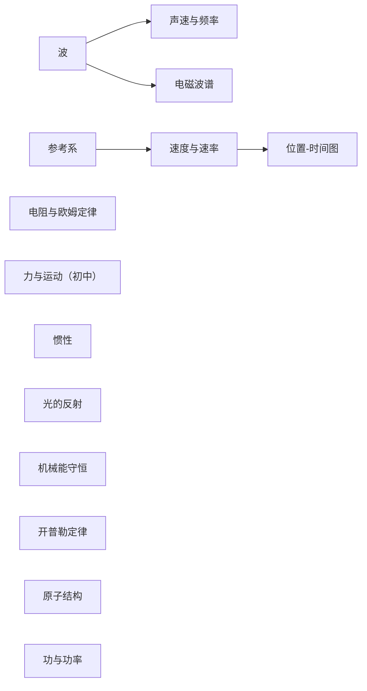
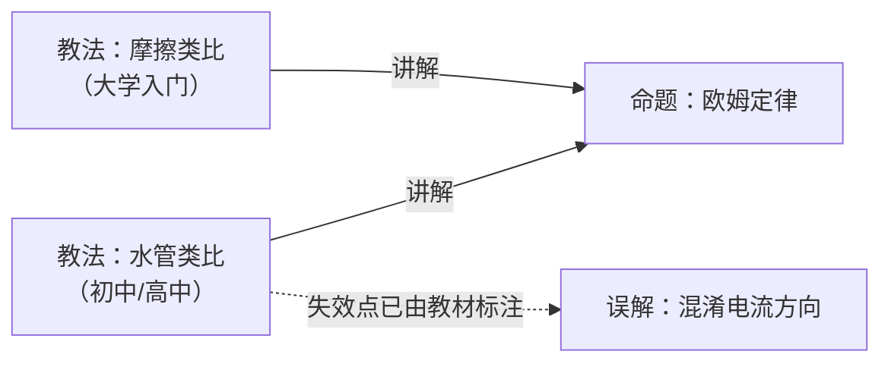

# Physics

> **English version of [`README.md`](README.md).**

## 知识点 (Knowledge points · concept nodes · carriers of prerequisite relations)



| 知识点 | 学段 | 先修 | 挂在其下的教法 | 误解 |
|---|---|---|---|---|
| [力与运动（初中）](知识点/forces-and-motion-jhs.en.md) | **初中** | — | 现象探究循环 | — |
| [波](知识点/waves.en.md) | 高中 | — | BL · OL 共 2 条 | 波把物质一起推走 |
| [惯性](知识点/inertia.en.md) | 高中 | **力（高中）**（与**初中**那一节的关系仍是进阶，非先修） | BL · AL 共 2 条 | 运动物体自然慢下来 |
| [力（高中）](知识点/force.en.md) | 高中 | —（**前置是「矢量」，归数学，库里还没有**） | OL · AL 共 2 条 | — |
| [牛顿第二定律](知识点/newtons-second-law.en.md) | 高中 | **惯性** | OL · AL 共 2 条 | —（教材点名的「重量 vs g」**本库未建**） |
| [牛顿第三定律](知识点/newtons-third-law.en.md) | 高中 | **牛顿第二定律** | OL · AL 共 2 条 | —（同上） |
| [参考系](知识点/frame-of-reference.en.md) | 高中 | — | BL · OL · AL 共 3 条 | 参考系当成背景 |
| [速度与速率](知识点/speed-and-velocity.en.md) | 高中 | 参考系 | BL/OL · AL 共 2 条 | — |
| [位置-时间图](知识点/position-time-graph.en.md) | 高中 | 速度与速率 | BL/OL · AL 共 2 条 | — |
| [加速度](知识点/acceleration.en.md) | 高中 | **速度与速率** | OL · AL 共 2 条 | — |
| [光的反射](知识点/reflection-of-light.en.md) | 高中 | —（前置是**初中几何**，不归物理） | BL · AL 共 2 条 | — |
| [声速与频率](知识点/speed-of-sound.en.md) | 高中 | **波** | BL · AL 共 2 条 | — |
| [机械能守恒](知识点/conservation-of-mechanical-energy.en.md) | 高中 | — | BL · OL 共 2 条 | 运动物体自然慢下来 |
| [电磁波谱](知识点/electromagnetic-spectrum.en.md) | 高中 | **波** | BL · OL/AL 共 2 条 | 可见光与不可见辐射有本质不同 |
| [开普勒定律](知识点/keplers-laws.en.md) | 高中 | — | OL · AL 共 2 条 | — |
| [万有引力定律](知识点/universal-gravitation.en.md) | 高中 | **开普勒定律** | OL · AL 共 2 条 | 混淆 G 与 g |
| [原子结构](知识点/atomic-structure.en.md) | 高中 | —（**前置是「量子化」，库里还没有**） | OL 共 3 条 | — |
| [功与功率](知识点/work-and-power.en.md) | 高中 | —（与机械能守恒的关系**尚未定**） | OL · AL 共 2 条 | — |
| [光的折射](知识点/refraction.en.md) | 初中 / 高中 | **波** | BL · OL · AL 共 3 条 | — |
| [动量和冲量](知识点/momentum-impulse.en.md) | 高中 | **牛顿第二定律** | AL 共 1 条 | — |
| [动量守恒定律](知识点/conservation-of-momentum.en.md) | 高中 | **动量和冲量** | OL · AL 共 2 条 | — |
| [弹性碰撞与非弹性碰撞](知识点/elastic-inelastic-collisions.en.md) | 高中 | **动量守恒定律** · **机械能守恒** | — | — |
| [电阻与欧姆定律](知识点/resistance-and-ohms-law.en.md) | 初中至高中 | — | 水管类比 · 摩擦类比 共 2 条 | 混淆电流方向 |

> [!IMPORTANT]
> **Batch 7 (2026-10-05) added the whole "momentum" chapter — the repo's first "force × time" thread.**
>
> It is **symmetric** with the existing "force × displacement" thread:
>
> | | Multiplied by | Yields | The repo's chain |
> |---|---|---|---|
> | **功 (work)** | **位移 (displacement)** | energy change | [功与功率](知识点/work-and-power.en.md) → [机械能守恒](知识点/conservation-of-mechanical-energy.en.md) |
> | **冲量 (impulse)** | **时间 (time)** | momentum change | [动量和冲量](知识点/momentum-impulse.en.md) → [动量守恒定律](知识点/conservation-of-momentum.en.md) |
>
> **The two threads meet at "collisions"**: momentum is always conserved; kinetic energy depends.
> So [弹性碰撞与非弹性碰撞](知识点/elastic-inelastic-collisions.en.md)'s `先修` **points to both threads**.
>
> **In fairness**: the momentum chapter's **leveled teaching hints are the thinnest the repo has met**
> (1388 characters across three modules, versus 2500+ for other chapters). So this batch **built only 3 教法**,
> and each entry states "the textbook gives only a few sentences; the expansion is the repo's interpretation".

> [!IMPORTANT]
> **Batch 6 (2026-10-05) completed the mechanics chain of 必修一, and fixed a real break.**
>
> [牛顿第二定律](知识点/newtons-second-law.en.md)'s `K19` once read:
>
> > **To be added: 力（高中）** — the repo has only the **初中** "力与运动", **no 高中 "力" node**,
> > and `F_net` needs it. **This is a real break in the repo's `先修` graph.**
>
> **The chain is now complete**, and every link's order comes from the textbook's Chapter 4 module arrangement
> (`Force → first law → second law → third law`):
>
> ```
> 力（高中） → 惯性 → 牛顿第二定律 → 牛顿第三定律
> ```
>
> **Every link's `先修` has a textbook basis** (the next link's `[OL]` hint says `Review Newton's first and
> second laws` and the like) — I did not infer it from logic.
>
> > [!WARNING]
> > **Also noting a new schema problem**:
> > [牛顿第三定律 · AL：两根橡皮筋](教法/newton3-al-rubber-band.en.md)
> > 's demonstration is marked **`[BL][OL][AL]` (all three levels share it)** in the textbook.
> > The repo's `水平档` field **cannot express "shared by all three levels"** — writing "进阶（AL）" is not equivalent.
> > **This is the repo's first all-three-levels 教法**; a separate Issue is open.

> [!IMPORTANT]
> **Batch 5 was the first batch "aligned to Chinese senior-high" (2026-10-05).**
>
> **The full gap list is in [覆盖度对照：中国高中物理](覆盖度/README.md)** —
> it lists the repo's state by chapter-level topic of the six 人教版 volumes, with statistics:
>
> | | 章级主题数 | 占比 |
> |---|---|---|
> | 🟢 covered | **4** | 15% |
> | 🟡 partially covered | **10** | 37% |
> | 🔴 fully missing | **13** | 48% |
>
> **This round added two, both in 必修一:** [加速度](知识点/acceleration.en.md) (after `速度与速率`)
> and [牛顿第二定律](知识点/newtons-second-law.en.md) (after `惯性`).
>
> **The same page notes a problem harder than the gaps**: nearly all of the repo's `教法` come from
> **OpenStax — an American textbook**. It gives "how America teaches",
> and **the repo has zero data on whether it works in a Chinese classroom**.

> [!IMPORTANT]
> **Both entries of batch 4 fill gaps I had written into my own entries.**
>
> | Gap filled | Current result |
> |---|---|
> | [开普勒定律](知识点/keplers-laws.en.md) `K11`'s to-add: "should clarify **the causal direction of the two**" | built [万有引力定律](知识点/universal-gravitation.en.md), `先修` is **开普勒定律 → 万有引力定律**, with **the textbook's own basis** (`m54189`'s `[OL]` hint asks for the "Kepler vs Newton" division) |
> | [光的反射](知识点/reflection-of-light.en.md) `K7`'s question: "should check **whether to merge**" | built [光的折射](知识点/refraction.en.md). **Answer: do not merge** — the textbook explicitly contrasts the two in refraction (`unlike the law of reflection…`), and **the two share the same geometric prerequisite**, which the textbook **writes in two separate modules** |
>
> **The shared prerequisite is itself a new finding**: the repo lacks a "angles in geometry" node,
> and **two nodes are already waiting for it**. This is a recorded gap (see [光的折射](知识点/refraction.en.md)).

> [!TIP]
> **The `先修` graph now has three chains:**
>
> - `波 → 声速与频率 / 电磁波谱 / 光的折射`
> - `参考系 → 速度与速率 → 位置-时间图`
> - `开普勒定律 → 万有引力定律` ← **added this round**, and the only edge expressing **"pattern → explanation"**

> [!TIP]
> **The `先修` graph has two chains: `波 → 声速与频率 / 电磁波谱` and `参考系 → 速度与速率 → 位置-时间图`.**
>
> The `波` node was **newly built to repair a gap**: the teaching of 声速与频率 and 电磁波谱 long said
> "first establish the concept of a wave", but there was no such 知识点 to point to. **Built it, and the two edges could hang.**

> [!NOTE]
> **Cross-stage relations are ruled** (`FORMAT.md` §4): `先修` **may cross stages**, but triggers a **warning**,
> reminding the author to confirm this is "conceptual prerequisite" rather than "advanced".
>
> The repo currently **has no way to express "advanced" relations**. `力与运动（初中）` and `惯性` are exactly this case —
> confirmed as **advanced**, so **no edge is built**, only noted in the entry body. See
> the "关联" section of [惯性](知识点/inertia.en.md).

> [!IMPORTANT]
> **`先修` edges connect only 知识点, not 教法.** Because 教法 is a **(知识点 × 水平档)** combination,
> and one 知识点 has multiple files; hanging prerequisites on 教法 would bind 水平档 into the prerequisite relation.
> This rule is enforced by [`tools/kbcheck.py`](../../tools/kbcheck.py) — **verified by an injected error**.

## 命题 (Propositions)

| Entry | Status | Source |
|---|---|---|
| [欧姆定律](命题/ohm-law.en.md) | **失据** ⚠️ | ~~可复算实验数据~~（**`ev-002` 已作废** — it is constructed data）+ CC BY textbook · **A1 knocked down** |
| [电压符号 U 与 V 的中英文教材差异](命题/voltage-symbol-u-v.en.md) | 待审 | cross-textbook comparison |
| [欧姆定律局限性的呈现位置差异](命题/ohm-law-scope-placement.en.md) | 待审 | cross-textbook comparison |
| [类比的选择与学段相关（假设）](命题/analogy-by-stage.en.md) | **失据** ⚠️ | cross-textbook comparison (n=2) · **A1 knocked down** |
| [教材内建按学习者水平分档的教学变体](命题/textbook-tiered-guidance.en.md) | **失据** ⚠️⚠️ | full extraction of 580 teaching hints · **A1 knocked down** |
| [n=2 无法在多个同样变化的变量之间做归因](命题/analogy-stage-attribution-invalid.en.md) | 待审 | an **attack** on the "analogy" proposition's A1 |
| [攻击：「教材内建分组教学变体」的计数与分档模型](命题/攻击/tieredguidance.en.md) | 暂定确认 | **AI-proposed · human-reviewed** attack |
| [攻击：「运动物体自然慢下来」的三条断言](命题/攻击/slownaturally.en.md) | 暂定确认 | **AI-proposed · human-reviewed** attack |
| [攻击：「功与功率」的判据行与节点边界](命题/攻击/work-power.en.md) | 暂定确认 | **AI-proposed · human-reviewed** attack |

> [!CAUTION]
> **The repo's widest-reaching attack to date (2026-10-05).**
>
> [攻击：教材内建分组教学变体](命题/攻击/tieredguidance.en.md) knocked down the proposition's A1.
> What was hit is **the foundation of the entire leveling model**:
>
> | Original claim | Verification result |
> |---|---|
> | markers tier the notes ("three level cards") | ❌ **of 248 notes with markers, 79% contain 2+ markers**; one note in `m54108` contains **6** |
> | `[EL]` is a level marker | ❌ it is a **language identity** |
> | the expansions of the four markers are sourced | ❌ **the textbook legend was never cited in the repo** |
> | "anyone can rerun and get the same statistics" | ❌ **ev-020 had no script, no data, no commit** |
>
> **What survives**: the markers **exist** in the textbook, and they **point to different suggestions**.
>
> **Knock-on effect: 26 downstream entries** read `[BL]/[OL]/[AL]` as learner tiers and wrote them into `水平档` and `禁忌` —
> an Issue is open for the re-review.

> [!IMPORTANT]
> **The repo's first attacked argument (2026-10-05).**
>
> [两个样本无法归因](命题/analogy-stage-attribution-invalid.en.md#a1) knocked down
> [类比的选择与学段相关](命题/analogy-by-stage.en.md#a1)'s A1,
> and that entry's status went from `待审` to **`失据`**.
>
> **The attack did not say "stage is irrelevant"** — it said the claim "the only significant difference is stage" does not hold:
> between the two books, the quantities changing at the same time also include **author team, series positioning, and era**,
> and at n=2 they fit the data **just as well as "stage"**.
>
> This was the **first real execution** of the main chain "argument attacked →求存活集合 → determine status".

## 教法 (Teaching methods)

| Entry | Status | Target audience | `禁忌` (who it does not apply to) |
|---|---|---|---|
| [现象探究循环](教法/phenomenon-inquiry-cycle.en.md) | 有效 | 初中 | 无可呈现现象（中）；本档以外（弱） |
| [水管类比](教法/water-pipe.en.md) | 有效 | 有水流生活经验、未学电磁场 | 本档以外（弱） |
| [摩擦类比](教法/friction-analogy.en.md) | 有效 | 已建立力与能量概念 | 未建立「电阻是材料属性」者；学超导者 |
| [惯性 · BL：定义](教法/inertia-bl-definition.en.md) | 有效 | 低于年级水平（BL） | 未知牛顿第一定律者（中）；本档以外（弱） |
| [惯性 · AL：两车探究](教法/inertia-al-cart-inquiry.en.md) | 有效 | 进阶（AL） | 不清楚「运动状态」者（中）；本档以外（弱） |
| [光的反射 · BL：几何前提](教法/reflection-bl-geometry.en.md) | 有效 | 低于年级水平（BL） | **未掌握几何「角」的概念（强·教材明示）**；本档以外（弱） |
| [光的反射 · AL：相互作用](教法/reflection-al-interactions.en.md) | 有效 | 进阶（AL） | 未掌握反射定律者（中）；本档以外（弱） |
| [声速与频率 · BL：需介质](教法/sound-bl-mechanical-wave.en.md) | 有效 | 低于年级水平（BL） | 未建立「波」概念者（中）；本档以外（弱） |
| [声速与频率 · AL：雷声滞后](教法/sound-al-thunder-lag.en.md) | 有效 | 进阶（AL） | 无雷雨/烟花经验者（中）；本档以外（弱） |
| [电磁波谱 · BL：「谱」指的是什么](教法/em-spectrum-bl-what-is-a-spectrum.en.md) | 有效 | 低于年级水平（BL） | 未掌握频率/波长/振幅者（中）；本档以外（弱） |
| [电磁波谱 · OL/AL：一条连续的谱](教法/em-spectrum-olal-continuous.en.md) | 有效 | 年级 / 进阶水平 | 未建立波长概念者（中）；本档以外（弱） |
| [开普勒定律 · OL：历史情境](教法/kepler-ol-historical-context.en.md) | 有效 | 年级水平（OL） | **不知「同一中心天体」限制者（强·教材明示 Emphasize）**；本档以外（弱） |
| [开普勒定律 · AL：定律与理论](教法/kepler-al-law-vs-theory.en.md) | 有效 | 进阶（AL） | 仍在建立公式使用能力者（中）；本档以外（弱） |
| [波 · BL：脉冲波与周期波](教法/waves-bl-pulse-periodic.en.md) | 有效 | 低于年级水平（BL） | 无具体波经验者（中）；本档以外（弱） |
| [波 · OL：频率变则波长变](教法/waves-ol-same-speed.en.md) | 有效 | 年级水平（OL） | 未建立 `v = fλ` 者（中）；不知「波速由介质决定」者（中） |
| [原子结构 · OL：金箔两结论](教法/atom-ol-gold-foil-two-results.en.md) | 有效 | 年级水平（OL） | 未看过实验现象者（中）；本档以外（弱） |
| [原子结构 · OL：能级图测验](教法/atom-ol-energy-level-quiz.en.md) | 有效 | 年级水平（OL） | 未建立「能级分立」者（中）；本档以外（弱） |
| [原子结构 · OL：气球类比](教法/atom-ol-balloon-analogy.en.md) | 有效 | 年级水平（OL）· **仅给卡住的人** | 未听过标准表述者（中）；本档以外（弱） |
| [功与功率 · OL：算不算功](教法/work-ol-what-counts.en.md) | 有效 | 年级水平（OL） | 未学机械能方程者（中）；本档以外（弱） |
| [功与功率 · AL：单位关系](教法/work-al-unit-relations.en.md) | 有效 | 进阶（AL） | 未建立 `W = fd` 者（中）；本档以外（弱） |
| [机械能守恒 · BL：单位区分](教法/mech-energy-bl-units.en.md) | 有效 | 低于年级水平（BL） | 未学过功率者（中）；本档以外（弱） |
| [机械能守恒 · OL：摩擦生热](教法/mech-energy-ol-friction-heat.en.md) | 有效 | 年级水平（OL） | 不知摩擦力者（中）；本档以外（弱） |
| [参考系 · BL：多参考点观察](教法/frame-bl-multi-viewpoint.en.md) | 有效 | 低于年级水平（BL） | 本档以外（弱） |
| [参考系 · OL：提问引导](教法/frame-ol-guided-discovery.en.md) | 有效 | 年级水平（OL） | **教材未标注**（缺口，非「已确认适用」） |
| [参考系 · AL：生成式下定义](教法/frame-al-generative-definition.en.md) | 有效 | 进阶（AL） | **非惯性参考系（强·教材明示）**；本档以外（弱） |
| [速度与速率 · BL/OL：日常用语切入](教法/speed-bl-ol-everyday-language.en.md) | 有效 | 低于年级 / 年级水平 | 本档以外（弱） |
| [速度与速率 · AL：追问与反例](教法/speed-al-socratic.en.md) | 有效 | 进阶（AL） | 本档以外（弱） |
| [位置-时间图 · BL/OL：情境叙事](教法/ptgraph-bl-ol-narrative.en.md) | 有效 | 低于年级 / 年级水平 | 本档以外（弱） |
| [位置-时间图 · AL：边界情形追问](教法/ptgraph-al-boundary-cases.en.md) | 有效 | 进阶（AL） | 本档以外（弱） |

> [!NOTE]
> **The table above is `禁忌` (who it does not apply to), not risk.** Each entry's risk is in its `## 风险` section.
> Only two have **strong** evidence: `光的反射 · BL` (geometric prerequisite, textbook-stated) and
> `参考系 · AL` (non-inertial frame, textbook-stated). The rest are marked **weak** —
> "the textbook doesn't mention other levels" does not mean "other levels don't apply".

> [!NOTE]
> The expansion of `水平档` is **inference, not quotation** (the textbook has no legend). See
> [decision record: the expansion of 水平档 is inference](../../docs/decisions/level-marker-inference.en.md).

### 同一知识点的分档对照 (Leveled comparison for the same 知识点)

For **the same 知识点** the textbook gives different levels' practices; the difference across the three levels is **not difficulty, but where the cognitive load sits**:

| 知识点 | BL（低于年级） | OL（年级） | AL（进阶） |
|---|---|---|---|
| 参考系 | 实物操作 + **多参考点并置**制造矛盾 | **提问链**引导到「需要起点」 | 学生**自己下定义** → 结对 → 全班比较 |
| 位置-时间图 | 情境叙事 → 学生画情境 → 再画图 | 同 BL，但可加问「零点是否影响图」 | **边界情形逼问**：为什么可以忽略曲线 |
| 惯性 | 先命名「保持运动状态」的性质 | —（教材未给 OL 档） | **两辆小车探究**：惯性取决于什么 |
| 光的反射 | 先补几何 + 说破「弹跳是简化」 | —（教材未给 OL 档） | 把反射放回吸收/透射的完整图景 |
| 声速与频率 | 先立「机械波需介质」+ 读表 | —（教材未给 OL 档） | **先猜声速** → 用雷声滞后推出有限性 |
| 机械能守恒 | 分清能量/力/功率的量纲 | **用摩擦生热堵「能量去哪了」** | —（教材未给 AL 档） |
| 电磁波谱 | 先弄清「**谱**」指什么（举声音、身高的例子） | 破除「可见光特殊」+ **穿透性解释频段分工** | 矢量场、纵/横波、**用穿透性解释温室效应** |
| 开普勒定律 | —（教材未给 BL 档） | **历史情境 + 手工算的量级** + 图钉绳画椭圆 | **定律描述模式，理论才解释**；冥王星质心判据 |
| 波 | **三个分类维度不互斥**（机械/非机械 · 横/纵 · 脉冲/周期） | **同介质中声速相同 ⇒ 频率变则波长变** | —（教材未给 AL 档） |
| 原子结构 | —（教材未给 BL 档） | ① 金箔实验的**两条结论**与现象对应 ② **能级图当场画箭头** ③ 气球类比（**仅给卡住的人**） | 玻尔模型 ↔ 能级图对照；黑体辐射与光电效应的支持 |
| 功与功率 | —（教材未给 BL 档） | **用反例把「累 ≠ 做功」钉死**（举着不动 / 水平搬运） | **从单位链推出「千瓦时是能量」** |
| [万有引力 · OL：谁做了什么](教法/gravitation-ol-history.en.md) | 有效 | 年级水平（OL） | 未学开普勒者（强）；本档以外（中） |
| [万有引力 · AL：两个 10 kg 球有多大引力](教法/gravitation-al-magnitude.en.md) | 有效 | 进阶（AL） | 不熟科学计数法者（强）；本档以外（中） |
| [折射 · BL：先补几何，再推 n > 1](教法/refraction-bl-geometry.en.md) | 有效 | 低于年级水平（BL） | 已熟练用折射定律者（强）；本档以外（中） |
| [折射 · OL：这个规律用方程说比用文字说容易](教法/refraction-ol-equation.en.md) | 有效 | 年级水平（OL） | 未学正弦者（强）；本档以外（中） |
| [折射 · AL：棱镜分光，窗玻璃为什么不分](教法/refraction-al-prism.en.md) | 有效 | 进阶（AL） | 不会两界面计算者（强）；本档以外（中） |
| [加速度 · OL：正负与那个不用的词](教法/acceleration-ol-sign.en.md) | 有效 | 年级水平（OL） | 未建立「速度有方向」者（强）；本档以外（中） |
| [加速度 · AL：用「变化率的变化率」读一句绕口的话](教法/acceleration-al-rate.en.md) | 有效 | 进阶（AL） | 未分清矢量标量者（强）；本档以外（中） |
| [牛顿第二定律 · OL：先回到惯性与外力](教法/newton2-ol-first-law.en.md) | 有效 | 年级水平（OL） | 未学惯性者（强）；本档以外（中） |
| [牛顿第二定律 · AL：三个变量分别解](教法/newton2-al-three-vars.en.md) | 有效 | 进阶（AL） | 不熟单位换算者（强）；本档以外（中） |
| [力 · OL：静者恒静与一个单数的词](教法/force-ol-push-pull.en.md) | 有效 | 年级水平（OL） | 未学运动学者（强）；本档以外（中） |
| [力 · AL：两个学生推一张桌子](教法/force-al-desk.en.md) | 有效 | 进阶（AL） | 未接触矢量者（强）；无重物或无人配合（中）；本档以外（中） |
| [牛顿第三定律 · OL：它为什么停在地上](教法/newton3-ol-normal-force.en.md) | 有效 | 年级水平（OL） | 未学第一二定律者（强）；本档以外（中） |
| [牛顿第三定律 · AL：两根橡皮筋与系统内外](教法/newton3-al-rubber-band.en.md) | 有效 | 进阶（AL）**（教材标为三档共用）** | 不做演示的课堂（强）；本档以外——**教材标的是三档共用，无档可排除** |
| [动量和冲量 · AL：牛顿第二定律的两种写法](教法/momentum-al-two-forms.en.md) | 有效 | 进阶（AL） | 没把 F=ma 用熟者（强）；不知 a=Δv/Δt 者（强）；本档以外（中） |
| [动量守恒 · OL：先问「守恒」这个词](教法/momentum-ol-word-conservation.en.md) | 有效 | 年级水平（OL） | 没学过任何守恒定律者（强）；已读正文者（强）；本档以外（中） |
| [动量守恒 · AL：地球上有没有完全孤立的系统](教法/momentum-al-whole-system.en.md) | 有效 | 进阶（AL） | 还没建立「系统」概念者（强）；本档以外（中） |

> [!IMPORTANT]
> **The three levels are not "the same practice made easier or harder" — they are three different practices.**
> The teacher's intervention direction is even opposite: the BL level fears the student **can't say it**, the AL level fears the student **says too much and can't be reined in**.

## 误解 (Misconceptions)

| Entry | Status | Source |
|---|---|---|
| [把电流方向当成电子实际移动方向](误解/conventional-current.en.md) | 有效 | 教材明确标注为需强调项 |
| [把参考系当成「背景」而不是「观察视角」](误解/frame-as-background.en.md) | 有效 | 教材 Misconception 标注 + **自带可当场诊断的演示** |
| [运动物体会「自然地」慢下来](误解/objects-slow-naturally.en.md) | 有效 | 教材明确点名需破除 |
| [以为可见光与不可见辐射有本质不同](误解/visible-light-is-special.en.md) | 有效 | 教材用 `Dispel any misconceptions` 明确要求破除 |
| [波把物质一起推走](误解/waves-carry-matter.en.md) | 有效 | 教材正文用 `Many people think … In reality, however …` 直接纠偏 |
| [把 G 与 g 当成同一个东西](误解/g-vs-g.en.md) | 有效 | 教材用 `Be sure no one is confusing G with g` **当成检查项**（全模块只此一句） |

> [!NOTE]
> **The last row of the table was added in batch 4 and forgotten then; `kbcheck.py`'s new check found it.**
>
> The repo's **subject-README omission** has happened **three times**:
>
> | Time | What was missed | Who found it |
> |---|---|---|
> | 1 | 5 `教法` | an AI adversarial review |
> | 2 | 9 `教法` (batch 4's 5 + batch 5's 4) | my own cross-check |
> | 3 | 1 `误解` (this one) | **`kbcheck.py`'s new check `check_readme_coverage`** |
>
> **The index does not catch up on its own.** This is now mechanically checkable.

## 资源 (Resources)

| Entry | Status | Type | Belongs to 知识点 | License |
|---|---|---|---|---|
| [PhET 模拟「力与运动：基础」](资源/phet-forces-and-motion-basics.en.md) | 有效 | 交互式模拟 | [惯性](知识点/inertia.en.md) | ⚠️ **CC BY-NC 4.0**（**非** CC BY） |
| [PhET 模拟「我的太阳系」](资源/phet-my-solar-system.en.md) | 有效 | 交互式模拟 | [开普勒定律](知识点/keplers-laws.en.md) | ⚠️ **CC BY-NC 4.0**（**非** CC BY） |

> [!CAUTION]
> **The license does not travel with the textbook.** The textbook OpenStax《Physics》 is **CC BY 4.0**,
> but the PhET sims it embeds are **CC BY-NC 4.0**, and **require attribution near the place of use**.
>
> "The textbook is freely reusable" **does not imply** "what it embeds is too".
> See the [resource entry](资源/phet-forces-and-motion-basics.en.md#license-important) and the [license-trap section of the evidence index](../../evidence/README.en.md).

## 路径 (Paths)

| Entry | Status | Target | Self-check |
|---|---|---|---|
| [运动学入门（低于年级水平）](路径/kinematics-intro-bl.en.md) | 有效 | 能用位置-时间图描述一个简单运动 | ✅ **3 项机械校验 + 1 项人工判定** |
| | | | 先修缺口 ✅ · 循环依赖 ✅ · **目标覆盖度 4/4 ✅** · 禁忌冲突 ✅（弱） |

> [!NOTE]
> This path's `自检` exposed three schema problems, **all now resolved** (plan A + Issue #13 + the outcomes mechanism):
>
> 1. ✅ `edges.先修` has a carrier (the `知识点` layer) → the first two became **machine checks**
> 2. ✅ `禁忌` was split from `风险` and given an evidence strength → "禁忌冲突" **can be judged**
> 3. ✅ `先修` granularity resolved (connects only 知识点)
> 4. ✅ **目标覆盖度** got a mechanism (`outcomes` + the arrangement table's `覆盖` column) → the last of the four self-checks filled in

> [!CAUTION]
> This path's `自检` **exposed three schema problems**:
>
> 1. `edges.先修` was empty repo-wide → the first two self-checks degenerated into manual assertions
> 2. `禁忌` semantics were mixed (**audience 禁忌** vs **风险**) → "禁忌冲突" could not be filled
> 3. **`先修` granularity didn't match** — 先修 is a relation **between 知识点**, while `edges` hang on
>    **(知识点 × 水平档)** entries. **This must be answered before fixing problem 1.**
>
> See the path entry's body ([路径/运动学入门-BL.md#自检暴露的三个-schema-问题]).
> **The path isn't written wrong — the object model isn't finished.**

## 教法并存：一个真实案例 (Coexisting 教法: a real case)



**For the same 知识点, different textbooks chose different analogies, and both work.**

- **水管类比** is strong in **intuition** — water pressure / flow / sand filter are everyday experience
- **摩擦类比** is strong in **explaining heating** — charge–atom collisions transfer energy to the conductor

"Which is better" is the wrong question. The right question is **"for whom, under what conditions"** —
this is axiom A2 "knowledge converges, 教法 coexist", made real, and it **isn't deduced — three real textbooks gave it**.

> [!NOTE]
> Further observation: in two OpenStax textbooks, **高中** uses the water analogy, **大学** uses the friction analogy.
> This suggests analogy choice may relate to **stage** — but the sample is only 2 books;
> see [命题：类比的选择与学段相关](命题/analogy-by-stage.en.md), **the hypothesis is not established**.

## 三个核心区分 (Three core distinctions)

- 「欧姆定律」 is a **命题** → has truth, must **converge** to one conclusion
- 「水管类比 / 摩擦类比」 is **教法** → valid only for a specific audience, must **coexist**, no ranking
- 「混淆电流方向」 is a **误解** → it is a **by-product** of analogy teaching, an asset, not garbage

> [!IMPORTANT]
> **All 7 entries in this directory are from real sources; none are examples.**
> The early 3 examples (fictional author + constructed data) were all rewritten or deleted on 2026-10-05.
